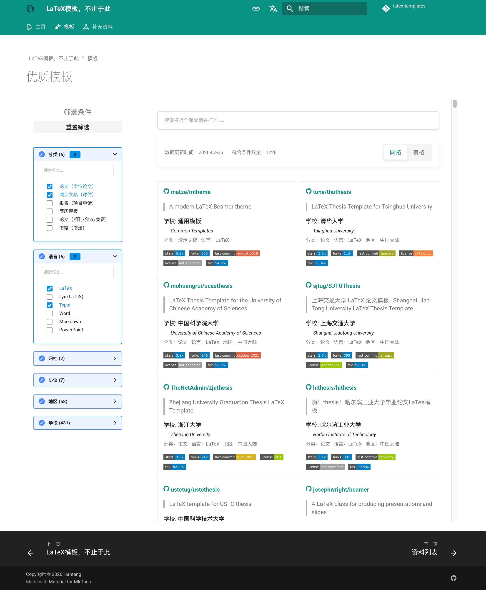

# Beyond LaTeX Templates

[简体中文 README](README.md) | [English README](README-en.md)

## 说明

最近更新: <!-- START-DATE -->*2026-11-28*<!-- END-DATE -->

主要收录LaTeX学位论文模板、演示文稿（Beamer），也包括Microsoft Word、Typst和Markdown等格式的期刊会议论文、演示文稿（幻灯片）和简历模板等。

> [!IMPORTANT]
>
> **模板资源说明**
>
> - 网站链接: [:link: latex-templates][link-site]
> - 文件(JSON格式): 
>   [:card_index_dividers: templates.json][link-data]
>   [:card_index_dividers: templates-resume.json][link-resume]

[link-site]: https://hantang.github.io/latex-templates/awesome
[link-data]: ./templates.json
[link-resume]: ./templates-resume.json

---

## 热门模板

<!-- START-TABLE -->

- [学位论文（LaTeX）](#学位论文latex)
- [学位论文（非LaTeX）](#学位论文非latex)
- [演示文稿和幻灯片（LaTeX）](#演示文稿和幻灯片latex)
- [简历模板（LaTeX等）](#简历模板latex等)
- [报告等模板（LaTeX）](#报告等模板latex)

### 学位论文（LaTeX）

| 学校（机构） | GitHub仓库 | 统计 | 说明 |
| --- | --- | --- | --- |

[archived]: https://img.shields.io/badge/archived-TRUE-orange?style=plastic
[fork]: https://img.shields.io/badge/fork-TRUE-green?style=plastic

### 学位论文（非LaTeX）

| 学校（机构） | GitHub仓库 | 统计 | 说明 |
| --- | --- | --- | --- |
| **清华大学** | [tuna/thuthesis] | ![5499][tuna/thuthesis/stars] ![1168][tuna/thuthesis/forks] ![2026-08-18][tuna/thuthesis/last-commit] | LaTeX Thesis Template for Tsinghua University |
| **中国科学院大学** | [mohuangrui/ucasthesis] | ![3924][mohuangrui/ucasthesis/stars] ![942][mohuangrui/ucasthesis/forks] ![2024-02-29][mohuangrui/ucasthesis/last-commit] | LaTeX Thesis Template for the University of Chinese Academy of Sciences |
| **上海交通大学** | [sjtug/SJTUThesis] | ![3912][sjtug/SJTUThesis/stars] ![791][sjtug/SJTUThesis/forks] ![2026-05-20][sjtug/SJTUThesis/last-commit] | 上海交通大学 LaTeX 论文模板 \| Shanghai Jiao Tong University LaTeX Thesis Template |
| **浙江大学** | [TheNetAdmin/zjuthesis] | ![3838][TheNetAdmin/zjuthesis/stars] ![755][TheNetAdmin/zjuthesis/forks] ![2025-12-08][TheNetAdmin/zjuthesis/last-commit] | Zhejiang University Graduation Thesis LaTeX Template |
| **哈尔滨工业大学** | [hithesis/hithesis] | ![2481][hithesis/hithesis/stars] ![408][hithesis/hithesis/forks] ![2026-11-22][hithesis/hithesis/last-commit] | 嗨！thesis！哈尔滨工业大学毕业论文LaTeX模板 |
| **中国科学技术大学** | [ustctug/ustcthesis] | ![2138][ustctug/ustcthesis/stars] ![453][ustctug/ustcthesis/forks] ![2026-11-21][ustctug/ustcthesis/last-commit] | LaTeX template for USTC thesis |
| **电子科技大学** | [bdebye/thesisuestc] | ![1703][bdebye/thesisuestc/stars] ![353][bdebye/thesisuestc/forks] ![2026-07-16][bdebye/thesisuestc/last-commit] | ThesisUESTC-电子科技大学毕业论文模板 |
| **通用模板** | [AndreyAkinshin/Russian-Phd-LaTeX-Dissertation-Template] | ![1551][AndreyAkinshin/Russian-Phd-LaTeX-Dissertation-Template/stars] ![760][AndreyAkinshin/Russian-Phd-LaTeX-Dissertation-Template/forks] ![2026-03-11][AndreyAkinshin/Russian-Phd-LaTeX-Dissertation-Template/last-commit] | LaTeX-template for russian Phd thesis |
| **武汉大学** | [whutug/whu-thesis] | ![1363][whutug/whu-thesis/stars] ![220][whutug/whu-thesis/forks] ![2025-05-27][whutug/whu-thesis/last-commit] | 武汉大学毕业论文 LaTeX 模版 2025 |
| **北京航空航天大学** | [BHOSC/BUAAthesis] | ![1287][BHOSC/BUAAthesis/stars] ![303][BHOSC/BUAAthesis/forks] ![2025-01-12][BHOSC/BUAAthesis/last-commit] | 北航毕设论文LaTeX模板 |
| **（英国）伦敦大学学院** *University College London (UCL)* | [tompollard/phd_thesis_markdown] | ![1278][tompollard/phd_thesis_markdown/stars] ![551][tompollard/phd_thesis_markdown/forks] ![2023-05-23][tompollard/phd_thesis_markdown/last-commit] | Template for writing a PhD thesis in Markdown |
| **通用模板** | [Pseudomanifold/latex-mimosis] | ![1244][Pseudomanifold/latex-mimosis/stars] ![135][Pseudomanifold/latex-mimosis/forks] ![2026-05-18][Pseudomanifold/latex-mimosis/last-commit] | A minimal & modern LaTeX template for your (bachelor's \| master's \| doctoral) thesis |
| **北京理工大学** | [BITNP/BIThesis] | ![1199][BITNP/BIThesis/stars] ![122][BITNP/BIThesis/forks] ![2026-10-03][BITNP/BIThesis/last-commit] | 📖 北京理工大学非官方 LaTeX 模板集合，包含本科、研究生毕业设计模板及更多。🎉 （更多文档请访问 wiki 和 release 中的手册） |
| **西安电子科技大学** | [note286/xduts] | ![1159][note286/xduts/stars] ![101][note286/xduts/forks] ![2025-05-04][note286/xduts/last-commit] | Xidian University TeX Suite 西安电子科技大学LaTeX套装 |
| **复旦大学** | [stone-zeng/fduthesis] | ![1060][stone-zeng/fduthesis/stars] ![236][stone-zeng/fduthesis/forks] ![2024-12-08][stone-zeng/fduthesis/last-commit] | LaTeX thesis template for Fudan University |
| **通用模板** | [joaomlourenco/novathesis] | ![1014][joaomlourenco/novathesis/stars] ![185][joaomlourenco/novathesis/forks] ![2026-10-30][joaomlourenco/novathesis/last-commit] | A LaTeX template for academic monographs (e.g., dissertations and thesis). This template serves both beginners and proficient LaTeX users. |
| **中山大学** | [SYSU-SCC/sysu-thesis] | ![983][SYSU-SCC/sysu-thesis/stars] ![95][SYSU-SCC/sysu-thesis/forks] ![2026-09-04][SYSU-SCC/sysu-thesis/last-commit] | 中山大学 LaTeX 毕业论文项目模板 |
| **通用模板** | [derric/cleanthesis] | ![922][derric/cleanthesis/stars] ![113][derric/cleanthesis/forks] ![2024-02-15][derric/cleanthesis/last-commit] | Clean Thesis is a clean, simple, and elegant LaTeX style (or template) for thesis documents. |
| **（英国）剑桥大学** *University of Cambridge* | [kks32/phd-thesis-template] | ![905][kks32/phd-thesis-template/stars] ![434][kks32/phd-thesis-template/forks] ![2026-04-28][kks32/phd-thesis-template/last-commit] | A LaTeX / XeLaTeX / LuaLaTeX PhD thesis template for Cambridge University Engineering Department (CUED) |
| **通用模板** | [ismayc/thesisdown] | ![822][ismayc/thesisdown/stars] ![353][ismayc/thesisdown/forks] ![2026-08-16][ismayc/thesisdown/last-commit] | ![archived] An updated R Markdown thesis template using the bookdown package |
| **通用模板** | [suchow/Dissertate] | ![757][suchow/Dissertate/stars] ![171][suchow/Dissertate/forks] ![2026-11-25][suchow/Dissertate/last-commit] | Beautiful LaTeX dissertation templates. |
| **南京大学** | [nju-lug/NJUThesis] | ![715][nju-lug/NJUThesis/stars] ![113][nju-lug/NJUThesis/forks] ![2026-06-11][nju-lug/NJUThesis/last-commit] | 南京大学学位论文模板 |
| **电子科技大学** | [shifujun/UESTCthesis] | ![652][shifujun/UESTCthesis/stars] ![165][shifujun/UESTCthesis/forks] ![2023-04-24][shifujun/UESTCthesis/last-commit] | ![archived] 电子科技大学毕设设计论文LaTeX模板 |
| **北京大学** | [CasperVector/pkuthss] | ![632][CasperVector/pkuthss/stars] ![199][CasperVector/pkuthss/forks] ![2024-04-25][CasperVector/pkuthss/last-commit] | LaTeX template for dissertations in Peking University |
| **西北工业大学** | [NWPUMetaphysicsOffice/Yet-Another-LaTeX-Template-for-NPU-Thesis] | ![632][NWPUMetaphysicsOffice/Yet-Another-LaTeX-Template-for-NPU-Thesis/stars] ![152][NWPUMetaphysicsOffice/Yet-Another-LaTeX-Template-for-NPU-Thesis/forks] ![2026-03-18][NWPUMetaphysicsOffice/Yet-Another-LaTeX-Template-for-NPU-Thesis/last-commit] | 西北工业大学硕博学位论文模版 \| Yet Another Thesis Template for Northwestern Polytechnical University |
| **北京航空航天大学** | [CheckBoxStudio/BUAAThesis] | ![613][CheckBoxStudio/BUAAThesis/stars] ![105][CheckBoxStudio/BUAAThesis/forks] ![2024-02-01][CheckBoxStudio/BUAAThesis/last-commit] | 北航研究生学位论文模板（Word+LaTeX）. |
| **华南理工大学** | [mengchaoheng/SCUT_thesis] | ![596][mengchaoheng/SCUT_thesis/stars] ![98][mengchaoheng/SCUT_thesis/forks] ![2026-08-02][mengchaoheng/SCUT_thesis/last-commit] | 华南理工大学硕博士学位论文模板(LaTeX)。Latex templates for the thesis of South China University of Technology |
| **国防科技大学** | [liubenyuan/nudtpaper] | ![573][liubenyuan/nudtpaper/stars] ![179][liubenyuan/nudtpaper/forks] ![2026-10-13][liubenyuan/nudtpaper/last-commit] | A LaTeX template for Master/PhD Thesis of NUDT |
| **北京邮电大学** | [sheng-qiang/BUPTBachelorThesis] | ![554][sheng-qiang/BUPTBachelorThesis/stars] ![126][sheng-qiang/BUPTBachelorThesis/forks] ![2022-06-02][sheng-qiang/BUPTBachelorThesis/last-commit] | A LaTeX Template for BUPT Bachelor Thesis (updated in 2018) 北京邮电大学学士学位论文LaTeX模板 |
| **同济大学** | [TJ-CSCCG/TongjiThesis] | ![479][TJ-CSCCG/TongjiThesis/stars] ![52][TJ-CSCCG/TongjiThesis/forks] ![2026-10-30][TJ-CSCCG/TongjiThesis/last-commit] | 同济大学毕业设计论文 LaTeX 模板 \| TongjiThesis - LaTeX Thesis Template for Tongji University |
| **（德国）慕尼黑工业大学** *Technische Universität München* | [fwalch/tum-thesis-latex] | ![465][fwalch/tum-thesis-latex/stars] ![291][fwalch/tum-thesis-latex/forks] ![2022-12-20][fwalch/tum-thesis-latex/last-commit] | ![archived] :notebook_with_decorative_cover: A LaTeX template for TUM Bachelor/Master theses. |
| **天津大学** | [a171232886/TJUThesis_master_2021] | ![456][a171232886/TJUThesis_master_2021/stars] ![71][a171232886/TJUThesis_master_2021/forks] ![2022-08-26][a171232886/TJUThesis_master_2021/last-commit] | 天大博士/硕士学位论文Latex模板，根据2021年版要求修改，可直接在Overleaf上运行。:star:所写的论文成功提交天津大学图书馆存档！（2021.12.24） |
| **电子科技大学** | [tinoryj/UESTC-Thesis-Latex-Template] | ![449][tinoryj/UESTC-Thesis-Latex-Template/stars] ![85][tinoryj/UESTC-Thesis-Latex-Template/forks] ![2026-03-14][tinoryj/UESTC-Thesis-Latex-Template/last-commit] | UESTC Thesis Latex Template. It fully supports the latest format specification since 2023, supports independent symbol table, abbreviation table, and complete and fully customizable Academic/Professional-Master/PhD covers. |
| **北京邮电大学** | [rioxwang/BUPTGraduateThesis] | ![426][rioxwang/BUPTGraduateThesis/stars] ![113][rioxwang/BUPTGraduateThesis/forks] ![2024-03-05][rioxwang/BUPTGraduateThesis/last-commit] |  |
| **西安交通大学** | [obster-y/XJTU-thesis] | ![423][obster-y/XJTU-thesis/stars] ![71][obster-y/XJTU-thesis/forks] ![2026-02-03][obster-y/XJTU-thesis/last-commit] | 西安交通大学学位论文模板（LaTeX）（适用硕士、博士学位）An official LaTeX template for Xi'an Jiaotong University degree thesis (Chinese and English) |
| **南京航空航天大学** | [nuaatug/nuaathesis] | ![418][nuaatug/nuaathesis/stars] ![79][nuaatug/nuaathesis/forks] ![2026-05-31][nuaatug/nuaathesis/last-commit] | LaTeX document class for NUAA, supporting bachelor/master/PH.D thesis in Chinese/English/Japanese. 南航本科、硕士、博士学位论文 LaTeX 模板 |
| **北京理工大学** | [BIT-thesis/LaTeX-template] | ![401][BIT-thesis/LaTeX-template/stars] ![91][BIT-thesis/LaTeX-template/forks] ![2024-03-21][BIT-thesis/LaTeX-template/last-commit] | LaTeX template for BIT thesis |
| **通用模板** | [latextemplates/scientific-thesis-template] | ![396][latextemplates/scientific-thesis-template/stars] ![133][latextemplates/scientific-thesis-template/forks] ![2026-11-20][latextemplates/scientific-thesis-template/last-commit] | LaTeX template for Master, Bachelor, Diploma, and Student Theses |
| **南京大学** | [njuhan/njuthesis-nju-thesis-template] | ![373][njuhan/njuthesis-nju-thesis-template/stars] ![117][njuhan/njuthesis-nju-thesis-template/forks] ![2026-01-14][njuhan/njuthesis-nju-thesis-template/last-commit] | 南京大学学位论文(本科/硕士/博士)，毕业论文LaTeX模板 |
| **哈尔滨工业大学** | [YangLaTeX/hitszthesis] | ![371][YangLaTeX/hitszthesis/stars] ![50][YangLaTeX/hitszthesis/forks] ![2025-03-10][YangLaTeX/hitszthesis/last-commit] | A dissertation template for Harbin Institute of Technology, ShenZhen (HITSZ), including bachelor, master and doctor dissertations. |
| **重庆大学** | [nanmu42/CQUThesis] | ![349][nanmu42/CQUThesis/stars] ![70][nanmu42/CQUThesis/forks] ![2026-06-22][nanmu42/CQUThesis/last-commit] | :pencil: 重庆大学毕业论文LaTeX模板---LaTeX Thesis Template for Chongqing University |
| **南方科技大学** | [iydon/sustechthesis] | ![348][iydon/sustechthesis/stars] ![81][iydon/sustechthesis/forks] ![2026-08-15][iydon/sustechthesis/last-commit] | 南方科技大学本科生毕业论文 LaTeX 模板 |
| **西安电子科技大学** | [note286/xdupgthesis] | ![342][note286/xdupgthesis/stars] ![53][note286/xdupgthesis/forks] ![2024-04-18][note286/xdupgthesis/last-commit] | \[停止维护 请使用note286/xduts\]西安电子科技大学研究生学位论文XeLaTeX模板 |
| **华中科技大学** | [skinaze/HUSTPaperTemp] | ![333][skinaze/HUSTPaperTemp/stars] ![50][skinaze/HUSTPaperTemp/forks] ![2022-04-12][skinaze/HUSTPaperTemp/last-commit] | 华中科技大学本科毕业论文LaTeX模板 2017 |
| **南方科技大学** | [SUSTech-CRA/sustech-master-thesis] | ![330][SUSTech-CRA/sustech-master-thesis/stars] ![62][SUSTech-CRA/sustech-master-thesis/forks] ![2026-11-15][SUSTech-CRA/sustech-master-thesis/last-commit] | 南方科技大学研究生学位论文LaTeX模板 |
| **广东工业大学** | [sikouhjw/gdutthesis] | ![325][sikouhjw/gdutthesis/stars] ![46][sikouhjw/gdutthesis/forks] ![2024-03-26][sikouhjw/gdutthesis/last-commit] | 广东工业大学 LaTeX 论文模板 |
| **中南大学** | [CSUcse/CSUthesis] | ![310][CSUcse/CSUthesis/stars] ![59][CSUcse/CSUthesis/forks] ![2025-04-02][CSUcse/CSUthesis/last-commit] | 中南大学研究生学位论文LaTex模版（博士和硕士） |
| **西北工业大学** | [polossk/LaTeX-Template-For-NPU-Thesis] | ![292][polossk/LaTeX-Template-For-NPU-Thesis/stars] ![45][polossk/LaTeX-Template-For-NPU-Thesis/forks] ![2023-05-17][polossk/LaTeX-Template-For-NPU-Thesis/last-commit] | 西北工业大学本科毕业设计论文模版 \| Thesis Template for Northwestern Polytechnical University |
| **华中科技大学** | [XinzeZhang/HUST-PhD-Thesis-Latex] | ![290][XinzeZhang/HUST-PhD-Thesis-Latex/stars] ![56][XinzeZhang/HUST-PhD-Thesis-Latex/forks] ![2026-09-06][XinzeZhang/HUST-PhD-Thesis-Latex/last-commit] | 华中科技大学博士毕业论文Latex模板 |
| **东南大学** | [Reanon/SEUThesisLatexTemplate] | ![281][Reanon/SEUThesisLatexTemplate/stars] ![37][Reanon/SEUThesisLatexTemplate/forks] ![2024-04-18][Reanon/SEUThesisLatexTemplate/last-commit] | 东南大学 硕士毕业论文 Latex 模版 网络空间安全学院 |
| **西安交通大学** | [Aetf/xjtuthesis] | ![277][Aetf/xjtuthesis/stars] ![48][Aetf/xjtuthesis/forks] ![2024-07-09][Aetf/xjtuthesis/last-commit] | 使用 LaTeX 排版学位论文！适用于西安交通大学学生 |
| **华南师范大学** | [scnu/scnuthesis] | ![269][scnu/scnuthesis/stars] ![70][scnu/scnuthesis/forks] ![2024-12-30][scnu/scnuthesis/last-commit] | 符合华南师范大学硕士/博士学位论文格式要求的LaTeX模板。 |
| **（德国）慕尼黑工业大学** *Technische Universität München* | [TUM-Dev/tum-thesis-latex] | ![265][TUM-Dev/tum-thesis-latex/stars] ![88][TUM-Dev/tum-thesis-latex/forks] ![2026-11-19][TUM-Dev/tum-thesis-latex/last-commit] | ![fork] :notebook_with_decorative_cover: A LaTeX template for TUM Bachelor/Master theses. |
| **厦门大学** | [zoam/xmu-thesis-grd] | ![258][zoam/xmu-thesis-grd/stars] ![47][zoam/xmu-thesis-grd/forks] ![2025-06-28][zoam/xmu-thesis-grd/last-commit] | 厦门大学研究生学位论文 LaTeX 模板 |
| **四川大学** | [kevinleeex/scu_thesis_2020] | ![256][kevinleeex/scu_thesis_2020/stars] ![44][kevinleeex/scu_thesis_2020/forks] ![2022-06-08][kevinleeex/scu_thesis_2020/last-commit] | 四川大学研究生学位论文模板LaTex(复刻官方word模板)Here you go! |
| **（德国）达姆施塔特工业大学** *Technische Universität Darmstadt (TU Darmstadt)* | [tudace/tuda_latex_templates] | ![254][tudace/tuda_latex_templates/stars] ![78][tudace/tuda_latex_templates/forks] ![2026-08-20][tudace/tuda_latex_templates/last-commit] | LaTeX Templates for TU Darmstadt |
| **（德国）FOM经济与管理应用科学大学** *FOM Hochschule für Oekonomie & Management gemeinnützige Gesellschaft mbH* | [andygrunwald/FOM-LaTeX-Template] | ![253][andygrunwald/FOM-LaTeX-Template/stars] ![249][andygrunwald/FOM-LaTeX-Template/forks] ![2026-09-18][andygrunwald/FOM-LaTeX-Template/last-commit] | A LaTeX template for term paper, bachelor or master thesis for "FOM University of Applied Sciences" |
| **台湾大学** *國立臺灣大學* | [tzhuan/ntu-thesis] | ![253][tzhuan/ntu-thesis/stars] ![127][tzhuan/ntu-thesis/forks] ![2022-04-06][tzhuan/ntu-thesis/last-commit] | NTU thesis template for XeLaTeX |
| **华南理工大学** | [alwintsui/scutthesis] | ![250][alwintsui/scutthesis/stars] ![54][alwintsui/scutthesis/forks] ![2025-03-12][alwintsui/scutthesis/last-commit] | Latex/Lyx templates for the thesis specifications of South China University of Technology (SCUT,华南理工大学) |
| **中南大学** | [disc0ver-csu/csu-thesis] | ![247][disc0ver-csu/csu-thesis/stars] ![41][disc0ver-csu/csu-thesis/forks] ![2023-10-04][disc0ver-csu/csu-thesis/last-commit] | 中南大学学术论文LaTex模板。Central South University Thesis LaTeX Template. |
| **南京大学** | [nju-lug/modern-nju-thesis] | ![245][nju-lug/modern-nju-thesis/stars] ![43][nju-lug/modern-nju-thesis/forks] ![2026-05-10][nju-lug/modern-nju-thesis/last-commit] | 南京大学学位论文 Typst 模板 modern-nju-thesis |
| **（波兰）华沙工业大学** *Politechnika Warszawska* | [ArturB/WUT-Thesis] | ![243][ArturB/WUT-Thesis/stars] ![26][ArturB/WUT-Thesis/forks] ![2023-01-27][ArturB/WUT-Thesis/last-commit] | LaTeX template for engineer and master thesis for Warsaw University of Technology. |
| **东南大学** | [TouchFishPioneer/SEU-master-thesis] | ![239][TouchFishPioneer/SEU-master-thesis/stars] ![55][TouchFishPioneer/SEU-master-thesis/forks] ![2024-04-22][TouchFishPioneer/SEU-master-thesis/last-commit] | 东南大学硕士研究生学位论文LaTeX模板 |
| **通用模板** | [Digital-Media/HagenbergThesis] | ![235][Digital-Media/HagenbergThesis/stars] ![51][Digital-Media/HagenbergThesis/forks] ![2026-10-23][Digital-Media/HagenbergThesis/last-commit] | Hagenberg LaTeX Thesis Template |
| **（英国）剑桥大学** *University of Cambridge* | [cambridge/thesis] | ![231][cambridge/thesis/stars] ![97][cambridge/thesis/forks] ![2026-08-16][cambridge/thesis/last-commit] | A LaTeX document class that conforms to the Computer Laboratory's PhD thesis formatting guidelines. |
| **北京邮电大学** | [sigmarising/BUPTMasterThesisWord] | ![227][sigmarising/BUPTMasterThesisWord/stars] ![27][sigmarising/BUPTMasterThesisWord/forks] ![2024-01-24][sigmarising/BUPTMasterThesisWord/last-commit] | ![archived] The Microsoft Office Word template of BUPT Thesis for Master Degree. |
| **清华大学** | [fatalerror-i/ThuWordThesis] | ![226][fatalerror-i/ThuWordThesis/stars] ![16][fatalerror-i/ThuWordThesis/forks] ![2026-11-18][fatalerror-i/ThuWordThesis/last-commit] | 清华大学学位论文Word模板。A Word thesis template for Tsinghua University. |
| **（英国）牛津大学** *University of Oxford* | [ulyngs/oxforddown] | ![225][ulyngs/oxforddown/stars] ![76][ulyngs/oxforddown/forks] ![2026-02-15][ulyngs/oxforddown/last-commit] | Template for writing an Oxford University thesis in R Markdown; uses the OxThesis LaTeX template and was inspired by thesisdown. |
| **合肥工业大学** | [HFUTTUG/HFUT_Thesis] | ![224][HFUTTUG/HFUT_Thesis/stars] ![32][HFUTTUG/HFUT_Thesis/forks] ![2026-05-22][HFUTTUG/HFUT_Thesis/last-commit] | LaTeX Thesis Template for Hefei University of Technology |
| **同济大学** | [wyqy/TongjiThesis_Proto] | ![221][wyqy/TongjiThesis_Proto/stars] ![32][wyqy/TongjiThesis_Proto/forks] ![2025-03-05][wyqy/TongjiThesis_Proto/last-commit] | 同济大学硕博士论文 LaTeX 模板 Tongji-Thesis - 2025 修订 |
| **国防科技大学** | [TomHeaven/nudt_thesis] | ![220][TomHeaven/nudt_thesis/stars] ![55][TomHeaven/nudt_thesis/forks] ![2023-02-02][TomHeaven/nudt_thesis/last-commit] | NUDT硕士博士毕业论文latex模板 |
| **（英国）牛津大学** *University of Oxford* | [mcmanigle/OxThesis] | ![216][mcmanigle/OxThesis/stars] ![132][mcmanigle/OxThesis/forks] ![2023-12-13][mcmanigle/OxThesis/last-commit] | LaTeX template for an Oxford University thesis |
| **上海大学** | [shuosc/SHU-Bachelor-Thesis-OSC] | ![215][shuosc/SHU-Bachelor-Thesis-OSC/stars] ![33][shuosc/SHU-Bachelor-Thesis-OSC/forks] ![2026-01-19][shuosc/SHU-Bachelor-Thesis-OSC/last-commit] | 上海大学本科生毕业论文 LaTeX 模板-开源社区版本。 |
| **南开大学** | [NewFuture/NKThesis] | ![209][NewFuture/NKThesis/stars] ![52][NewFuture/NKThesis/forks] ![2026-04-27][NewFuture/NKThesis/last-commit] | 南开大学硕士毕业论文/博士论文模板 (Latex Template for Nankai University) |
| **台湾大学** *國立臺灣大學* | [Hsins/NTU-Thesis-LaTeX-Template] | ![208][Hsins/NTU-Thesis-LaTeX-Template/stars] ![53][Hsins/NTU-Thesis-LaTeX-Template/forks] ![2024-08-13][Hsins/NTU-Thesis-LaTeX-Template/last-commit] | 🎓 Unofficial LaTeX templates for your graduate thesis (both master's theses and doctoral dissertations) at National Taiwan University. 國立臺灣大學碩博士學位論文 LaTeX 模板 |
| **兰州大学** | [yuhldr/LZUThesis2020] | ![208][yuhldr/LZUThesis2020/stars] ![35][yuhldr/LZUThesis2020/forks] ![2026-03-10][yuhldr/LZUThesis2020/last-commit] | 兰州大学2025毕业论文LaTex模板：本科生、研究生两个模板 |
| **（丹麦）奥尔堡大学** *Aalborg Universitet (AAU)* | [jkjaer/aauLatexTemplates] | ![200][jkjaer/aauLatexTemplates/stars] ![152][jkjaer/aauLatexTemplates/forks] ![2026-09-10][jkjaer/aauLatexTemplates/last-commit] | A collection of Aalborg University LaTeX-templates |
| **（英国）伦敦大学学院** *University College London (UCL)* | [UCL/ucl-latex-thesis-templates] | ![195][UCL/ucl-latex-thesis-templates/stars] ![135][UCL/ucl-latex-thesis-templates/forks] ![2022-07-06][UCL/ucl-latex-thesis-templates/last-commit] | UCL LaTeX thesis templates. |
| **（伊朗）德黑兰大学** *دانشگاه تهران* | [sinamomken/tehran-thesis] | ![195][sinamomken/tehran-thesis/stars] ![47][sinamomken/tehran-thesis/forks] ![2025-09-10][sinamomken/tehran-thesis/last-commit] | LaTeX template for BSc/MSc/PhD theses of University of Tehran - قالب لاتک پایان‌نامه دانشگاه تهران |
| **东南大学** | [wen-fei/seu-thesis-latex-template] | ![190][wen-fei/seu-thesis-latex-template/stars] ![41][wen-fei/seu-thesis-latex-template/forks] ![2023-12-04][wen-fei/seu-thesis-latex-template/last-commit] | 东南大学毕业论文latex模板 |
| **华中科技大学** | [hust-latex/hustthesis] | ![187][hust-latex/hustthesis/stars] ![34][hust-latex/hustthesis/forks] ![2026-06-25][hust-latex/hustthesis/last-commit] | :notebook_with_decorative_cover: An Unofficial Thesis Template in LaTeX for Huazhong University of Science and Technology |
| **通用模板** | [sppmg/TW_Thesis_Template] | ![186][sppmg/TW_Thesis_Template/stars] ![43][sppmg/TW_Thesis_Template/forks] ![2023-08-07][sppmg/TW_Thesis_Template/last-commit] | The LaTeX Template for TW Thesis 台灣碩博士 LaTeX 論文樣板 |
| **通用模板** | [jinhao-huang/SimplePaper] | ![184][jinhao-huang/SimplePaper/stars] ![18][jinhao-huang/SimplePaper/forks] ![2025-04-16][jinhao-huang/SimplePaper/last-commit] | 一个简单的 Typst 中文模板 |
| **西安电子科技大学** | [StickCui/XDUthesis-personal] | ![175][StickCui/XDUthesis-personal/stars] ![70][StickCui/XDUthesis-personal/forks] ![2026-11-25][StickCui/XDUthesis-personal/last-commit] | XDUthesis 西安电子科技大学学位论文模板 Xidian University thesis template |
| **北京大学** | [pku-typst/pkuthss-typst] | ![167][pku-typst/pkuthss-typst/stars] ![41][pku-typst/pkuthss-typst/forks] ![2026-09-03][pku-typst/pkuthss-typst/last-commit] | Typst template for dissertations in Peking University (PKU). |
| **天津大学** | [twtstudio/TJUThesisLatexTemplate] | ![159][twtstudio/TJUThesisLatexTemplate/stars] ![30][twtstudio/TJUThesisLatexTemplate/forks] ![2024-06-13][twtstudio/TJUThesisLatexTemplate/last-commit] | LaTeX templates for TJU graduate thesis. Originally forked from code.google.com/p/tjuthesis |
| **台湾成功大学** *國立成功大學* | [wengan-li/ncku-thesis-template-latex] | ![153][wengan-li/ncku-thesis-template-latex/stars] ![50][wengan-li/ncku-thesis-template-latex/forks] ![2026-11-14][wengan-li/ncku-thesis-template-latex/last-commit] | NCKU Thesis/Dissertation Template in Latex \| 台灣國立成功大學碩博士用畢業論文LaTex模板 |
| **华南理工大学** | [ShevonKuan/SCUT-thesis] | ![153][ShevonKuan/SCUT-thesis/stars] ![11][ShevonKuan/SCUT-thesis/forks] ![2024-05-24][ShevonKuan/SCUT-thesis/last-commit] | ![archived] (更新于2024年) 华南理工大学 LaTeX 论文模板项目，star一下嘛~(☆▽☆)，应该是最完善也是最容易使用的华工本科生论文模板了 |
| **深圳大学** | [Cao-Wuhui/SZU_Latex_Master_Template] | ![147][Cao-Wuhui/SZU_Latex_Master_Template/stars] ![20][Cao-Wuhui/SZU_Latex_Master_Template/forks] ![2026-06-22][Cao-Wuhui/SZU_Latex_Master_Template/last-commit] | 深圳大学硕士学位论文Latex参考模板（长期支持）。LaTeX Template for Master's Degree Theses at Shenzhen University (Long Time Support). |
| **苏州大学** | [tianhaoo/Soochow-University-Thesis-Overleaf-LaTeX-Template] | ![147][tianhaoo/Soochow-University-Thesis-Overleaf-LaTeX-Template/stars] ![14][tianhaoo/Soochow-University-Thesis-Overleaf-LaTeX-Template/forks] ![2023-05-18][tianhaoo/Soochow-University-Thesis-Overleaf-LaTeX-Template/last-commit] | 苏州大学研究生毕业论文Latex模板 - Overleaf |
| **湖南大学** | [hnuthesis/hnuthesis] | ![144][hnuthesis/hnuthesis/stars] ![33][hnuthesis/hnuthesis/forks] ![2026-10-16][hnuthesis/hnuthesis/last-commit] | 湖南大学硕士学位论文 LaTeX 模板 |
| **厦门大学** | [F5Soft/xmu-template] | ![142][F5Soft/xmu-template/stars] ![21][F5Soft/xmu-template/forks] ![2025-05-07][F5Soft/xmu-template/last-commit] | 厦门大学本科毕业论文 LaTeX 模版和毕业答辩幻灯片 LaTeX 模版 |
| **中国人民大学** | [ZebinWang/ructhesis] | ![140][ZebinWang/ructhesis/stars] ![68][ZebinWang/ructhesis/forks] ![2022-12-07][ZebinWang/ructhesis/last-commit] | 中国人民大学LaTeX论文模板 |
| **山东大学** | [cnDelbert/SDU_thesis_template_for_postgraduate] | ![140][cnDelbert/SDU_thesis_template_for_postgraduate/stars] ![42][cnDelbert/SDU_thesis_template_for_postgraduate/forks] ![2025-05-17][cnDelbert/SDU_thesis_template_for_postgraduate/last-commit] | 山东大学硕/博士研究生毕业论文模板 |
| **东南大学** | [seuthesis-word/seuthesis-word.github.io] | ![139][seuthesis-word/seuthesis-word.github.io/stars] ![9][seuthesis-word/seuthesis-word.github.io/forks] ![2026-10-04][seuthesis-word/seuthesis-word.github.io/last-commit] | 东南大学硕士学位论文Word模板 Southeast University Master's Thesis Word Template |
| **南开大学** | [Tr0py/NKU-thesis-template-2020] | ![138][Tr0py/NKU-thesis-template-2020/stars] ![13][Tr0py/NKU-thesis-template-2020/forks] ![2024-06-01][Tr0py/NKU-thesis-template-2020/last-commit] | 南开大学毕业论文模板 Nankai University Thesis Template https://tr0py.github.io/NKU-thesis-template-2020/ |
| **（德国）慕尼黑工业大学** *Technische Universität München* | [ls1intum/thesis-template-typst] | ![137][ls1intum/thesis-template-typst/stars] ![42][ls1intum/thesis-template-typst/forks] ![2026-09-11][ls1intum/thesis-template-typst/last-commit] | TUM AET thesis typst template |
| **（新加坡）新加坡国立大学** *National University of Singapore (NUS)* | [streamjoin/nusthesis] | ![135][streamjoin/nusthesis/stars] ![38][streamjoin/nusthesis/forks] ![2022-07-01][streamjoin/nusthesis/last-commit] | A LaTeX template for thesis of the National University of Singapore (NUS) |
| **东北大学** | [sci-m-wang/NEU-Thesis] | ![134][sci-m-wang/NEU-Thesis/stars] ![15][sci-m-wang/NEU-Thesis/forks] ![2026-11-16][sci-m-wang/NEU-Thesis/last-commit] | 东北大学学位论文LaTex版 (本硕博通用)，可直接导入Overleaf。LaTex version of Northeastern University's thesis, which can be imported directly into Overleaf. |
| **西北工业大学** | [1195343015/modern-npu-thesis] | ![133][1195343015/modern-npu-thesis/stars] ![113][1195343015/modern-npu-thesis/forks] ![2026-10-06][1195343015/modern-npu-thesis/last-commit] | 西北工业大学本科毕业设计/硕士博士学位论文 Typst 模板 |
| **上海大学** | [BlueFisher/shuthesis] | ![133][BlueFisher/shuthesis/stars] ![27][BlueFisher/shuthesis/forks] ![2026-05-12][BlueFisher/shuthesis/last-commit] | 上海大学硕博学位论文 LaTeX 模板 Thesis Template for Shanghai University |
| **桂林电子科技大学** | [YanMing-lxb/GUET_Thesis_LaTeX] | ![133][YanMing-lxb/GUET_Thesis_LaTeX/stars] ![21][YanMing-lxb/GUET_Thesis_LaTeX/forks] ![2026-04-15][YanMing-lxb/GUET_Thesis_LaTeX/last-commit] | 桂林电子科技大学硕博学位论文LATEX模板 |
| **深圳大学** | [jonzhaocn/szu-thesis-master] | ![133][jonzhaocn/szu-thesis-master/stars] ![19][jonzhaocn/szu-thesis-master/forks] ![2023-11-16][jonzhaocn/szu-thesis-master/last-commit] | 深圳大学（深大）硕士学位论文latex模板 |
| **上海科技大学** | [lirundong/shtthesis] | ![128][lirundong/shtthesis/stars] ![25][lirundong/shtthesis/forks] ![2024-01-24][lirundong/shtthesis/last-commit] | ![fork] An unofficial LaTeX thesis template for ShanghaiTech University. |
| **（德国）慕尼黑工业大学** *Technische Universität München* | [TUM-LIS/tum-dissertation-latex] | ![125][TUM-LIS/tum-dissertation-latex/stars] ![56][TUM-LIS/tum-dissertation-latex/forks] ![2023-07-22][TUM-LIS/tum-dissertation-latex/last-commit] | Latex template for a TUM dissertation/PhD thesis |
| **（葡萄牙）阿威罗大学** *Universidade de Aveiro* | [detiuaveiro/ua-thesis-template] | ![124][detiuaveiro/ua-thesis-template/stars] ![51][detiuaveiro/ua-thesis-template/forks] ![2026-11-23][detiuaveiro/ua-thesis-template/last-commit] | 📖 A thesis LaTeX template that complies with the University of Aveiro's guidelines and provides a simple CLI workflow around make and compatibility with Overleaf. |
| **四川大学** | [fanmcgrady/SCU-Thesis-LaTeX-Template] | ![124][fanmcgrady/SCU-Thesis-LaTeX-Template/stars] ![27][fanmcgrady/SCU-Thesis-LaTeX-Template/forks] ![2026-05-09][fanmcgrady/SCU-Thesis-LaTeX-Template/last-commit] | ![fork] 四川大学本科、硕士、博士论文LaTeX模版 |
| **（荷兰）代尔夫特理工大学** *Technische Universiteit Delft (TU Delft)* | [Inventitech/phd-thesis-template] | ![121][Inventitech/phd-thesis-template/stars] ![64][Inventitech/phd-thesis-template/forks] ![2026-01-30][Inventitech/phd-thesis-template/last-commit] | A LaTeX template for creating beautiful PhD theses, originally created by TU Delft. |
| **（加拿大）不列颠哥伦比亚大学** *University of British Columbia* | [briandealwis/ubcdiss] | ![120][briandealwis/ubcdiss/stars] ![104][briandealwis/ubcdiss/forks] ![2022-12-15][briandealwis/ubcdiss/last-commit] | A LaTeX template for dissertations at the University of British Columbia |
| **中国海洋大学** | [summitgao/OUC-LaTex-bachelor] | ![117][summitgao/OUC-LaTex-bachelor/stars] ![17][summitgao/OUC-LaTex-bachelor/forks] ![2024-07-01][summitgao/OUC-LaTex-bachelor/last-commit] | 中国海洋大学本科生毕业论文LaTeX模板（Overleaf版） |
| **上海大学** | [shuosc/SHU-Bachelor-Thesis-Typst] | ![116][shuosc/SHU-Bachelor-Thesis-Typst/stars] ![19][shuosc/SHU-Bachelor-Thesis-Typst/forks] ![2025-12-05][shuosc/SHU-Bachelor-Thesis-Typst/last-commit] | 上海大学本科生毕业论文Typst模板 |
| **通用模板** | [zarrabi/thesis-template] | ![115][zarrabi/thesis-template/stars] ![42][zarrabi/thesis-template/forks] ![2025-11-15][zarrabi/thesis-template/last-commit] | A LaTeX template for typesetting theses in Persian |
| **通用模板** | [mirea-ninja/Latex-Template-for-Report-Diploma-Thesis] | ![115][mirea-ninja/Latex-Template-for-Report-Diploma-Thesis/stars] ![17][mirea-ninja/Latex-Template-for-Report-Diploma-Thesis/forks] ![2023-04-13][mirea-ninja/Latex-Template-for-Report-Diploma-Thesis/last-commit] | LaTeX шаблоны для написания отчетов/дипломов/курсовых работ |
| **（日本）名古屋大学** *名古屋大学* | [akira-okumura/MasterThesisTemplate] | ![114][akira-okumura/MasterThesisTemplate/stars] ![27][akira-okumura/MasterThesisTemplate/forks] ![2026-03-26][akira-okumura/MasterThesisTemplate/last-commit] | 修士論文 LaTeX テンプレート｜名古屋大学宇宙地球環境研究所の理学系修士学生用 |
| **北京大学** | [xelmirage/pku_thesis_docx] | ![114][xelmirage/pku_thesis_docx/stars] ![18][xelmirage/pku_thesis_docx/forks] ![2025-01-09][xelmirage/pku_thesis_docx/last-commit] | docx版本的北京大学毕业论文模板 |
| **（挪威）挪威科技大学** *Norges teknisk-naturvitenskapelige universitet (NTNU)* | [COPCSE-NTNU/thesis-NTNU] | ![110][COPCSE-NTNU/thesis-NTNU/stars] ![430][COPCSE-NTNU/thesis-NTNU/forks] ![2025-06-11][COPCSE-NTNU/thesis-NTNU/last-commit] | An NTNU thesis LaTeX document class for bachelor, master, and PhD theses |
| **（越南）河内国家大学** *Đại học Quốc gia Hà Nội* | [leduyquang753/uet-graduation-latex] | ![109][leduyquang753/uet-graduation-latex/stars] ![26][leduyquang753/uet-graduation-latex/forks] ![2024-12-31][leduyquang753/uet-graduation-latex/last-commit] | A document class for VNU-UET graduation documents using LaTeX. |
| **北京邮电大学** | [Jimmy-L4/BUPTGraduateThesis] | ![107][Jimmy-L4/BUPTGraduateThesis/stars] ![6][Jimmy-L4/BUPTGraduateThesis/forks] ![2024-07-17][Jimmy-L4/BUPTGraduateThesis/last-commit] | BUPTGraduateThesis提供北京邮电大学研究生学位论文LaTeX文档类，其符合北邮研究生院2014年11月发布的《关于研究生学位论文格式的统一要求》，目前已根据2017年标准修正格式、添加英文扉页，已根据2023年标准修正格式、添加答辩小组名单页，已根据2024年标准修正格式 |
| **南京大学** | [FengChendian/NJUThesis2021] | ![106][FengChendian/NJUThesis2021/stars] ![27][FengChendian/NJUThesis2021/forks] ![2022-01-08][FengChendian/NJUThesis2021/last-commit] | ![archived] ![fork] A LATEX template of NJU Thesis 2021 Version 南京大学本科生毕业论文LaTex模板 2021版 |
| **福州大学** | [siaimes/ThesisFZU] | ![105][siaimes/ThesisFZU/stars] ![16][siaimes/ThesisFZU/forks] ![2024-01-23][siaimes/ThesisFZU/last-commit] | ![archived] 福州大学学位论文模板 全校全年段通用 |
| **通用模板** | [cagix/pandoc-thesis] | ![104][cagix/pandoc-thesis/stars] ![26][cagix/pandoc-thesis/forks] ![2026-06-22][cagix/pandoc-thesis/last-commit] | Pandoc Thesis Template: A Template for Thesis Documents written in Markdown |
| **东南大学** | [SuikaXhq/seu-bachelor-thesis-2022] | ![103][SuikaXhq/seu-bachelor-thesis-2022/stars] ![6][SuikaXhq/seu-bachelor-thesis-2022/forks] ![2024-03-09][SuikaXhq/seu-bachelor-thesis-2022/last-commit] | 东南大学本科毕业设计（论文）模版 |
| **（希腊）雅典国家技术大学** *Εθνικό Μετσόβιο Πολυτεχνείο* | [estamos/NTUA-ECE-Thesis-Template] | ![102][estamos/NTUA-ECE-Thesis-Template/stars] ![10][estamos/NTUA-ECE-Thesis-Template/forks] ![2025-07-29][estamos/NTUA-ECE-Thesis-Template/last-commit] | 📑 LaTeX Thesis Template for School of Electrical and Computer Engineering \| National Technical University of Athens |
| **（俄罗斯）塞瓦斯托波尔国立技术大学** *Севастопольський національний технічний університет* | [Amet13/overfull] | ![101][Amet13/overfull/stars] ![28][Amet13/overfull/forks] ![2026-11-25][Amet13/overfull/last-commit] | Preflight for LaTeX papers and theses, for AI agents and by hand |
| **华东师范大学** | [ECNU-ICA/ECNU_graduation_thesis_template] | ![101][ECNU-ICA/ECNU_graduation_thesis_template/stars] ![21][ECNU-ICA/ECNU_graduation_thesis_template/forks] ![2022-03-22][ECNU-ICA/ECNU_graduation_thesis_template/last-commit] | 华东师范大学研究生毕业论文 Latex 模板 |
| **东南大学** | [zhimengfan1990/seuthesix] | ![97][zhimengfan1990/seuthesix/stars] ![51][zhimengfan1990/seuthesix/forks] ![2023-03-19][zhimengfan1990/seuthesix/last-commit] | seuthesix: A LaTeX document class for typesetting thesis/dissertation of Southeast University. |
| **华中科技大学** | [zfengg/HUSTtex] | ![97][zfengg/HUSTtex/stars] ![12][zfengg/HUSTtex/forks] ![2024-09-24][zfengg/HUSTtex/last-commit] | A series of TeX templates for undergraduate thesis at HUST. |
| **北京邮电大学** | [QQKdeGit/bupt-typst] | ![97][QQKdeGit/bupt-typst/stars] ![9][QQKdeGit/bupt-typst/forks] ![2024-01-13][QQKdeGit/bupt-typst/last-commit] | 北京邮电大学本科生毕设论文 Typst 模板。Typst template for dissertations in Beijing University of Posts and Telecommunications (BUPT). |
| **复旦大学** | [yzbrlan/fudan-thesis-latex-template] | ![92][yzbrlan/fudan-thesis-latex-template/stars] ![20][yzbrlan/fudan-thesis-latex-template/forks] ![2023-03-30][yzbrlan/fudan-thesis-latex-template/last-commit] | 复旦论文latex模版，包括毕业论文模版，普通课程论文模版(带封皮) |
| **广东工业大学** | [sikouhjw/gdutthesis-Word] | ![91][sikouhjw/gdutthesis-Word/stars] ![9][sikouhjw/gdutthesis-Word/forks] ![2024-04-07][sikouhjw/gdutthesis-Word/last-commit] | 广东工业大学 Word 论文模板 |
| **大连民族大学** | [neumason/DLNU] | ![90][neumason/DLNU/stars] ![3][neumason/DLNU/forks] ![2024-03-10][neumason/DLNU/last-commit] | 大连民族大学研究生学位论文参考Latex和word模版，依据2023学校规范开发的相应Latex和word模板。 |
| **山东大学** | [Liam0205/sduthesis] | ![89][Liam0205/sduthesis/stars] ![32][Liam0205/sduthesis/forks] ![2026-05-04][Liam0205/sduthesis/last-commit] | 山东大学学位论文模板 (LaTeX thesis template for Shandong University) |
| **中国地质大学（武汉）** | [Timozer/CUGThesis] | ![89][Timozer/CUGThesis/stars] ![25][Timozer/CUGThesis/forks] ![2024-03-15][Timozer/CUGThesis/last-commit] | 中国地质大学（武汉）研究生学位论文 TeX 模板。目前仍然在开发和完善中，如果有下载并且使用的同学，请时常记得来这里更新模板。 |
| **（俄罗斯）莫斯科物理技术学院** *Московский Физико-Технический институт* | [yl3dy/mipt-thesis] | ![89][yl3dy/mipt-thesis/stars] ![25][yl3dy/mipt-thesis/forks] ![2022-05-25][yl3dy/mipt-thesis/last-commit] | Шаблон для дипломов в МФТИ |
| **中国海洋大学** | [summitgao/OUC-LaTex-master] | ![88][summitgao/OUC-LaTex-master/stars] ![11][summitgao/OUC-LaTex-master/forks] ![2024-07-01][summitgao/OUC-LaTex-master/last-commit] | 中国海洋大学硕士博士学位论文 LaTeX 模板（Overleaf版） |
| **（加拿大）多伦多大学** *University of Toronto* | [jessexknight/ut-thesis] | ![87][jessexknight/ut-thesis/stars] ![33][jessexknight/ut-thesis/forks] ![2024-07-26][jessexknight/ut-thesis/last-commit] | University of Toronto thesis class for LaTeX |
| **东南大学** | [DansYU/SeuThesiY] | ![87][DansYU/SeuThesiY/stars] ![23][DansYU/SeuThesiY/forks] ![2024-11-10][DansYU/SeuThesiY/last-commit] | 用于排版东南大学硕博学位论文的LaTeX模板 |
| **（匈牙利）罗兰大学** *Eötvös Loránd Tudományegyetem (ELTE)* | [mcserep/elteikthesis] | ![87][mcserep/elteikthesis/stars] ![22][mcserep/elteikthesis/forks] ![2024-04-26][mcserep/elteikthesis/last-commit] | ELTE FI bachelor and master thesis template. |
| **通用模板** | [severinlandolt/latex-thesis-template] | ![87][severinlandolt/latex-thesis-template/stars] ![16][severinlandolt/latex-thesis-template/forks] ![2022-09-20][severinlandolt/latex-thesis-template/last-commit] | A LaTeX template for humans. |
| **西安电子科技大学** | [Hubert9982/typst_xdutemplate] | ![87][Hubert9982/typst_xdutemplate/stars] ![12][Hubert9982/typst_xdutemplate/forks] ![2026-05-17][Hubert9982/typst_xdutemplate/last-commit] | 西安电子科技大学本科毕业设计Typst非官方模板 |
| **深圳技术大学** | [SZTU-ACM/SZTU-Thesis-Latex-Template] | ![86][SZTU-ACM/SZTU-Thesis-Latex-Template/stars] ![17][SZTU-ACM/SZTU-Thesis-Latex-Template/forks] ![2026-05-14][SZTU-ACM/SZTU-Thesis-Latex-Template/last-commit] | 深圳技术大学本科毕业论文Latex模板 |
| **天津大学** | [haimingz/tjuthesis] | ![85][haimingz/tjuthesis/stars] ![17][haimingz/tjuthesis/forks] ![2026-11-24][haimingz/tjuthesis/last-commit] | LaTeX template for Tianjin University Master's and Doctoral Theses. 天津大学硕博学位论文 LaTeX 模板。 |
| **湖南大学** | [XayahSuSuSu/Latex-HNUThesisTemplate] | ![85][XayahSuSuSu/Latex-HNUThesisTemplate/stars] ![14][XayahSuSuSu/Latex-HNUThesisTemplate/forks] ![2024-05-05][XayahSuSuSu/Latex-HNUThesisTemplate/last-commit] | 湖南大学本科毕业论文LaTeX模板（大理类） |
| **上海交通大学** | [sjtug/modern-sjtu-thesis] | ![85][sjtug/modern-sjtu-thesis/stars] ![11][sjtug/modern-sjtu-thesis/forks] ![2026-10-15][sjtug/modern-sjtu-thesis/last-commit] | 上海交通大学学位论文 Typst 模板 (SJTU Thesis Typst Template) |
| **台湾台北科技大学** *國立臺北科技大學* | [c1ydehhx/NTUT-Thesis-Template] | ![84][c1ydehhx/NTUT-Thesis-Template/stars] ![27][c1ydehhx/NTUT-Thesis-Template/forks] ![2026-08-18][c1ydehhx/NTUT-Thesis-Template/last-commit] | A XeLaTeX thesis template for National Taipei University of Technology. |
| **华东师范大学** | [Koyamin/ecnuthesis] | ![84][Koyamin/ecnuthesis/stars] ![20][Koyamin/ecnuthesis/forks] ![2026-11-08][Koyamin/ecnuthesis/last-commit] | LaTeX Thesis Template for East China Normal University (ECNU) |
| **吉林大学** | [maxuewei2/JLUThesis2020] | ![84][maxuewei2/JLUThesis2020/stars] ![15][maxuewei2/JLUThesis2020/forks] ![2026-07-24][maxuewei2/JLUThesis2020/last-commit] | 吉林大学硕博学位论文 LaTeX 模板——jluthesis2020 |
| **南开大学** | [alumik/nkthesis] | ![84][alumik/nkthesis/stars] ![3][alumik/nkthesis/forks] ![2026-11-05][alumik/nkthesis/last-commit] | 南开大学硕士博士毕业论文模板（2026年9月修订版）Nankai University Master's and Doctoral Thesis LaTeX Template (Revised September 2026) |
| **（马耳他）马耳他大学** *L-Università ta' Malta* | [jp-um/university_of_malta_LaTeX_dissertation_template] | ![81][jp-um/university_of_malta_LaTeX_dissertation_template/stars] ![36][jp-um/university_of_malta_LaTeX_dissertation_template/forks] ![2026-10-26][jp-um/university_of_malta_LaTeX_dissertation_template/last-commit] | A modern, highly configurable assignment/project/fyp/dissertation/thesis template. |
| **河海大学** | [caowenhan/hhuthesis] | ![81][caowenhan/hhuthesis/stars] ![17][caowenhan/hhuthesis/forks] ![2022-02-11][caowenhan/hhuthesis/last-commit] | Aiming at the dissertations nonstandard format problems such as chart format, writing format and formula format, a simple and easy-to-use LaTeX template for Hohai dissertations is provided. The template strictly follows the requirements of the academic committee of Hohai University on the format of the dissertations and the corresponding national standards and specifications. |
| **西南交通大学** | [Sophie10001b/swjtuThesisV3.0] | ![81][Sophie10001b/swjtuThesisV3.0/stars] ![14][Sophie10001b/swjtuThesisV3.0/forks] ![2026-05-27][Sophie10001b/swjtuThesisV3.0/last-commit] | V3.0 LaTeX Template for PhD/MA Thesis of Southwest Jiaotong University (SWJTU) / 西南交通大学研究生学位论文LaTeX模板(V3.0) |
| **四川大学** | [SunnyHaze/scu-thesis-template] | ![81][SunnyHaze/scu-thesis-template/stars] ![3][SunnyHaze/scu-thesis-template/forks] ![2026-07-04][SunnyHaze/scu-thesis-template/last-commit] | 四川大学本科毕业论文word模板及常见要求 |
| **同济大学** | [TJ-CSCCG/Tongji-Beamer] | ![80][TJ-CSCCG/Tongji-Beamer/stars] ![9][TJ-CSCCG/Tongji-Beamer/forks] ![2023-11-22][TJ-CSCCG/Tongji-Beamer/last-commit] | :page_facing_up: 同济大学 Beamer / 幻灯片 模板，一个其他大学 Beamer 模板的本土化套壳，支持 Overleaf / Windows / Linux。 |
| **重庆大学** | [neardws/My-Doctoral-Dissertation] | ![79][neardws/My-Doctoral-Dissertation/stars] ![13][neardws/My-Doctoral-Dissertation/forks] ![2024-03-30][neardws/My-Doctoral-Dissertation/last-commit] | 重庆大学博士学位论文LaTex模版，支持2023年格式要求 |
| **南京邮电大学** | [gzr-lgtm/NJUPThesis-Bachelor] | ![79][gzr-lgtm/NJUPThesis-Bachelor/stars] ![11][gzr-lgtm/NJUPThesis-Bachelor/forks] ![2022-05-02][gzr-lgtm/NJUPThesis-Bachelor/last-commit] | LaTeX template for NJUPT Undergraduate Thesis. 南京邮电大学本科毕业论文LaTeX模版。 |
| **（美国）加利福尼亚大学欧文分校** *University of California, Irvine (UCI)* | [lotten/uci-thesis-latex] | ![78][lotten/uci-thesis-latex/stars] ![58][lotten/uci-thesis-latex/forks] ![2025-09-06][lotten/uci-thesis-latex/last-commit] | LaTeX template for thesis and dissertation documents at UC Irvine |
| **中南大学** | [CSGrandeur/CSU-Thesis-LaTeX-Template] | ![78][CSGrandeur/CSU-Thesis-LaTeX-Template/stars] ![36][CSGrandeur/CSU-Thesis-LaTeX-Template/forks] ![2022-06-27][CSGrandeur/CSU-Thesis-LaTeX-Template/last-commit] | 中南大学学位论文LaTeX模板 |
| **西北工业大学** | [lihanshu/NWPU-Thesis-Template] | ![78][lihanshu/NWPU-Thesis-Template/stars] ![10][lihanshu/NWPU-Thesis-Template/forks] ![2025-12-10][lihanshu/NWPU-Thesis-Template/last-commit] | 西北工业大学 2025 本科毕业设计 LaTeX 模板 (中文) Northwestern Polytechnical University 2025 Undergraduate Graduation Design Thesis LaTeX Template |
| **（荷兰）代尔夫特理工大学** *Technische Universiteit Delft (TU Delft)* | [dzwaneveld/tudelft-report-thesis-template] | ![77][dzwaneveld/tudelft-report-thesis-template/stars] ![23][dzwaneveld/tudelft-report-thesis-template/forks] ![2024-09-05][dzwaneveld/tudelft-report-thesis-template/last-commit] | A LaTeX report/thesis template that aims to simplify and improve the (Xe)LaTeX template provided by the TU Delft. Ready-to-go with its rewritten class file and redesigned cover page. |
| **暨南大学** | [Latiyas/JNUThesis] | ![77][Latiyas/JNUThesis/stars] ![11][Latiyas/JNUThesis/forks] ![2026-09-03][Latiyas/JNUThesis/last-commit] | 暨南大学硕博士学位论文Overleaf模板 |
| **南京信息工程大学** | [sakronos/NUIST_Bachelor_Thesis_LaTeX_Template] | ![77][sakronos/NUIST_Bachelor_Thesis_LaTeX_Template/stars] ![10][sakronos/NUIST_Bachelor_Thesis_LaTeX_Template/forks] ![2022-05-14][sakronos/NUIST_Bachelor_Thesis_LaTeX_Template/last-commit] | 南京信息工程大学本科生毕业论文 LaTeX 模板 |
| **（美国）加利福尼亚大学圣迭戈分校** *University of California, San Diego (UCSD)* | [ucsd-thesis/ucsd-thesis] | ![76][ucsd-thesis/ucsd-thesis/stars] ![61][ucsd-thesis/ucsd-thesis/forks] ![2022-06-27][ucsd-thesis/ucsd-thesis/last-commit] |  |
| **郑州大学** | [tuxify/zzuthesis] | ![74][tuxify/zzuthesis/stars] ![24][tuxify/zzuthesis/forks] ![2023-05-31][tuxify/zzuthesis/last-commit] | 郑州大学本科毕业设计(论文)和研究生学位论文(含 硕士和博士) LaTex 模版。--Imported from code.google.com/p/zzuthesis |
| **武汉理工大学** | [huangyxi/WHUT-Bachelor] | ![74][huangyxi/WHUT-Bachelor/stars] ![10][huangyxi/WHUT-Bachelor/forks] ![2026-03-09][huangyxi/WHUT-Bachelor/last-commit] | 武汉理工大学本科生毕业设计（论文） LaTeX 模板 LaTeX Template for Bachelor's Degree Thesis at Wuhan University of Technology (WHUT) |
| **桂林电子科技大学** | [wrm244/GUEThesis] | ![74][wrm244/GUEThesis/stars] ![8][wrm244/GUEThesis/forks] ![2024-05-23][wrm244/GUEThesis/last-commit] | 桂林电子科技大学本科毕业论文(毕业设计)LaTex模板 |
| **中国矿业大学** | [OpenCUMT/thesis-latex] | ![73][OpenCUMT/thesis-latex/stars] ![9][OpenCUMT/thesis-latex/forks] ![2026-01-30][OpenCUMT/thesis-latex/last-commit] | 中国矿业大学学位论文 LaTeX 模板 (CUMT Thesis LaTeX Template)。支持本科、硕士、博士学位论文撰写。 |
| **（土耳其）伊斯坦布尔科技大学** *istanbul Teknik Üniversitesi (ITU)* | [ondes/Template-Latex-ITU-Thesis] | ![71][ondes/Template-Latex-ITU-Thesis/stars] ![25][ondes/Template-Latex-ITU-Thesis/forks] ![2023-10-21][ondes/Template-Latex-ITU-Thesis/last-commit] | LaTeX Template of Istanbul Technical University thesis projects |
| **北京航空航天大学** | [ixzhao/BUAA_Dissertation_Template] | ![71][ixzhao/BUAA_Dissertation_Template/stars] ![11][ixzhao/BUAA_Dissertation_Template/forks] ![2025-02-15][ixzhao/BUAA_Dissertation_Template/last-commit] | ![archived] 北航硕博研究生毕业设计论文模板（Word） |
| **（澳大利亚）莫纳什大学** *Monash University* | [robjhyndman/MonashThesis] | ![70][robjhyndman/MonashThesis/stars] ![52][robjhyndman/MonashThesis/forks] ![2021-12-30][robjhyndman/MonashThesis/last-commit] | Monash PhD thesis template |
| **（德国）IU国际应用科学大学** *IU International University of Applied Sciences* | [markushaug/iu-latex-template] | ![68][markushaug/iu-latex-template/stars] ![17][markushaug/iu-latex-template/forks] ![2026-01-21][markushaug/iu-latex-template/last-commit] | LaTex Template for academic papers at the IU International University (2026) |
| **（智利）智利天主教大学** *Pontificia Universidad Católica de Chile* | [open-source-uc/latex-templates] | ![68][open-source-uc/latex-templates/stars] ![14][open-source-uc/latex-templates/forks] ![2026-09-18][open-source-uc/latex-templates/last-commit] | Repositorio donde se recopilan los templates creados por la comunidad OSUC |
| **（美国）马萨诸塞大学** *University of Massachusetts (UMass)* | [umasscs/umassthesis] | ![67][umasscs/umassthesis/stars] ![52][umasscs/umassthesis/forks] ![2023-10-18][umasscs/umassthesis/last-commit] | Unofficial UMass thesis style files for use with LaTeX |
| **河海大学** | [davyxx3/hhu-thesis-bachelor] | ![67][davyxx3/hhu-thesis-bachelor/stars] ![3][davyxx3/hhu-thesis-bachelor/forks] ![2024-06-21][davyxx3/hhu-thesis-bachelor/last-commit] | 河海大学本科毕业论文LaTeX模板（理工科）【2024年更新】 |
| **台湾阳明交通大学** *國立陽明交通大學* | [JingWangTW/NYCU-Thesis-Template] | ![66][JingWangTW/NYCU-Thesis-Template/stars] ![15][JingWangTW/NYCU-Thesis-Template/forks] ![2025-02-23][JingWangTW/NYCU-Thesis-Template/last-commit] | ![fork] LaTeX Template of Thesis for National Yang Ming Chiao Tung University (NYCU) |
| **（俄罗斯）塞瓦斯托波尔国立技术大学** *Севастопольський національний технічний університет* | [Amet13/proofback] | ![65][Amet13/proofback/stars] ![15][Amet13/proofback/forks] ![2026-11-25][Amet13/proofback/last-commit] | Дипломная работа бакалавра в LaTeX, оформленная в соответствии с нормоконтролем СевГУ в 2015 году |
| **东南大学** | [Teddy-van-Jerry/seuthesis2024b] | ![65][Teddy-van-Jerry/seuthesis2024b/stars] ![5][Teddy-van-Jerry/seuthesis2024b/forks] ![2024-08-28][Teddy-van-Jerry/seuthesis2024b/last-commit] | LaTeX Template of Southeast University Thesis for Class of 2024 Bachelors (东南大学 2024 届本科毕设 LaTeX 模板) |
| **通用模板** | [being24/latex-template-ja] | ![64][being24/latex-template-ja/stars] ![64][being24/latex-template-ja/forks] ![2026-11-24][being24/latex-template-ja/last-commit] | できるだけ簡単にLaTeX環境を構築できるようにするテンプレート |
| **杭州电子科技大学** | [myhsia/hduthesis] | ![64][myhsia/hduthesis/stars] ![0][myhsia/hduthesis/forks] ![2025-03-24][myhsia/hduthesis/last-commit] | 杭州电子科技大学学位论文 LaTeX 模板 / LaTeX class for bachelor and MPhil theses in Hangzhou Dianzi University. Also available on Gitee: https://gitee.com/myhsia/hduthesis |
| **（美国）麻省理工学院** *Massachusetts Institute of Technology (MIT)* | [kljensen/mit-phd-thesis] | ![63][kljensen/mit-phd-thesis/stars] ![31][kljensen/mit-phd-thesis/forks] ![2024-02-26][kljensen/mit-phd-thesis/last-commit] | ![archived] MIT Ph.D. Thesis in LaTeX |
| **（波兰）华沙工业大学** *Politechnika Warszawska* | [SP5LMA/EE-dyplom] | ![63][SP5LMA/EE-dyplom/stars] ![14][SP5LMA/EE-dyplom/forks] ![2026-06-08][SP5LMA/EE-dyplom/last-commit] | Szablon prac dyplomowych na Wydziale Elektrycznym Politechniki Warszawskiej, zgodny z obowiązującymi wytycznymi, w tym Zarządzeniem JM Rektora 4/2022 z późniejszymi zmianami. |
| **通用模板** | [zagoli/simple-typst-thesis] | ![63][zagoli/simple-typst-thesis/stars] ![4][zagoli/simple-typst-thesis/forks] ![2025-04-11][zagoli/simple-typst-thesis/last-commit] | A template to use for a simple thesis written in Typst. |
| **（奥地利）约翰内斯·开普勒大学** *Johannes Kepler Universität Linz* | [michaelroland/jku-templates-report-latex] | ![62][michaelroland/jku-templates-report-latex/stars] ![19][michaelroland/jku-templates-report-latex/forks] ![2026-05-13][michaelroland/jku-templates-report-latex/last-commit] | LaTeX Thesis and Technical Report Template for Johannes Kepler University Linz |
| **上海理工大学** | [FrankSFLYS/usstthesis] | ![62][FrankSFLYS/usstthesis/stars] ![5][FrankSFLYS/usstthesis/forks] ![2026-05-15][FrankSFLYS/usstthesis/last-commit] | 上海理工大学本科毕业设计（论文）LaTeX 模板 |
| **（美国）斯坦福大学** *Stanford University* | [dcroote/stanford-thesis-example] | ![61][dcroote/stanford-thesis-example/stars] ![22][dcroote/stanford-thesis-example/forks] ![2026-11-25][dcroote/stanford-thesis-example/last-commit] | Stanford LaTeX thesis template |
| **哈尔滨工业大学** | [hitszosa/universal-hit-thesis] | ![61][hitszosa/universal-hit-thesis/stars] ![12][hitszosa/universal-hit-thesis/forks] ![2026-09-24][hitszosa/universal-hit-thesis/last-commit] | 哈尔滨工业大学 Typst 论文模板 |
| **（新加坡）南洋理工大学** *Nanyang Technological University (NTU)* | [doem97/NTU-EEE-MSc-Dissertation-Template] | ![61][doem97/NTU-EEE-MSc-Dissertation-Template/stars] ![4][doem97/NTU-EEE-MSc-Dissertation-Template/forks] ![2022-07-15][doem97/NTU-EEE-MSc-Dissertation-Template/last-commit] | EEE Latex Dissertation Template, Nanyang Technological University (NTU), re-defined in 2021 |
| **南昌大学** | [Jin-bao/NCU-thesis] | ![61][Jin-bao/NCU-thesis/stars] ![3][Jin-bao/NCU-thesis/forks] ![2026-03-19][Jin-bao/NCU-thesis/last-commit] | 南昌大学学位（毕业）论文 LaTeX 模板 |
| **北京科技大学** | [Jeff-Hugh/USTBThesis] | ![60][Jeff-Hugh/USTBThesis/stars] ![14][Jeff-Hugh/USTBThesis/forks] ![2022-12-01][Jeff-Hugh/USTBThesis/last-commit] | Thesis Tex model for USTB |
| **武汉大学** | [AaronComo/WHU-Bachelor-Thesis-Template] | ![59][AaronComo/WHU-Bachelor-Thesis-Template/stars] ![7][AaronComo/WHU-Bachelor-Thesis-Template/forks] ![2025-05-07][AaronComo/WHU-Bachelor-Thesis-Template/last-commit] | 武汉大学本科生毕业设计（论文）LaTeX 模板，2025 网安院版 |
| **（德国）斯图加特大学** *Universität Stuttgart* | [latextemplates/uni-stuttgart-dissertation-template] | ![58][latextemplates/uni-stuttgart-dissertation-template/stars] ![20][latextemplates/uni-stuttgart-dissertation-template/forks] ![2026-11-20][latextemplates/uni-stuttgart-dissertation-template/last-commit] | Unofficial LaTeX template for a PhD thesis at University of Stuttgart, Germany |
| **（英国）爱丁堡大学** *Oilthigh Dhùn Èideann* | [james-d-h/quarto-phd-thesis] | ![58][james-d-h/quarto-phd-thesis/stars] ![17][james-d-h/quarto-phd-thesis/forks] ![2023-05-03][james-d-h/quarto-phd-thesis/last-commit] | Quarto Template PhD Thesis - The University of Edinburgh |
| **重庆邮电大学** | [coding-tan/CQUPTtex] | ![58][coding-tan/CQUPTtex/stars] ![8][coding-tan/CQUPTtex/forks] ![2022-07-21][coding-tan/CQUPTtex/last-commit] | 依据重庆邮电大学本科生毕业论文格式要求整理，2022年7月更新 |
| **武汉理工大学** | [Jiayin-Gu/WUTthesis] | ![57][Jiayin-Gu/WUTthesis/stars] ![15][Jiayin-Gu/WUTthesis/forks] ![2026-11-24][Jiayin-Gu/WUTthesis/last-commit] | 武汉理工大学研究生学位论文LaTeX模板 |
| **澳门科技大学** *澳門科技大學* | [iihciyekub/MUST-Thesis] | ![56][iihciyekub/MUST-Thesis/stars] ![16][iihciyekub/MUST-Thesis/forks] ![2024-04-25][iihciyekub/MUST-Thesis/last-commit] | latex-template: 澳门科技大学,硕士or博士毕业论文模版 |
| **上海海事大学** | [hellckt/SHMTUThesis] | ![56][hellckt/SHMTUThesis/stars] ![16][hellckt/SHMTUThesis/forks] ![2022-05-29][hellckt/SHMTUThesis/last-commit] | 上海海事大学 LaTeX 学位论文模板 |
| **通用模板** | [ut-khanlab/master_thesis_template_for_typst] | ![56][ut-khanlab/master_thesis_template_for_typst/stars] ![5][ut-khanlab/master_thesis_template_for_typst/forks] ![2024-12-30][ut-khanlab/master_thesis_template_for_typst/last-commit] | Writing in typst, thesis template |
| **中山大学** | [howardlau1999/sysu-thesis-typst] | ![56][howardlau1999/sysu-thesis-typst/stars] ![4][howardlau1999/sysu-thesis-typst/forks] ![2024-09-27][howardlau1999/sysu-thesis-typst/last-commit] | ![archived] 中山大学学位论文 Typst 模板 |
| **（挪威）特罗姆瑟大学- 挪威北极圈大学** *Universitetet i Tromsø – Norges arktiske universitet* | [egraff/uit-thesis] | ![55][egraff/uit-thesis/stars] ![55][egraff/uit-thesis/forks] ![2026-11-20][egraff/uit-thesis/last-commit] | LaTeX document class for writing theses |
| **北京交通大学** | [paulzhn/bjtu-bachelor-thesis] | ![55][paulzhn/bjtu-bachelor-thesis/stars] ![6][paulzhn/bjtu-bachelor-thesis/forks] ![2022-06-28][paulzhn/bjtu-bachelor-thesis/last-commit] | 北京交通大学本科毕设latex模板（非官方） |
| **北京化工大学** | [the-ccsn/BUCTthesis] | ![55][the-ccsn/BUCTthesis/stars] ![5][the-ccsn/BUCTthesis/forks] ![2024-07-10][the-ccsn/BUCTthesis/last-commit] | 📝A LaTeX writting template for BUCT thesis. |
| **通用模板** | [danielvartan/abnt] | ![54][danielvartan/abnt/stars] ![3][danielvartan/abnt/forks] ![2026-01-28][danielvartan/abnt/last-commit] | 📓 Quarto Format for ABNT Theses and Dissertations |
| **浙江工业大学** | [zjutjh/zjutthesis] | ![53][zjutjh/zjutthesis/stars] ![31][zjutjh/zjutthesis/forks] ![2023-01-30][zjutjh/zjutthesis/last-commit] | ZJUT XeLaTeX template of graduation project |
| **台湾阳明交通大学** *國立陽明交通大學* | [Po-haoHuang/nctu-thesis] | ![53][Po-haoHuang/nctu-thesis/stars] ![20][Po-haoHuang/nctu-thesis/forks] ![2023-02-19][Po-haoHuang/nctu-thesis/last-commit] | ![fork] NCTU thesis template for XeLaTeX |
| **华南理工大学** | [OChicken/SCUT-Bachelor-Thesis-Template] | ![53][OChicken/SCUT-Bachelor-Thesis-Template/stars] ![11][OChicken/SCUT-Bachelor-Thesis-Template/forks] ![2024-04-13][OChicken/SCUT-Bachelor-Thesis-Template/last-commit] | Latex template for the bachelor graduation thesis of South China University of Technology (SCUT) 华南理工大学 本科毕业论文LaTeX模板 |
| **西南财经大学** | [sierxue/ThesisSWUFE] | ![53][sierxue/ThesisSWUFE/stars] ![11][sierxue/ThesisSWUFE/forks] ![2023-01-01][sierxue/ThesisSWUFE/last-commit] | 西南财经大学毕业论文模板 |
| **（美国）明尼苏达大学** *University of Minnesota* | [agude/UMN-PhD-Thesis-Template] | ![52][agude/UMN-PhD-Thesis-Template/stars] ![45][agude/UMN-PhD-Thesis-Template/forks] ![2026-09-19][agude/UMN-PhD-Thesis-Template/last-commit] | The LaTeX thesis template provided by the University of Minnesota, with various improvements. |
| **香港科技大学** *香港科技大學* | [onlytailei/HKUST_latex_thesis_2019] | ![51][onlytailei/HKUST_latex_thesis_2019/stars] ![16][onlytailei/HKUST_latex_thesis_2019/forks] ![2023-01-02][onlytailei/HKUST_latex_thesis_2019/last-commit] | HKUST thesis latex template for PhD and MPhil, especially for ECE, 2019 |
| **上海工程技术大学** | [MobtgZhang/sues-thesis] | ![51][MobtgZhang/sues-thesis/stars] ![8][MobtgZhang/sues-thesis/forks] ![2025-03-17][MobtgZhang/sues-thesis/last-commit] | 上海工程技术大学硕士学位论文模板 |
| **暨南大学** | [ytZhou/JNUMasterThesis] | ![50][ytZhou/JNUMasterThesis/stars] ![15][ytZhou/JNUMasterThesis/forks] ![2023-06-16][ytZhou/JNUMasterThesis/last-commit] | 暨南大学硕士学位论文LaTex模板 |
| **长安大学** | [xiaoleeza/chdthesis] | ![50][xiaoleeza/chdthesis/stars] ![11][xiaoleeza/chdthesis/forks] ![2025-07-29][xiaoleeza/chdthesis/last-commit] | 长安大学研究生学位论文LaTeX模板 |
| **中国海洋大学** | [OSOUC/UndergraduateThesisLaTeXTemplate] | ![50][OSOUC/UndergraduateThesisLaTeXTemplate/stars] ![9][OSOUC/UndergraduateThesisLaTeXTemplate/forks] ![2022-05-01][OSOUC/UndergraduateThesisLaTeXTemplate/last-commit] | 中国海洋大学本科毕业论文LaTeX模版 OUC Undergraduate Thesis LaTeX Template |
| **北京师范大学** | [jinyiliu/bnu-thesis-template] | ![50][jinyiliu/bnu-thesis-template/stars] ![8][jinyiliu/bnu-thesis-template/forks] ![2025-03-03][jinyiliu/bnu-thesis-template/last-commit] | Beijing Normal University bachelor, master and doctor thesis templates. |
| **（瑞士）苏黎世应用科技大学** *ZHAW Zürcher Hochschule für Angewandte Wissenschaften* | [matteodelucchi/ZHAW_thesis-template] | ![46][matteodelucchi/ZHAW_thesis-template/stars] ![92][matteodelucchi/ZHAW_thesis-template/forks] ![2024-10-28][matteodelucchi/ZHAW_thesis-template/last-commit] | LaTeX thesis template for ZHAW, Zurich University of Applied Sciences. |
| **（英国）牛津大学** *University of Oxford* | [maurovm/thesis_template] | ![30][maurovm/thesis_template/stars] ![43][maurovm/thesis_template/forks] ![2026-05-28][maurovm/thesis_template/last-commit] | LaTeX class for an undergraduate 4th year project (4YP) report or a DPhil / PhD doctoral thesis for a student of the Department of Engineering Science at the University of Oxford |
| **（意大利）帕多瓦大学** *Università degli Studi di Padova (UNIPD)* | [FIUP/Thesis-template] | ![25][FIUP/Thesis-template/stars] ![56][FIUP/Thesis-template/forks] ![2024-02-11][FIUP/Thesis-template/last-commit] | A simple Thesis template for the Bachelor's Degree in Computer Science @Unipadova |
| **（印度尼西亚）加查马达大学** *Universitas Gadjah Mada (UGM)* | [canggihpw/thesisdtetiugm] | ![18][canggihpw/thesisdtetiugm/stars] ![39][canggihpw/thesisdtetiugm/forks] ![2023-03-08][canggihpw/thesisdtetiugm/last-commit] | Latex Template for Thesis Writing at DTETI UGM |

[archived]: https://img.shields.io/badge/archived-TRUE-orange?style=plastic
[fork]: https://img.shields.io/badge/fork-TRUE-green?style=plastic
[tuna/thuthesis]: https://github.com/tuna/thuthesis
[tuna/thuthesis/stars]: https://img.shields.io/github/stars/tuna/thuthesis?style=flat-square
[tuna/thuthesis/forks]: https://img.shields.io/github/forks/tuna/thuthesis?style=flat-square
[tuna/thuthesis/last-commit]: https://img.shields.io/github/last-commit/tuna/thuthesis?style=flat-square
[mohuangrui/ucasthesis]: https://github.com/mohuangrui/ucasthesis
[mohuangrui/ucasthesis/stars]: https://img.shields.io/github/stars/mohuangrui/ucasthesis?style=flat-square
[mohuangrui/ucasthesis/forks]: https://img.shields.io/github/forks/mohuangrui/ucasthesis?style=flat-square
[mohuangrui/ucasthesis/last-commit]: https://img.shields.io/github/last-commit/mohuangrui/ucasthesis?style=flat-square
[sjtug/SJTUThesis]: https://github.com/sjtug/SJTUThesis
[sjtug/SJTUThesis/stars]: https://img.shields.io/github/stars/sjtug/SJTUThesis?style=flat-square
[sjtug/SJTUThesis/forks]: https://img.shields.io/github/forks/sjtug/SJTUThesis?style=flat-square
[sjtug/SJTUThesis/last-commit]: https://img.shields.io/github/last-commit/sjtug/SJTUThesis?style=flat-square
[TheNetAdmin/zjuthesis]: https://github.com/TheNetAdmin/zjuthesis
[TheNetAdmin/zjuthesis/stars]: https://img.shields.io/github/stars/TheNetAdmin/zjuthesis?style=flat-square
[TheNetAdmin/zjuthesis/forks]: https://img.shields.io/github/forks/TheNetAdmin/zjuthesis?style=flat-square
[TheNetAdmin/zjuthesis/last-commit]: https://img.shields.io/github/last-commit/TheNetAdmin/zjuthesis?style=flat-square
[hithesis/hithesis]: https://github.com/hithesis/hithesis
[hithesis/hithesis/stars]: https://img.shields.io/github/stars/hithesis/hithesis?style=flat-square
[hithesis/hithesis/forks]: https://img.shields.io/github/forks/hithesis/hithesis?style=flat-square
[hithesis/hithesis/last-commit]: https://img.shields.io/github/last-commit/hithesis/hithesis?style=flat-square
[ustctug/ustcthesis]: https://github.com/ustctug/ustcthesis
[ustctug/ustcthesis/stars]: https://img.shields.io/github/stars/ustctug/ustcthesis?style=flat-square
[ustctug/ustcthesis/forks]: https://img.shields.io/github/forks/ustctug/ustcthesis?style=flat-square
[ustctug/ustcthesis/last-commit]: https://img.shields.io/github/last-commit/ustctug/ustcthesis?style=flat-square
[bdebye/thesisuestc]: https://github.com/bdebye/thesisuestc
[bdebye/thesisuestc/stars]: https://img.shields.io/github/stars/bdebye/thesisuestc?style=flat-square
[bdebye/thesisuestc/forks]: https://img.shields.io/github/forks/bdebye/thesisuestc?style=flat-square
[bdebye/thesisuestc/last-commit]: https://img.shields.io/github/last-commit/bdebye/thesisuestc?style=flat-square
[AndreyAkinshin/Russian-Phd-LaTeX-Dissertation-Template]: https://github.com/AndreyAkinshin/Russian-Phd-LaTeX-Dissertation-Template
[AndreyAkinshin/Russian-Phd-LaTeX-Dissertation-Template/stars]: https://img.shields.io/github/stars/AndreyAkinshin/Russian-Phd-LaTeX-Dissertation-Template?style=flat-square
[AndreyAkinshin/Russian-Phd-LaTeX-Dissertation-Template/forks]: https://img.shields.io/github/forks/AndreyAkinshin/Russian-Phd-LaTeX-Dissertation-Template?style=flat-square
[AndreyAkinshin/Russian-Phd-LaTeX-Dissertation-Template/last-commit]: https://img.shields.io/github/last-commit/AndreyAkinshin/Russian-Phd-LaTeX-Dissertation-Template?style=flat-square
[whutug/whu-thesis]: https://github.com/whutug/whu-thesis
[whutug/whu-thesis/stars]: https://img.shields.io/github/stars/whutug/whu-thesis?style=flat-square
[whutug/whu-thesis/forks]: https://img.shields.io/github/forks/whutug/whu-thesis?style=flat-square
[whutug/whu-thesis/last-commit]: https://img.shields.io/github/last-commit/whutug/whu-thesis?style=flat-square
[BHOSC/BUAAthesis]: https://github.com/BHOSC/BUAAthesis
[BHOSC/BUAAthesis/stars]: https://img.shields.io/github/stars/BHOSC/BUAAthesis?style=flat-square
[BHOSC/BUAAthesis/forks]: https://img.shields.io/github/forks/BHOSC/BUAAthesis?style=flat-square
[BHOSC/BUAAthesis/last-commit]: https://img.shields.io/github/last-commit/BHOSC/BUAAthesis?style=flat-square
[tompollard/phd_thesis_markdown]: https://github.com/tompollard/phd_thesis_markdown
[tompollard/phd_thesis_markdown/stars]: https://img.shields.io/github/stars/tompollard/phd_thesis_markdown?style=flat-square
[tompollard/phd_thesis_markdown/forks]: https://img.shields.io/github/forks/tompollard/phd_thesis_markdown?style=flat-square
[tompollard/phd_thesis_markdown/last-commit]: https://img.shields.io/github/last-commit/tompollard/phd_thesis_markdown?style=flat-square
[Pseudomanifold/latex-mimosis]: https://github.com/Pseudomanifold/latex-mimosis
[Pseudomanifold/latex-mimosis/stars]: https://img.shields.io/github/stars/Pseudomanifold/latex-mimosis?style=flat-square
[Pseudomanifold/latex-mimosis/forks]: https://img.shields.io/github/forks/Pseudomanifold/latex-mimosis?style=flat-square
[Pseudomanifold/latex-mimosis/last-commit]: https://img.shields.io/github/last-commit/Pseudomanifold/latex-mimosis?style=flat-square
[BITNP/BIThesis]: https://github.com/BITNP/BIThesis
[BITNP/BIThesis/stars]: https://img.shields.io/github/stars/BITNP/BIThesis?style=flat-square
[BITNP/BIThesis/forks]: https://img.shields.io/github/forks/BITNP/BIThesis?style=flat-square
[BITNP/BIThesis/last-commit]: https://img.shields.io/github/last-commit/BITNP/BIThesis?style=flat-square
[note286/xduts]: https://github.com/note286/xduts
[note286/xduts/stars]: https://img.shields.io/github/stars/note286/xduts?style=flat-square
[note286/xduts/forks]: https://img.shields.io/github/forks/note286/xduts?style=flat-square
[note286/xduts/last-commit]: https://img.shields.io/github/last-commit/note286/xduts?style=flat-square
[stone-zeng/fduthesis]: https://github.com/stone-zeng/fduthesis
[stone-zeng/fduthesis/stars]: https://img.shields.io/github/stars/stone-zeng/fduthesis?style=flat-square
[stone-zeng/fduthesis/forks]: https://img.shields.io/github/forks/stone-zeng/fduthesis?style=flat-square
[stone-zeng/fduthesis/last-commit]: https://img.shields.io/github/last-commit/stone-zeng/fduthesis?style=flat-square
[joaomlourenco/novathesis]: https://github.com/joaomlourenco/novathesis
[joaomlourenco/novathesis/stars]: https://img.shields.io/github/stars/joaomlourenco/novathesis?style=flat-square
[joaomlourenco/novathesis/forks]: https://img.shields.io/github/forks/joaomlourenco/novathesis?style=flat-square
[joaomlourenco/novathesis/last-commit]: https://img.shields.io/github/last-commit/joaomlourenco/novathesis?style=flat-square
[SYSU-SCC/sysu-thesis]: https://github.com/SYSU-SCC/sysu-thesis
[SYSU-SCC/sysu-thesis/stars]: https://img.shields.io/github/stars/SYSU-SCC/sysu-thesis?style=flat-square
[SYSU-SCC/sysu-thesis/forks]: https://img.shields.io/github/forks/SYSU-SCC/sysu-thesis?style=flat-square
[SYSU-SCC/sysu-thesis/last-commit]: https://img.shields.io/github/last-commit/SYSU-SCC/sysu-thesis?style=flat-square
[derric/cleanthesis]: https://github.com/derric/cleanthesis
[derric/cleanthesis/stars]: https://img.shields.io/github/stars/derric/cleanthesis?style=flat-square
[derric/cleanthesis/forks]: https://img.shields.io/github/forks/derric/cleanthesis?style=flat-square
[derric/cleanthesis/last-commit]: https://img.shields.io/github/last-commit/derric/cleanthesis?style=flat-square
[kks32/phd-thesis-template]: https://github.com/kks32/phd-thesis-template
[kks32/phd-thesis-template/stars]: https://img.shields.io/github/stars/kks32/phd-thesis-template?style=flat-square
[kks32/phd-thesis-template/forks]: https://img.shields.io/github/forks/kks32/phd-thesis-template?style=flat-square
[kks32/phd-thesis-template/last-commit]: https://img.shields.io/github/last-commit/kks32/phd-thesis-template?style=flat-square
[ismayc/thesisdown]: https://github.com/ismayc/thesisdown
[ismayc/thesisdown/stars]: https://img.shields.io/github/stars/ismayc/thesisdown?style=flat-square
[ismayc/thesisdown/forks]: https://img.shields.io/github/forks/ismayc/thesisdown?style=flat-square
[ismayc/thesisdown/last-commit]: https://img.shields.io/github/last-commit/ismayc/thesisdown?style=flat-square
[suchow/Dissertate]: https://github.com/suchow/Dissertate
[suchow/Dissertate/stars]: https://img.shields.io/github/stars/suchow/Dissertate?style=flat-square
[suchow/Dissertate/forks]: https://img.shields.io/github/forks/suchow/Dissertate?style=flat-square
[suchow/Dissertate/last-commit]: https://img.shields.io/github/last-commit/suchow/Dissertate?style=flat-square
[nju-lug/NJUThesis]: https://github.com/nju-lug/NJUThesis
[nju-lug/NJUThesis/stars]: https://img.shields.io/github/stars/nju-lug/NJUThesis?style=flat-square
[nju-lug/NJUThesis/forks]: https://img.shields.io/github/forks/nju-lug/NJUThesis?style=flat-square
[nju-lug/NJUThesis/last-commit]: https://img.shields.io/github/last-commit/nju-lug/NJUThesis?style=flat-square
[shifujun/UESTCthesis]: https://github.com/shifujun/UESTCthesis
[shifujun/UESTCthesis/stars]: https://img.shields.io/github/stars/shifujun/UESTCthesis?style=flat-square
[shifujun/UESTCthesis/forks]: https://img.shields.io/github/forks/shifujun/UESTCthesis?style=flat-square
[shifujun/UESTCthesis/last-commit]: https://img.shields.io/github/last-commit/shifujun/UESTCthesis?style=flat-square
[CasperVector/pkuthss]: https://github.com/CasperVector/pkuthss
[CasperVector/pkuthss/stars]: https://img.shields.io/github/stars/CasperVector/pkuthss?style=flat-square
[CasperVector/pkuthss/forks]: https://img.shields.io/github/forks/CasperVector/pkuthss?style=flat-square
[CasperVector/pkuthss/last-commit]: https://img.shields.io/github/last-commit/CasperVector/pkuthss?style=flat-square
[NWPUMetaphysicsOffice/Yet-Another-LaTeX-Template-for-NPU-Thesis]: https://github.com/NWPUMetaphysicsOffice/Yet-Another-LaTeX-Template-for-NPU-Thesis
[NWPUMetaphysicsOffice/Yet-Another-LaTeX-Template-for-NPU-Thesis/stars]: https://img.shields.io/github/stars/NWPUMetaphysicsOffice/Yet-Another-LaTeX-Template-for-NPU-Thesis?style=flat-square
[NWPUMetaphysicsOffice/Yet-Another-LaTeX-Template-for-NPU-Thesis/forks]: https://img.shields.io/github/forks/NWPUMetaphysicsOffice/Yet-Another-LaTeX-Template-for-NPU-Thesis?style=flat-square
[NWPUMetaphysicsOffice/Yet-Another-LaTeX-Template-for-NPU-Thesis/last-commit]: https://img.shields.io/github/last-commit/NWPUMetaphysicsOffice/Yet-Another-LaTeX-Template-for-NPU-Thesis?style=flat-square
[CheckBoxStudio/BUAAThesis]: https://github.com/CheckBoxStudio/BUAAThesis
[CheckBoxStudio/BUAAThesis/stars]: https://img.shields.io/github/stars/CheckBoxStudio/BUAAThesis?style=flat-square
[CheckBoxStudio/BUAAThesis/forks]: https://img.shields.io/github/forks/CheckBoxStudio/BUAAThesis?style=flat-square
[CheckBoxStudio/BUAAThesis/last-commit]: https://img.shields.io/github/last-commit/CheckBoxStudio/BUAAThesis?style=flat-square
[mengchaoheng/SCUT_thesis]: https://github.com/mengchaoheng/SCUT_thesis
[mengchaoheng/SCUT_thesis/stars]: https://img.shields.io/github/stars/mengchaoheng/SCUT_thesis?style=flat-square
[mengchaoheng/SCUT_thesis/forks]: https://img.shields.io/github/forks/mengchaoheng/SCUT_thesis?style=flat-square
[mengchaoheng/SCUT_thesis/last-commit]: https://img.shields.io/github/last-commit/mengchaoheng/SCUT_thesis?style=flat-square
[liubenyuan/nudtpaper]: https://github.com/liubenyuan/nudtpaper
[liubenyuan/nudtpaper/stars]: https://img.shields.io/github/stars/liubenyuan/nudtpaper?style=flat-square
[liubenyuan/nudtpaper/forks]: https://img.shields.io/github/forks/liubenyuan/nudtpaper?style=flat-square
[liubenyuan/nudtpaper/last-commit]: https://img.shields.io/github/last-commit/liubenyuan/nudtpaper?style=flat-square
[sheng-qiang/BUPTBachelorThesis]: https://github.com/sheng-qiang/BUPTBachelorThesis
[sheng-qiang/BUPTBachelorThesis/stars]: https://img.shields.io/github/stars/sheng-qiang/BUPTBachelorThesis?style=flat-square
[sheng-qiang/BUPTBachelorThesis/forks]: https://img.shields.io/github/forks/sheng-qiang/BUPTBachelorThesis?style=flat-square
[sheng-qiang/BUPTBachelorThesis/last-commit]: https://img.shields.io/github/last-commit/sheng-qiang/BUPTBachelorThesis?style=flat-square
[TJ-CSCCG/TongjiThesis]: https://github.com/TJ-CSCCG/TongjiThesis
[TJ-CSCCG/TongjiThesis/stars]: https://img.shields.io/github/stars/TJ-CSCCG/TongjiThesis?style=flat-square
[TJ-CSCCG/TongjiThesis/forks]: https://img.shields.io/github/forks/TJ-CSCCG/TongjiThesis?style=flat-square
[TJ-CSCCG/TongjiThesis/last-commit]: https://img.shields.io/github/last-commit/TJ-CSCCG/TongjiThesis?style=flat-square
[fwalch/tum-thesis-latex]: https://github.com/fwalch/tum-thesis-latex
[fwalch/tum-thesis-latex/stars]: https://img.shields.io/github/stars/fwalch/tum-thesis-latex?style=flat-square
[fwalch/tum-thesis-latex/forks]: https://img.shields.io/github/forks/fwalch/tum-thesis-latex?style=flat-square
[fwalch/tum-thesis-latex/last-commit]: https://img.shields.io/github/last-commit/fwalch/tum-thesis-latex?style=flat-square
[a171232886/TJUThesis_master_2021]: https://github.com/a171232886/TJUThesis_master_2021
[a171232886/TJUThesis_master_2021/stars]: https://img.shields.io/github/stars/a171232886/TJUThesis_master_2021?style=flat-square
[a171232886/TJUThesis_master_2021/forks]: https://img.shields.io/github/forks/a171232886/TJUThesis_master_2021?style=flat-square
[a171232886/TJUThesis_master_2021/last-commit]: https://img.shields.io/github/last-commit/a171232886/TJUThesis_master_2021?style=flat-square
[tinoryj/UESTC-Thesis-Latex-Template]: https://github.com/tinoryj/UESTC-Thesis-Latex-Template
[tinoryj/UESTC-Thesis-Latex-Template/stars]: https://img.shields.io/github/stars/tinoryj/UESTC-Thesis-Latex-Template?style=flat-square
[tinoryj/UESTC-Thesis-Latex-Template/forks]: https://img.shields.io/github/forks/tinoryj/UESTC-Thesis-Latex-Template?style=flat-square
[tinoryj/UESTC-Thesis-Latex-Template/last-commit]: https://img.shields.io/github/last-commit/tinoryj/UESTC-Thesis-Latex-Template?style=flat-square
[rioxwang/BUPTGraduateThesis]: https://github.com/rioxwang/BUPTGraduateThesis
[rioxwang/BUPTGraduateThesis/stars]: https://img.shields.io/github/stars/rioxwang/BUPTGraduateThesis?style=flat-square
[rioxwang/BUPTGraduateThesis/forks]: https://img.shields.io/github/forks/rioxwang/BUPTGraduateThesis?style=flat-square
[rioxwang/BUPTGraduateThesis/last-commit]: https://img.shields.io/github/last-commit/rioxwang/BUPTGraduateThesis?style=flat-square
[obster-y/XJTU-thesis]: https://github.com/obster-y/XJTU-thesis
[obster-y/XJTU-thesis/stars]: https://img.shields.io/github/stars/obster-y/XJTU-thesis?style=flat-square
[obster-y/XJTU-thesis/forks]: https://img.shields.io/github/forks/obster-y/XJTU-thesis?style=flat-square
[obster-y/XJTU-thesis/last-commit]: https://img.shields.io/github/last-commit/obster-y/XJTU-thesis?style=flat-square
[nuaatug/nuaathesis]: https://github.com/nuaatug/nuaathesis
[nuaatug/nuaathesis/stars]: https://img.shields.io/github/stars/nuaatug/nuaathesis?style=flat-square
[nuaatug/nuaathesis/forks]: https://img.shields.io/github/forks/nuaatug/nuaathesis?style=flat-square
[nuaatug/nuaathesis/last-commit]: https://img.shields.io/github/last-commit/nuaatug/nuaathesis?style=flat-square
[BIT-thesis/LaTeX-template]: https://github.com/BIT-thesis/LaTeX-template
[BIT-thesis/LaTeX-template/stars]: https://img.shields.io/github/stars/BIT-thesis/LaTeX-template?style=flat-square
[BIT-thesis/LaTeX-template/forks]: https://img.shields.io/github/forks/BIT-thesis/LaTeX-template?style=flat-square
[BIT-thesis/LaTeX-template/last-commit]: https://img.shields.io/github/last-commit/BIT-thesis/LaTeX-template?style=flat-square
[latextemplates/scientific-thesis-template]: https://github.com/latextemplates/scientific-thesis-template
[latextemplates/scientific-thesis-template/stars]: https://img.shields.io/github/stars/latextemplates/scientific-thesis-template?style=flat-square
[latextemplates/scientific-thesis-template/forks]: https://img.shields.io/github/forks/latextemplates/scientific-thesis-template?style=flat-square
[latextemplates/scientific-thesis-template/last-commit]: https://img.shields.io/github/last-commit/latextemplates/scientific-thesis-template?style=flat-square
[njuhan/njuthesis-nju-thesis-template]: https://github.com/njuhan/njuthesis-nju-thesis-template
[njuhan/njuthesis-nju-thesis-template/stars]: https://img.shields.io/github/stars/njuhan/njuthesis-nju-thesis-template?style=flat-square
[njuhan/njuthesis-nju-thesis-template/forks]: https://img.shields.io/github/forks/njuhan/njuthesis-nju-thesis-template?style=flat-square
[njuhan/njuthesis-nju-thesis-template/last-commit]: https://img.shields.io/github/last-commit/njuhan/njuthesis-nju-thesis-template?style=flat-square
[YangLaTeX/hitszthesis]: https://github.com/YangLaTeX/hitszthesis
[YangLaTeX/hitszthesis/stars]: https://img.shields.io/github/stars/YangLaTeX/hitszthesis?style=flat-square
[YangLaTeX/hitszthesis/forks]: https://img.shields.io/github/forks/YangLaTeX/hitszthesis?style=flat-square
[YangLaTeX/hitszthesis/last-commit]: https://img.shields.io/github/last-commit/YangLaTeX/hitszthesis?style=flat-square
[nanmu42/CQUThesis]: https://github.com/nanmu42/CQUThesis
[nanmu42/CQUThesis/stars]: https://img.shields.io/github/stars/nanmu42/CQUThesis?style=flat-square
[nanmu42/CQUThesis/forks]: https://img.shields.io/github/forks/nanmu42/CQUThesis?style=flat-square
[nanmu42/CQUThesis/last-commit]: https://img.shields.io/github/last-commit/nanmu42/CQUThesis?style=flat-square
[iydon/sustechthesis]: https://github.com/iydon/sustechthesis
[iydon/sustechthesis/stars]: https://img.shields.io/github/stars/iydon/sustechthesis?style=flat-square
[iydon/sustechthesis/forks]: https://img.shields.io/github/forks/iydon/sustechthesis?style=flat-square
[iydon/sustechthesis/last-commit]: https://img.shields.io/github/last-commit/iydon/sustechthesis?style=flat-square
[note286/xdupgthesis]: https://github.com/note286/xdupgthesis
[note286/xdupgthesis/stars]: https://img.shields.io/github/stars/note286/xdupgthesis?style=flat-square
[note286/xdupgthesis/forks]: https://img.shields.io/github/forks/note286/xdupgthesis?style=flat-square
[note286/xdupgthesis/last-commit]: https://img.shields.io/github/last-commit/note286/xdupgthesis?style=flat-square
[skinaze/HUSTPaperTemp]: https://github.com/skinaze/HUSTPaperTemp
[skinaze/HUSTPaperTemp/stars]: https://img.shields.io/github/stars/skinaze/HUSTPaperTemp?style=flat-square
[skinaze/HUSTPaperTemp/forks]: https://img.shields.io/github/forks/skinaze/HUSTPaperTemp?style=flat-square
[skinaze/HUSTPaperTemp/last-commit]: https://img.shields.io/github/last-commit/skinaze/HUSTPaperTemp?style=flat-square
[SUSTech-CRA/sustech-master-thesis]: https://github.com/SUSTech-CRA/sustech-master-thesis
[SUSTech-CRA/sustech-master-thesis/stars]: https://img.shields.io/github/stars/SUSTech-CRA/sustech-master-thesis?style=flat-square
[SUSTech-CRA/sustech-master-thesis/forks]: https://img.shields.io/github/forks/SUSTech-CRA/sustech-master-thesis?style=flat-square
[SUSTech-CRA/sustech-master-thesis/last-commit]: https://img.shields.io/github/last-commit/SUSTech-CRA/sustech-master-thesis?style=flat-square
[sikouhjw/gdutthesis]: https://github.com/sikouhjw/gdutthesis
[sikouhjw/gdutthesis/stars]: https://img.shields.io/github/stars/sikouhjw/gdutthesis?style=flat-square
[sikouhjw/gdutthesis/forks]: https://img.shields.io/github/forks/sikouhjw/gdutthesis?style=flat-square
[sikouhjw/gdutthesis/last-commit]: https://img.shields.io/github/last-commit/sikouhjw/gdutthesis?style=flat-square
[CSUcse/CSUthesis]: https://github.com/CSUcse/CSUthesis
[CSUcse/CSUthesis/stars]: https://img.shields.io/github/stars/CSUcse/CSUthesis?style=flat-square
[CSUcse/CSUthesis/forks]: https://img.shields.io/github/forks/CSUcse/CSUthesis?style=flat-square
[CSUcse/CSUthesis/last-commit]: https://img.shields.io/github/last-commit/CSUcse/CSUthesis?style=flat-square
[polossk/LaTeX-Template-For-NPU-Thesis]: https://github.com/polossk/LaTeX-Template-For-NPU-Thesis
[polossk/LaTeX-Template-For-NPU-Thesis/stars]: https://img.shields.io/github/stars/polossk/LaTeX-Template-For-NPU-Thesis?style=flat-square
[polossk/LaTeX-Template-For-NPU-Thesis/forks]: https://img.shields.io/github/forks/polossk/LaTeX-Template-For-NPU-Thesis?style=flat-square
[polossk/LaTeX-Template-For-NPU-Thesis/last-commit]: https://img.shields.io/github/last-commit/polossk/LaTeX-Template-For-NPU-Thesis?style=flat-square
[XinzeZhang/HUST-PhD-Thesis-Latex]: https://github.com/XinzeZhang/HUST-PhD-Thesis-Latex
[XinzeZhang/HUST-PhD-Thesis-Latex/stars]: https://img.shields.io/github/stars/XinzeZhang/HUST-PhD-Thesis-Latex?style=flat-square
[XinzeZhang/HUST-PhD-Thesis-Latex/forks]: https://img.shields.io/github/forks/XinzeZhang/HUST-PhD-Thesis-Latex?style=flat-square
[XinzeZhang/HUST-PhD-Thesis-Latex/last-commit]: https://img.shields.io/github/last-commit/XinzeZhang/HUST-PhD-Thesis-Latex?style=flat-square
[Reanon/SEUThesisLatexTemplate]: https://github.com/Reanon/SEUThesisLatexTemplate
[Reanon/SEUThesisLatexTemplate/stars]: https://img.shields.io/github/stars/Reanon/SEUThesisLatexTemplate?style=flat-square
[Reanon/SEUThesisLatexTemplate/forks]: https://img.shields.io/github/forks/Reanon/SEUThesisLatexTemplate?style=flat-square
[Reanon/SEUThesisLatexTemplate/last-commit]: https://img.shields.io/github/last-commit/Reanon/SEUThesisLatexTemplate?style=flat-square
[Aetf/xjtuthesis]: https://github.com/Aetf/xjtuthesis
[Aetf/xjtuthesis/stars]: https://img.shields.io/github/stars/Aetf/xjtuthesis?style=flat-square
[Aetf/xjtuthesis/forks]: https://img.shields.io/github/forks/Aetf/xjtuthesis?style=flat-square
[Aetf/xjtuthesis/last-commit]: https://img.shields.io/github/last-commit/Aetf/xjtuthesis?style=flat-square
[scnu/scnuthesis]: https://github.com/scnu/scnuthesis
[scnu/scnuthesis/stars]: https://img.shields.io/github/stars/scnu/scnuthesis?style=flat-square
[scnu/scnuthesis/forks]: https://img.shields.io/github/forks/scnu/scnuthesis?style=flat-square
[scnu/scnuthesis/last-commit]: https://img.shields.io/github/last-commit/scnu/scnuthesis?style=flat-square
[TUM-Dev/tum-thesis-latex]: https://github.com/TUM-Dev/tum-thesis-latex
[TUM-Dev/tum-thesis-latex/stars]: https://img.shields.io/github/stars/TUM-Dev/tum-thesis-latex?style=flat-square
[TUM-Dev/tum-thesis-latex/forks]: https://img.shields.io/github/forks/TUM-Dev/tum-thesis-latex?style=flat-square
[TUM-Dev/tum-thesis-latex/last-commit]: https://img.shields.io/github/last-commit/TUM-Dev/tum-thesis-latex?style=flat-square
[zoam/xmu-thesis-grd]: https://github.com/zoam/xmu-thesis-grd
[zoam/xmu-thesis-grd/stars]: https://img.shields.io/github/stars/zoam/xmu-thesis-grd?style=flat-square
[zoam/xmu-thesis-grd/forks]: https://img.shields.io/github/forks/zoam/xmu-thesis-grd?style=flat-square
[zoam/xmu-thesis-grd/last-commit]: https://img.shields.io/github/last-commit/zoam/xmu-thesis-grd?style=flat-square
[kevinleeex/scu_thesis_2020]: https://github.com/kevinleeex/scu_thesis_2020
[kevinleeex/scu_thesis_2020/stars]: https://img.shields.io/github/stars/kevinleeex/scu_thesis_2020?style=flat-square
[kevinleeex/scu_thesis_2020/forks]: https://img.shields.io/github/forks/kevinleeex/scu_thesis_2020?style=flat-square
[kevinleeex/scu_thesis_2020/last-commit]: https://img.shields.io/github/last-commit/kevinleeex/scu_thesis_2020?style=flat-square
[tudace/tuda_latex_templates]: https://github.com/tudace/tuda_latex_templates
[tudace/tuda_latex_templates/stars]: https://img.shields.io/github/stars/tudace/tuda_latex_templates?style=flat-square
[tudace/tuda_latex_templates/forks]: https://img.shields.io/github/forks/tudace/tuda_latex_templates?style=flat-square
[tudace/tuda_latex_templates/last-commit]: https://img.shields.io/github/last-commit/tudace/tuda_latex_templates?style=flat-square
[andygrunwald/FOM-LaTeX-Template]: https://github.com/andygrunwald/FOM-LaTeX-Template
[andygrunwald/FOM-LaTeX-Template/stars]: https://img.shields.io/github/stars/andygrunwald/FOM-LaTeX-Template?style=flat-square
[andygrunwald/FOM-LaTeX-Template/forks]: https://img.shields.io/github/forks/andygrunwald/FOM-LaTeX-Template?style=flat-square
[andygrunwald/FOM-LaTeX-Template/last-commit]: https://img.shields.io/github/last-commit/andygrunwald/FOM-LaTeX-Template?style=flat-square
[tzhuan/ntu-thesis]: https://github.com/tzhuan/ntu-thesis
[tzhuan/ntu-thesis/stars]: https://img.shields.io/github/stars/tzhuan/ntu-thesis?style=flat-square
[tzhuan/ntu-thesis/forks]: https://img.shields.io/github/forks/tzhuan/ntu-thesis?style=flat-square
[tzhuan/ntu-thesis/last-commit]: https://img.shields.io/github/last-commit/tzhuan/ntu-thesis?style=flat-square
[alwintsui/scutthesis]: https://github.com/alwintsui/scutthesis
[alwintsui/scutthesis/stars]: https://img.shields.io/github/stars/alwintsui/scutthesis?style=flat-square
[alwintsui/scutthesis/forks]: https://img.shields.io/github/forks/alwintsui/scutthesis?style=flat-square
[alwintsui/scutthesis/last-commit]: https://img.shields.io/github/last-commit/alwintsui/scutthesis?style=flat-square
[disc0ver-csu/csu-thesis]: https://github.com/disc0ver-csu/csu-thesis
[disc0ver-csu/csu-thesis/stars]: https://img.shields.io/github/stars/disc0ver-csu/csu-thesis?style=flat-square
[disc0ver-csu/csu-thesis/forks]: https://img.shields.io/github/forks/disc0ver-csu/csu-thesis?style=flat-square
[disc0ver-csu/csu-thesis/last-commit]: https://img.shields.io/github/last-commit/disc0ver-csu/csu-thesis?style=flat-square
[nju-lug/modern-nju-thesis]: https://github.com/nju-lug/modern-nju-thesis
[nju-lug/modern-nju-thesis/stars]: https://img.shields.io/github/stars/nju-lug/modern-nju-thesis?style=flat-square
[nju-lug/modern-nju-thesis/forks]: https://img.shields.io/github/forks/nju-lug/modern-nju-thesis?style=flat-square
[nju-lug/modern-nju-thesis/last-commit]: https://img.shields.io/github/last-commit/nju-lug/modern-nju-thesis?style=flat-square
[ArturB/WUT-Thesis]: https://github.com/ArturB/WUT-Thesis
[ArturB/WUT-Thesis/stars]: https://img.shields.io/github/stars/ArturB/WUT-Thesis?style=flat-square
[ArturB/WUT-Thesis/forks]: https://img.shields.io/github/forks/ArturB/WUT-Thesis?style=flat-square
[ArturB/WUT-Thesis/last-commit]: https://img.shields.io/github/last-commit/ArturB/WUT-Thesis?style=flat-square
[TouchFishPioneer/SEU-master-thesis]: https://github.com/TouchFishPioneer/SEU-master-thesis
[TouchFishPioneer/SEU-master-thesis/stars]: https://img.shields.io/github/stars/TouchFishPioneer/SEU-master-thesis?style=flat-square
[TouchFishPioneer/SEU-master-thesis/forks]: https://img.shields.io/github/forks/TouchFishPioneer/SEU-master-thesis?style=flat-square
[TouchFishPioneer/SEU-master-thesis/last-commit]: https://img.shields.io/github/last-commit/TouchFishPioneer/SEU-master-thesis?style=flat-square
[Digital-Media/HagenbergThesis]: https://github.com/Digital-Media/HagenbergThesis
[Digital-Media/HagenbergThesis/stars]: https://img.shields.io/github/stars/Digital-Media/HagenbergThesis?style=flat-square
[Digital-Media/HagenbergThesis/forks]: https://img.shields.io/github/forks/Digital-Media/HagenbergThesis?style=flat-square
[Digital-Media/HagenbergThesis/last-commit]: https://img.shields.io/github/last-commit/Digital-Media/HagenbergThesis?style=flat-square
[cambridge/thesis]: https://github.com/cambridge/thesis
[cambridge/thesis/stars]: https://img.shields.io/github/stars/cambridge/thesis?style=flat-square
[cambridge/thesis/forks]: https://img.shields.io/github/forks/cambridge/thesis?style=flat-square
[cambridge/thesis/last-commit]: https://img.shields.io/github/last-commit/cambridge/thesis?style=flat-square
[sigmarising/BUPTMasterThesisWord]: https://github.com/sigmarising/BUPTMasterThesisWord
[sigmarising/BUPTMasterThesisWord/stars]: https://img.shields.io/github/stars/sigmarising/BUPTMasterThesisWord?style=flat-square
[sigmarising/BUPTMasterThesisWord/forks]: https://img.shields.io/github/forks/sigmarising/BUPTMasterThesisWord?style=flat-square
[sigmarising/BUPTMasterThesisWord/last-commit]: https://img.shields.io/github/last-commit/sigmarising/BUPTMasterThesisWord?style=flat-square
[fatalerror-i/ThuWordThesis]: https://github.com/fatalerror-i/ThuWordThesis
[fatalerror-i/ThuWordThesis/stars]: https://img.shields.io/github/stars/fatalerror-i/ThuWordThesis?style=flat-square
[fatalerror-i/ThuWordThesis/forks]: https://img.shields.io/github/forks/fatalerror-i/ThuWordThesis?style=flat-square
[fatalerror-i/ThuWordThesis/last-commit]: https://img.shields.io/github/last-commit/fatalerror-i/ThuWordThesis?style=flat-square
[ulyngs/oxforddown]: https://github.com/ulyngs/oxforddown
[ulyngs/oxforddown/stars]: https://img.shields.io/github/stars/ulyngs/oxforddown?style=flat-square
[ulyngs/oxforddown/forks]: https://img.shields.io/github/forks/ulyngs/oxforddown?style=flat-square
[ulyngs/oxforddown/last-commit]: https://img.shields.io/github/last-commit/ulyngs/oxforddown?style=flat-square
[HFUTTUG/HFUT_Thesis]: https://github.com/HFUTTUG/HFUT_Thesis
[HFUTTUG/HFUT_Thesis/stars]: https://img.shields.io/github/stars/HFUTTUG/HFUT_Thesis?style=flat-square
[HFUTTUG/HFUT_Thesis/forks]: https://img.shields.io/github/forks/HFUTTUG/HFUT_Thesis?style=flat-square
[HFUTTUG/HFUT_Thesis/last-commit]: https://img.shields.io/github/last-commit/HFUTTUG/HFUT_Thesis?style=flat-square
[wyqy/TongjiThesis_Proto]: https://github.com/wyqy/TongjiThesis_Proto
[wyqy/TongjiThesis_Proto/stars]: https://img.shields.io/github/stars/wyqy/TongjiThesis_Proto?style=flat-square
[wyqy/TongjiThesis_Proto/forks]: https://img.shields.io/github/forks/wyqy/TongjiThesis_Proto?style=flat-square
[wyqy/TongjiThesis_Proto/last-commit]: https://img.shields.io/github/last-commit/wyqy/TongjiThesis_Proto?style=flat-square
[TomHeaven/nudt_thesis]: https://github.com/TomHeaven/nudt_thesis
[TomHeaven/nudt_thesis/stars]: https://img.shields.io/github/stars/TomHeaven/nudt_thesis?style=flat-square
[TomHeaven/nudt_thesis/forks]: https://img.shields.io/github/forks/TomHeaven/nudt_thesis?style=flat-square
[TomHeaven/nudt_thesis/last-commit]: https://img.shields.io/github/last-commit/TomHeaven/nudt_thesis?style=flat-square
[mcmanigle/OxThesis]: https://github.com/mcmanigle/OxThesis
[mcmanigle/OxThesis/stars]: https://img.shields.io/github/stars/mcmanigle/OxThesis?style=flat-square
[mcmanigle/OxThesis/forks]: https://img.shields.io/github/forks/mcmanigle/OxThesis?style=flat-square
[mcmanigle/OxThesis/last-commit]: https://img.shields.io/github/last-commit/mcmanigle/OxThesis?style=flat-square
[shuosc/SHU-Bachelor-Thesis-OSC]: https://github.com/shuosc/SHU-Bachelor-Thesis-OSC
[shuosc/SHU-Bachelor-Thesis-OSC/stars]: https://img.shields.io/github/stars/shuosc/SHU-Bachelor-Thesis-OSC?style=flat-square
[shuosc/SHU-Bachelor-Thesis-OSC/forks]: https://img.shields.io/github/forks/shuosc/SHU-Bachelor-Thesis-OSC?style=flat-square
[shuosc/SHU-Bachelor-Thesis-OSC/last-commit]: https://img.shields.io/github/last-commit/shuosc/SHU-Bachelor-Thesis-OSC?style=flat-square
[NewFuture/NKThesis]: https://github.com/NewFuture/NKThesis
[NewFuture/NKThesis/stars]: https://img.shields.io/github/stars/NewFuture/NKThesis?style=flat-square
[NewFuture/NKThesis/forks]: https://img.shields.io/github/forks/NewFuture/NKThesis?style=flat-square
[NewFuture/NKThesis/last-commit]: https://img.shields.io/github/last-commit/NewFuture/NKThesis?style=flat-square
[Hsins/NTU-Thesis-LaTeX-Template]: https://github.com/Hsins/NTU-Thesis-LaTeX-Template
[Hsins/NTU-Thesis-LaTeX-Template/stars]: https://img.shields.io/github/stars/Hsins/NTU-Thesis-LaTeX-Template?style=flat-square
[Hsins/NTU-Thesis-LaTeX-Template/forks]: https://img.shields.io/github/forks/Hsins/NTU-Thesis-LaTeX-Template?style=flat-square
[Hsins/NTU-Thesis-LaTeX-Template/last-commit]: https://img.shields.io/github/last-commit/Hsins/NTU-Thesis-LaTeX-Template?style=flat-square
[yuhldr/LZUThesis2020]: https://github.com/yuhldr/LZUThesis2020
[yuhldr/LZUThesis2020/stars]: https://img.shields.io/github/stars/yuhldr/LZUThesis2020?style=flat-square
[yuhldr/LZUThesis2020/forks]: https://img.shields.io/github/forks/yuhldr/LZUThesis2020?style=flat-square
[yuhldr/LZUThesis2020/last-commit]: https://img.shields.io/github/last-commit/yuhldr/LZUThesis2020?style=flat-square
[jkjaer/aauLatexTemplates]: https://github.com/jkjaer/aauLatexTemplates
[jkjaer/aauLatexTemplates/stars]: https://img.shields.io/github/stars/jkjaer/aauLatexTemplates?style=flat-square
[jkjaer/aauLatexTemplates/forks]: https://img.shields.io/github/forks/jkjaer/aauLatexTemplates?style=flat-square
[jkjaer/aauLatexTemplates/last-commit]: https://img.shields.io/github/last-commit/jkjaer/aauLatexTemplates?style=flat-square
[UCL/ucl-latex-thesis-templates]: https://github.com/UCL/ucl-latex-thesis-templates
[UCL/ucl-latex-thesis-templates/stars]: https://img.shields.io/github/stars/UCL/ucl-latex-thesis-templates?style=flat-square
[UCL/ucl-latex-thesis-templates/forks]: https://img.shields.io/github/forks/UCL/ucl-latex-thesis-templates?style=flat-square
[UCL/ucl-latex-thesis-templates/last-commit]: https://img.shields.io/github/last-commit/UCL/ucl-latex-thesis-templates?style=flat-square
[sinamomken/tehran-thesis]: https://github.com/sinamomken/tehran-thesis
[sinamomken/tehran-thesis/stars]: https://img.shields.io/github/stars/sinamomken/tehran-thesis?style=flat-square
[sinamomken/tehran-thesis/forks]: https://img.shields.io/github/forks/sinamomken/tehran-thesis?style=flat-square
[sinamomken/tehran-thesis/last-commit]: https://img.shields.io/github/last-commit/sinamomken/tehran-thesis?style=flat-square
[wen-fei/seu-thesis-latex-template]: https://github.com/wen-fei/seu-thesis-latex-template
[wen-fei/seu-thesis-latex-template/stars]: https://img.shields.io/github/stars/wen-fei/seu-thesis-latex-template?style=flat-square
[wen-fei/seu-thesis-latex-template/forks]: https://img.shields.io/github/forks/wen-fei/seu-thesis-latex-template?style=flat-square
[wen-fei/seu-thesis-latex-template/last-commit]: https://img.shields.io/github/last-commit/wen-fei/seu-thesis-latex-template?style=flat-square
[hust-latex/hustthesis]: https://github.com/hust-latex/hustthesis
[hust-latex/hustthesis/stars]: https://img.shields.io/github/stars/hust-latex/hustthesis?style=flat-square
[hust-latex/hustthesis/forks]: https://img.shields.io/github/forks/hust-latex/hustthesis?style=flat-square
[hust-latex/hustthesis/last-commit]: https://img.shields.io/github/last-commit/hust-latex/hustthesis?style=flat-square
[sppmg/TW_Thesis_Template]: https://github.com/sppmg/TW_Thesis_Template
[sppmg/TW_Thesis_Template/stars]: https://img.shields.io/github/stars/sppmg/TW_Thesis_Template?style=flat-square
[sppmg/TW_Thesis_Template/forks]: https://img.shields.io/github/forks/sppmg/TW_Thesis_Template?style=flat-square
[sppmg/TW_Thesis_Template/last-commit]: https://img.shields.io/github/last-commit/sppmg/TW_Thesis_Template?style=flat-square
[jinhao-huang/SimplePaper]: https://github.com/jinhao-huang/SimplePaper
[jinhao-huang/SimplePaper/stars]: https://img.shields.io/github/stars/jinhao-huang/SimplePaper?style=flat-square
[jinhao-huang/SimplePaper/forks]: https://img.shields.io/github/forks/jinhao-huang/SimplePaper?style=flat-square
[jinhao-huang/SimplePaper/last-commit]: https://img.shields.io/github/last-commit/jinhao-huang/SimplePaper?style=flat-square
[StickCui/XDUthesis-personal]: https://github.com/StickCui/XDUthesis-personal
[StickCui/XDUthesis-personal/stars]: https://img.shields.io/github/stars/StickCui/XDUthesis-personal?style=flat-square
[StickCui/XDUthesis-personal/forks]: https://img.shields.io/github/forks/StickCui/XDUthesis-personal?style=flat-square
[StickCui/XDUthesis-personal/last-commit]: https://img.shields.io/github/last-commit/StickCui/XDUthesis-personal?style=flat-square
[pku-typst/pkuthss-typst]: https://github.com/pku-typst/pkuthss-typst
[pku-typst/pkuthss-typst/stars]: https://img.shields.io/github/stars/pku-typst/pkuthss-typst?style=flat-square
[pku-typst/pkuthss-typst/forks]: https://img.shields.io/github/forks/pku-typst/pkuthss-typst?style=flat-square
[pku-typst/pkuthss-typst/last-commit]: https://img.shields.io/github/last-commit/pku-typst/pkuthss-typst?style=flat-square
[twtstudio/TJUThesisLatexTemplate]: https://github.com/twtstudio/TJUThesisLatexTemplate
[twtstudio/TJUThesisLatexTemplate/stars]: https://img.shields.io/github/stars/twtstudio/TJUThesisLatexTemplate?style=flat-square
[twtstudio/TJUThesisLatexTemplate/forks]: https://img.shields.io/github/forks/twtstudio/TJUThesisLatexTemplate?style=flat-square
[twtstudio/TJUThesisLatexTemplate/last-commit]: https://img.shields.io/github/last-commit/twtstudio/TJUThesisLatexTemplate?style=flat-square
[wengan-li/ncku-thesis-template-latex]: https://github.com/wengan-li/ncku-thesis-template-latex
[wengan-li/ncku-thesis-template-latex/stars]: https://img.shields.io/github/stars/wengan-li/ncku-thesis-template-latex?style=flat-square
[wengan-li/ncku-thesis-template-latex/forks]: https://img.shields.io/github/forks/wengan-li/ncku-thesis-template-latex?style=flat-square
[wengan-li/ncku-thesis-template-latex/last-commit]: https://img.shields.io/github/last-commit/wengan-li/ncku-thesis-template-latex?style=flat-square
[ShevonKuan/SCUT-thesis]: https://github.com/ShevonKuan/SCUT-thesis
[ShevonKuan/SCUT-thesis/stars]: https://img.shields.io/github/stars/ShevonKuan/SCUT-thesis?style=flat-square
[ShevonKuan/SCUT-thesis/forks]: https://img.shields.io/github/forks/ShevonKuan/SCUT-thesis?style=flat-square
[ShevonKuan/SCUT-thesis/last-commit]: https://img.shields.io/github/last-commit/ShevonKuan/SCUT-thesis?style=flat-square
[Cao-Wuhui/SZU_Latex_Master_Template]: https://github.com/Cao-Wuhui/SZU_Latex_Master_Template
[Cao-Wuhui/SZU_Latex_Master_Template/stars]: https://img.shields.io/github/stars/Cao-Wuhui/SZU_Latex_Master_Template?style=flat-square
[Cao-Wuhui/SZU_Latex_Master_Template/forks]: https://img.shields.io/github/forks/Cao-Wuhui/SZU_Latex_Master_Template?style=flat-square
[Cao-Wuhui/SZU_Latex_Master_Template/last-commit]: https://img.shields.io/github/last-commit/Cao-Wuhui/SZU_Latex_Master_Template?style=flat-square
[tianhaoo/Soochow-University-Thesis-Overleaf-LaTeX-Template]: https://github.com/tianhaoo/Soochow-University-Thesis-Overleaf-LaTeX-Template
[tianhaoo/Soochow-University-Thesis-Overleaf-LaTeX-Template/stars]: https://img.shields.io/github/stars/tianhaoo/Soochow-University-Thesis-Overleaf-LaTeX-Template?style=flat-square
[tianhaoo/Soochow-University-Thesis-Overleaf-LaTeX-Template/forks]: https://img.shields.io/github/forks/tianhaoo/Soochow-University-Thesis-Overleaf-LaTeX-Template?style=flat-square
[tianhaoo/Soochow-University-Thesis-Overleaf-LaTeX-Template/last-commit]: https://img.shields.io/github/last-commit/tianhaoo/Soochow-University-Thesis-Overleaf-LaTeX-Template?style=flat-square
[hnuthesis/hnuthesis]: https://github.com/hnuthesis/hnuthesis
[hnuthesis/hnuthesis/stars]: https://img.shields.io/github/stars/hnuthesis/hnuthesis?style=flat-square
[hnuthesis/hnuthesis/forks]: https://img.shields.io/github/forks/hnuthesis/hnuthesis?style=flat-square
[hnuthesis/hnuthesis/last-commit]: https://img.shields.io/github/last-commit/hnuthesis/hnuthesis?style=flat-square
[F5Soft/xmu-template]: https://github.com/F5Soft/xmu-template
[F5Soft/xmu-template/stars]: https://img.shields.io/github/stars/F5Soft/xmu-template?style=flat-square
[F5Soft/xmu-template/forks]: https://img.shields.io/github/forks/F5Soft/xmu-template?style=flat-square
[F5Soft/xmu-template/last-commit]: https://img.shields.io/github/last-commit/F5Soft/xmu-template?style=flat-square
[ZebinWang/ructhesis]: https://github.com/ZebinWang/ructhesis
[ZebinWang/ructhesis/stars]: https://img.shields.io/github/stars/ZebinWang/ructhesis?style=flat-square
[ZebinWang/ructhesis/forks]: https://img.shields.io/github/forks/ZebinWang/ructhesis?style=flat-square
[ZebinWang/ructhesis/last-commit]: https://img.shields.io/github/last-commit/ZebinWang/ructhesis?style=flat-square
[cnDelbert/SDU_thesis_template_for_postgraduate]: https://github.com/cnDelbert/SDU_thesis_template_for_postgraduate
[cnDelbert/SDU_thesis_template_for_postgraduate/stars]: https://img.shields.io/github/stars/cnDelbert/SDU_thesis_template_for_postgraduate?style=flat-square
[cnDelbert/SDU_thesis_template_for_postgraduate/forks]: https://img.shields.io/github/forks/cnDelbert/SDU_thesis_template_for_postgraduate?style=flat-square
[cnDelbert/SDU_thesis_template_for_postgraduate/last-commit]: https://img.shields.io/github/last-commit/cnDelbert/SDU_thesis_template_for_postgraduate?style=flat-square
[seuthesis-word/seuthesis-word.github.io]: https://github.com/seuthesis-word/seuthesis-word.github.io
[seuthesis-word/seuthesis-word.github.io/stars]: https://img.shields.io/github/stars/seuthesis-word/seuthesis-word.github.io?style=flat-square
[seuthesis-word/seuthesis-word.github.io/forks]: https://img.shields.io/github/forks/seuthesis-word/seuthesis-word.github.io?style=flat-square
[seuthesis-word/seuthesis-word.github.io/last-commit]: https://img.shields.io/github/last-commit/seuthesis-word/seuthesis-word.github.io?style=flat-square
[Tr0py/NKU-thesis-template-2020]: https://github.com/Tr0py/NKU-thesis-template-2020
[Tr0py/NKU-thesis-template-2020/stars]: https://img.shields.io/github/stars/Tr0py/NKU-thesis-template-2020?style=flat-square
[Tr0py/NKU-thesis-template-2020/forks]: https://img.shields.io/github/forks/Tr0py/NKU-thesis-template-2020?style=flat-square
[Tr0py/NKU-thesis-template-2020/last-commit]: https://img.shields.io/github/last-commit/Tr0py/NKU-thesis-template-2020?style=flat-square
[ls1intum/thesis-template-typst]: https://github.com/ls1intum/thesis-template-typst
[ls1intum/thesis-template-typst/stars]: https://img.shields.io/github/stars/ls1intum/thesis-template-typst?style=flat-square
[ls1intum/thesis-template-typst/forks]: https://img.shields.io/github/forks/ls1intum/thesis-template-typst?style=flat-square
[ls1intum/thesis-template-typst/last-commit]: https://img.shields.io/github/last-commit/ls1intum/thesis-template-typst?style=flat-square
[streamjoin/nusthesis]: https://github.com/streamjoin/nusthesis
[streamjoin/nusthesis/stars]: https://img.shields.io/github/stars/streamjoin/nusthesis?style=flat-square
[streamjoin/nusthesis/forks]: https://img.shields.io/github/forks/streamjoin/nusthesis?style=flat-square
[streamjoin/nusthesis/last-commit]: https://img.shields.io/github/last-commit/streamjoin/nusthesis?style=flat-square
[sci-m-wang/NEU-Thesis]: https://github.com/sci-m-wang/NEU-Thesis
[sci-m-wang/NEU-Thesis/stars]: https://img.shields.io/github/stars/sci-m-wang/NEU-Thesis?style=flat-square
[sci-m-wang/NEU-Thesis/forks]: https://img.shields.io/github/forks/sci-m-wang/NEU-Thesis?style=flat-square
[sci-m-wang/NEU-Thesis/last-commit]: https://img.shields.io/github/last-commit/sci-m-wang/NEU-Thesis?style=flat-square
[1195343015/modern-npu-thesis]: https://github.com/1195343015/modern-npu-thesis
[1195343015/modern-npu-thesis/stars]: https://img.shields.io/github/stars/1195343015/modern-npu-thesis?style=flat-square
[1195343015/modern-npu-thesis/forks]: https://img.shields.io/github/forks/1195343015/modern-npu-thesis?style=flat-square
[1195343015/modern-npu-thesis/last-commit]: https://img.shields.io/github/last-commit/1195343015/modern-npu-thesis?style=flat-square
[BlueFisher/shuthesis]: https://github.com/BlueFisher/shuthesis
[BlueFisher/shuthesis/stars]: https://img.shields.io/github/stars/BlueFisher/shuthesis?style=flat-square
[BlueFisher/shuthesis/forks]: https://img.shields.io/github/forks/BlueFisher/shuthesis?style=flat-square
[BlueFisher/shuthesis/last-commit]: https://img.shields.io/github/last-commit/BlueFisher/shuthesis?style=flat-square
[YanMing-lxb/GUET_Thesis_LaTeX]: https://github.com/YanMing-lxb/GUET_Thesis_LaTeX
[YanMing-lxb/GUET_Thesis_LaTeX/stars]: https://img.shields.io/github/stars/YanMing-lxb/GUET_Thesis_LaTeX?style=flat-square
[YanMing-lxb/GUET_Thesis_LaTeX/forks]: https://img.shields.io/github/forks/YanMing-lxb/GUET_Thesis_LaTeX?style=flat-square
[YanMing-lxb/GUET_Thesis_LaTeX/last-commit]: https://img.shields.io/github/last-commit/YanMing-lxb/GUET_Thesis_LaTeX?style=flat-square
[jonzhaocn/szu-thesis-master]: https://github.com/jonzhaocn/szu-thesis-master
[jonzhaocn/szu-thesis-master/stars]: https://img.shields.io/github/stars/jonzhaocn/szu-thesis-master?style=flat-square
[jonzhaocn/szu-thesis-master/forks]: https://img.shields.io/github/forks/jonzhaocn/szu-thesis-master?style=flat-square
[jonzhaocn/szu-thesis-master/last-commit]: https://img.shields.io/github/last-commit/jonzhaocn/szu-thesis-master?style=flat-square
[lirundong/shtthesis]: https://github.com/lirundong/shtthesis
[lirundong/shtthesis/stars]: https://img.shields.io/github/stars/lirundong/shtthesis?style=flat-square
[lirundong/shtthesis/forks]: https://img.shields.io/github/forks/lirundong/shtthesis?style=flat-square
[lirundong/shtthesis/last-commit]: https://img.shields.io/github/last-commit/lirundong/shtthesis?style=flat-square
[TUM-LIS/tum-dissertation-latex]: https://github.com/TUM-LIS/tum-dissertation-latex
[TUM-LIS/tum-dissertation-latex/stars]: https://img.shields.io/github/stars/TUM-LIS/tum-dissertation-latex?style=flat-square
[TUM-LIS/tum-dissertation-latex/forks]: https://img.shields.io/github/forks/TUM-LIS/tum-dissertation-latex?style=flat-square
[TUM-LIS/tum-dissertation-latex/last-commit]: https://img.shields.io/github/last-commit/TUM-LIS/tum-dissertation-latex?style=flat-square
[detiuaveiro/ua-thesis-template]: https://github.com/detiuaveiro/ua-thesis-template
[detiuaveiro/ua-thesis-template/stars]: https://img.shields.io/github/stars/detiuaveiro/ua-thesis-template?style=flat-square
[detiuaveiro/ua-thesis-template/forks]: https://img.shields.io/github/forks/detiuaveiro/ua-thesis-template?style=flat-square
[detiuaveiro/ua-thesis-template/last-commit]: https://img.shields.io/github/last-commit/detiuaveiro/ua-thesis-template?style=flat-square
[fanmcgrady/SCU-Thesis-LaTeX-Template]: https://github.com/fanmcgrady/SCU-Thesis-LaTeX-Template
[fanmcgrady/SCU-Thesis-LaTeX-Template/stars]: https://img.shields.io/github/stars/fanmcgrady/SCU-Thesis-LaTeX-Template?style=flat-square
[fanmcgrady/SCU-Thesis-LaTeX-Template/forks]: https://img.shields.io/github/forks/fanmcgrady/SCU-Thesis-LaTeX-Template?style=flat-square
[fanmcgrady/SCU-Thesis-LaTeX-Template/last-commit]: https://img.shields.io/github/last-commit/fanmcgrady/SCU-Thesis-LaTeX-Template?style=flat-square
[Inventitech/phd-thesis-template]: https://github.com/Inventitech/phd-thesis-template
[Inventitech/phd-thesis-template/stars]: https://img.shields.io/github/stars/Inventitech/phd-thesis-template?style=flat-square
[Inventitech/phd-thesis-template/forks]: https://img.shields.io/github/forks/Inventitech/phd-thesis-template?style=flat-square
[Inventitech/phd-thesis-template/last-commit]: https://img.shields.io/github/last-commit/Inventitech/phd-thesis-template?style=flat-square
[briandealwis/ubcdiss]: https://github.com/briandealwis/ubcdiss
[briandealwis/ubcdiss/stars]: https://img.shields.io/github/stars/briandealwis/ubcdiss?style=flat-square
[briandealwis/ubcdiss/forks]: https://img.shields.io/github/forks/briandealwis/ubcdiss?style=flat-square
[briandealwis/ubcdiss/last-commit]: https://img.shields.io/github/last-commit/briandealwis/ubcdiss?style=flat-square
[summitgao/OUC-LaTex-bachelor]: https://github.com/summitgao/OUC-LaTex-bachelor
[summitgao/OUC-LaTex-bachelor/stars]: https://img.shields.io/github/stars/summitgao/OUC-LaTex-bachelor?style=flat-square
[summitgao/OUC-LaTex-bachelor/forks]: https://img.shields.io/github/forks/summitgao/OUC-LaTex-bachelor?style=flat-square
[summitgao/OUC-LaTex-bachelor/last-commit]: https://img.shields.io/github/last-commit/summitgao/OUC-LaTex-bachelor?style=flat-square
[shuosc/SHU-Bachelor-Thesis-Typst]: https://github.com/shuosc/SHU-Bachelor-Thesis-Typst
[shuosc/SHU-Bachelor-Thesis-Typst/stars]: https://img.shields.io/github/stars/shuosc/SHU-Bachelor-Thesis-Typst?style=flat-square
[shuosc/SHU-Bachelor-Thesis-Typst/forks]: https://img.shields.io/github/forks/shuosc/SHU-Bachelor-Thesis-Typst?style=flat-square
[shuosc/SHU-Bachelor-Thesis-Typst/last-commit]: https://img.shields.io/github/last-commit/shuosc/SHU-Bachelor-Thesis-Typst?style=flat-square
[zarrabi/thesis-template]: https://github.com/zarrabi/thesis-template
[zarrabi/thesis-template/stars]: https://img.shields.io/github/stars/zarrabi/thesis-template?style=flat-square
[zarrabi/thesis-template/forks]: https://img.shields.io/github/forks/zarrabi/thesis-template?style=flat-square
[zarrabi/thesis-template/last-commit]: https://img.shields.io/github/last-commit/zarrabi/thesis-template?style=flat-square
[mirea-ninja/Latex-Template-for-Report-Diploma-Thesis]: https://github.com/mirea-ninja/Latex-Template-for-Report-Diploma-Thesis
[mirea-ninja/Latex-Template-for-Report-Diploma-Thesis/stars]: https://img.shields.io/github/stars/mirea-ninja/Latex-Template-for-Report-Diploma-Thesis?style=flat-square
[mirea-ninja/Latex-Template-for-Report-Diploma-Thesis/forks]: https://img.shields.io/github/forks/mirea-ninja/Latex-Template-for-Report-Diploma-Thesis?style=flat-square
[mirea-ninja/Latex-Template-for-Report-Diploma-Thesis/last-commit]: https://img.shields.io/github/last-commit/mirea-ninja/Latex-Template-for-Report-Diploma-Thesis?style=flat-square
[akira-okumura/MasterThesisTemplate]: https://github.com/akira-okumura/MasterThesisTemplate
[akira-okumura/MasterThesisTemplate/stars]: https://img.shields.io/github/stars/akira-okumura/MasterThesisTemplate?style=flat-square
[akira-okumura/MasterThesisTemplate/forks]: https://img.shields.io/github/forks/akira-okumura/MasterThesisTemplate?style=flat-square
[akira-okumura/MasterThesisTemplate/last-commit]: https://img.shields.io/github/last-commit/akira-okumura/MasterThesisTemplate?style=flat-square
[xelmirage/pku_thesis_docx]: https://github.com/xelmirage/pku_thesis_docx
[xelmirage/pku_thesis_docx/stars]: https://img.shields.io/github/stars/xelmirage/pku_thesis_docx?style=flat-square
[xelmirage/pku_thesis_docx/forks]: https://img.shields.io/github/forks/xelmirage/pku_thesis_docx?style=flat-square
[xelmirage/pku_thesis_docx/last-commit]: https://img.shields.io/github/last-commit/xelmirage/pku_thesis_docx?style=flat-square
[COPCSE-NTNU/thesis-NTNU]: https://github.com/COPCSE-NTNU/thesis-NTNU
[COPCSE-NTNU/thesis-NTNU/stars]: https://img.shields.io/github/stars/COPCSE-NTNU/thesis-NTNU?style=flat-square
[COPCSE-NTNU/thesis-NTNU/forks]: https://img.shields.io/github/forks/COPCSE-NTNU/thesis-NTNU?style=flat-square
[COPCSE-NTNU/thesis-NTNU/last-commit]: https://img.shields.io/github/last-commit/COPCSE-NTNU/thesis-NTNU?style=flat-square
[leduyquang753/uet-graduation-latex]: https://github.com/leduyquang753/uet-graduation-latex
[leduyquang753/uet-graduation-latex/stars]: https://img.shields.io/github/stars/leduyquang753/uet-graduation-latex?style=flat-square
[leduyquang753/uet-graduation-latex/forks]: https://img.shields.io/github/forks/leduyquang753/uet-graduation-latex?style=flat-square
[leduyquang753/uet-graduation-latex/last-commit]: https://img.shields.io/github/last-commit/leduyquang753/uet-graduation-latex?style=flat-square
[Jimmy-L4/BUPTGraduateThesis]: https://github.com/Jimmy-L4/BUPTGraduateThesis
[Jimmy-L4/BUPTGraduateThesis/stars]: https://img.shields.io/github/stars/Jimmy-L4/BUPTGraduateThesis?style=flat-square
[Jimmy-L4/BUPTGraduateThesis/forks]: https://img.shields.io/github/forks/Jimmy-L4/BUPTGraduateThesis?style=flat-square
[Jimmy-L4/BUPTGraduateThesis/last-commit]: https://img.shields.io/github/last-commit/Jimmy-L4/BUPTGraduateThesis?style=flat-square
[FengChendian/NJUThesis2021]: https://github.com/FengChendian/NJUThesis2021
[FengChendian/NJUThesis2021/stars]: https://img.shields.io/github/stars/FengChendian/NJUThesis2021?style=flat-square
[FengChendian/NJUThesis2021/forks]: https://img.shields.io/github/forks/FengChendian/NJUThesis2021?style=flat-square
[FengChendian/NJUThesis2021/last-commit]: https://img.shields.io/github/last-commit/FengChendian/NJUThesis2021?style=flat-square
[siaimes/ThesisFZU]: https://github.com/siaimes/ThesisFZU
[siaimes/ThesisFZU/stars]: https://img.shields.io/github/stars/siaimes/ThesisFZU?style=flat-square
[siaimes/ThesisFZU/forks]: https://img.shields.io/github/forks/siaimes/ThesisFZU?style=flat-square
[siaimes/ThesisFZU/last-commit]: https://img.shields.io/github/last-commit/siaimes/ThesisFZU?style=flat-square
[cagix/pandoc-thesis]: https://github.com/cagix/pandoc-thesis
[cagix/pandoc-thesis/stars]: https://img.shields.io/github/stars/cagix/pandoc-thesis?style=flat-square
[cagix/pandoc-thesis/forks]: https://img.shields.io/github/forks/cagix/pandoc-thesis?style=flat-square
[cagix/pandoc-thesis/last-commit]: https://img.shields.io/github/last-commit/cagix/pandoc-thesis?style=flat-square
[SuikaXhq/seu-bachelor-thesis-2022]: https://github.com/SuikaXhq/seu-bachelor-thesis-2022
[SuikaXhq/seu-bachelor-thesis-2022/stars]: https://img.shields.io/github/stars/SuikaXhq/seu-bachelor-thesis-2022?style=flat-square
[SuikaXhq/seu-bachelor-thesis-2022/forks]: https://img.shields.io/github/forks/SuikaXhq/seu-bachelor-thesis-2022?style=flat-square
[SuikaXhq/seu-bachelor-thesis-2022/last-commit]: https://img.shields.io/github/last-commit/SuikaXhq/seu-bachelor-thesis-2022?style=flat-square
[estamos/NTUA-ECE-Thesis-Template]: https://github.com/estamos/NTUA-ECE-Thesis-Template
[estamos/NTUA-ECE-Thesis-Template/stars]: https://img.shields.io/github/stars/estamos/NTUA-ECE-Thesis-Template?style=flat-square
[estamos/NTUA-ECE-Thesis-Template/forks]: https://img.shields.io/github/forks/estamos/NTUA-ECE-Thesis-Template?style=flat-square
[estamos/NTUA-ECE-Thesis-Template/last-commit]: https://img.shields.io/github/last-commit/estamos/NTUA-ECE-Thesis-Template?style=flat-square
[Amet13/overfull]: https://github.com/Amet13/overfull
[Amet13/overfull/stars]: https://img.shields.io/github/stars/Amet13/overfull?style=flat-square
[Amet13/overfull/forks]: https://img.shields.io/github/forks/Amet13/overfull?style=flat-square
[Amet13/overfull/last-commit]: https://img.shields.io/github/last-commit/Amet13/overfull?style=flat-square
[ECNU-ICA/ECNU_graduation_thesis_template]: https://github.com/ECNU-ICA/ECNU_graduation_thesis_template
[ECNU-ICA/ECNU_graduation_thesis_template/stars]: https://img.shields.io/github/stars/ECNU-ICA/ECNU_graduation_thesis_template?style=flat-square
[ECNU-ICA/ECNU_graduation_thesis_template/forks]: https://img.shields.io/github/forks/ECNU-ICA/ECNU_graduation_thesis_template?style=flat-square
[ECNU-ICA/ECNU_graduation_thesis_template/last-commit]: https://img.shields.io/github/last-commit/ECNU-ICA/ECNU_graduation_thesis_template?style=flat-square
[zhimengfan1990/seuthesix]: https://github.com/zhimengfan1990/seuthesix
[zhimengfan1990/seuthesix/stars]: https://img.shields.io/github/stars/zhimengfan1990/seuthesix?style=flat-square
[zhimengfan1990/seuthesix/forks]: https://img.shields.io/github/forks/zhimengfan1990/seuthesix?style=flat-square
[zhimengfan1990/seuthesix/last-commit]: https://img.shields.io/github/last-commit/zhimengfan1990/seuthesix?style=flat-square
[zfengg/HUSTtex]: https://github.com/zfengg/HUSTtex
[zfengg/HUSTtex/stars]: https://img.shields.io/github/stars/zfengg/HUSTtex?style=flat-square
[zfengg/HUSTtex/forks]: https://img.shields.io/github/forks/zfengg/HUSTtex?style=flat-square
[zfengg/HUSTtex/last-commit]: https://img.shields.io/github/last-commit/zfengg/HUSTtex?style=flat-square
[QQKdeGit/bupt-typst]: https://github.com/QQKdeGit/bupt-typst
[QQKdeGit/bupt-typst/stars]: https://img.shields.io/github/stars/QQKdeGit/bupt-typst?style=flat-square
[QQKdeGit/bupt-typst/forks]: https://img.shields.io/github/forks/QQKdeGit/bupt-typst?style=flat-square
[QQKdeGit/bupt-typst/last-commit]: https://img.shields.io/github/last-commit/QQKdeGit/bupt-typst?style=flat-square
[yzbrlan/fudan-thesis-latex-template]: https://github.com/yzbrlan/fudan-thesis-latex-template
[yzbrlan/fudan-thesis-latex-template/stars]: https://img.shields.io/github/stars/yzbrlan/fudan-thesis-latex-template?style=flat-square
[yzbrlan/fudan-thesis-latex-template/forks]: https://img.shields.io/github/forks/yzbrlan/fudan-thesis-latex-template?style=flat-square
[yzbrlan/fudan-thesis-latex-template/last-commit]: https://img.shields.io/github/last-commit/yzbrlan/fudan-thesis-latex-template?style=flat-square
[sikouhjw/gdutthesis-Word]: https://github.com/sikouhjw/gdutthesis-Word
[sikouhjw/gdutthesis-Word/stars]: https://img.shields.io/github/stars/sikouhjw/gdutthesis-Word?style=flat-square
[sikouhjw/gdutthesis-Word/forks]: https://img.shields.io/github/forks/sikouhjw/gdutthesis-Word?style=flat-square
[sikouhjw/gdutthesis-Word/last-commit]: https://img.shields.io/github/last-commit/sikouhjw/gdutthesis-Word?style=flat-square
[neumason/DLNU]: https://github.com/neumason/DLNU
[neumason/DLNU/stars]: https://img.shields.io/github/stars/neumason/DLNU?style=flat-square
[neumason/DLNU/forks]: https://img.shields.io/github/forks/neumason/DLNU?style=flat-square
[neumason/DLNU/last-commit]: https://img.shields.io/github/last-commit/neumason/DLNU?style=flat-square
[Liam0205/sduthesis]: https://github.com/Liam0205/sduthesis
[Liam0205/sduthesis/stars]: https://img.shields.io/github/stars/Liam0205/sduthesis?style=flat-square
[Liam0205/sduthesis/forks]: https://img.shields.io/github/forks/Liam0205/sduthesis?style=flat-square
[Liam0205/sduthesis/last-commit]: https://img.shields.io/github/last-commit/Liam0205/sduthesis?style=flat-square
[Timozer/CUGThesis]: https://github.com/Timozer/CUGThesis
[Timozer/CUGThesis/stars]: https://img.shields.io/github/stars/Timozer/CUGThesis?style=flat-square
[Timozer/CUGThesis/forks]: https://img.shields.io/github/forks/Timozer/CUGThesis?style=flat-square
[Timozer/CUGThesis/last-commit]: https://img.shields.io/github/last-commit/Timozer/CUGThesis?style=flat-square
[yl3dy/mipt-thesis]: https://github.com/yl3dy/mipt-thesis
[yl3dy/mipt-thesis/stars]: https://img.shields.io/github/stars/yl3dy/mipt-thesis?style=flat-square
[yl3dy/mipt-thesis/forks]: https://img.shields.io/github/forks/yl3dy/mipt-thesis?style=flat-square
[yl3dy/mipt-thesis/last-commit]: https://img.shields.io/github/last-commit/yl3dy/mipt-thesis?style=flat-square
[summitgao/OUC-LaTex-master]: https://github.com/summitgao/OUC-LaTex-master
[summitgao/OUC-LaTex-master/stars]: https://img.shields.io/github/stars/summitgao/OUC-LaTex-master?style=flat-square
[summitgao/OUC-LaTex-master/forks]: https://img.shields.io/github/forks/summitgao/OUC-LaTex-master?style=flat-square
[summitgao/OUC-LaTex-master/last-commit]: https://img.shields.io/github/last-commit/summitgao/OUC-LaTex-master?style=flat-square
[jessexknight/ut-thesis]: https://github.com/jessexknight/ut-thesis
[jessexknight/ut-thesis/stars]: https://img.shields.io/github/stars/jessexknight/ut-thesis?style=flat-square
[jessexknight/ut-thesis/forks]: https://img.shields.io/github/forks/jessexknight/ut-thesis?style=flat-square
[jessexknight/ut-thesis/last-commit]: https://img.shields.io/github/last-commit/jessexknight/ut-thesis?style=flat-square
[DansYU/SeuThesiY]: https://github.com/DansYU/SeuThesiY
[DansYU/SeuThesiY/stars]: https://img.shields.io/github/stars/DansYU/SeuThesiY?style=flat-square
[DansYU/SeuThesiY/forks]: https://img.shields.io/github/forks/DansYU/SeuThesiY?style=flat-square
[DansYU/SeuThesiY/last-commit]: https://img.shields.io/github/last-commit/DansYU/SeuThesiY?style=flat-square
[mcserep/elteikthesis]: https://github.com/mcserep/elteikthesis
[mcserep/elteikthesis/stars]: https://img.shields.io/github/stars/mcserep/elteikthesis?style=flat-square
[mcserep/elteikthesis/forks]: https://img.shields.io/github/forks/mcserep/elteikthesis?style=flat-square
[mcserep/elteikthesis/last-commit]: https://img.shields.io/github/last-commit/mcserep/elteikthesis?style=flat-square
[severinlandolt/latex-thesis-template]: https://github.com/severinlandolt/latex-thesis-template
[severinlandolt/latex-thesis-template/stars]: https://img.shields.io/github/stars/severinlandolt/latex-thesis-template?style=flat-square
[severinlandolt/latex-thesis-template/forks]: https://img.shields.io/github/forks/severinlandolt/latex-thesis-template?style=flat-square
[severinlandolt/latex-thesis-template/last-commit]: https://img.shields.io/github/last-commit/severinlandolt/latex-thesis-template?style=flat-square
[Hubert9982/typst_xdutemplate]: https://github.com/Hubert9982/typst_xdutemplate
[Hubert9982/typst_xdutemplate/stars]: https://img.shields.io/github/stars/Hubert9982/typst_xdutemplate?style=flat-square
[Hubert9982/typst_xdutemplate/forks]: https://img.shields.io/github/forks/Hubert9982/typst_xdutemplate?style=flat-square
[Hubert9982/typst_xdutemplate/last-commit]: https://img.shields.io/github/last-commit/Hubert9982/typst_xdutemplate?style=flat-square
[SZTU-ACM/SZTU-Thesis-Latex-Template]: https://github.com/SZTU-ACM/SZTU-Thesis-Latex-Template
[SZTU-ACM/SZTU-Thesis-Latex-Template/stars]: https://img.shields.io/github/stars/SZTU-ACM/SZTU-Thesis-Latex-Template?style=flat-square
[SZTU-ACM/SZTU-Thesis-Latex-Template/forks]: https://img.shields.io/github/forks/SZTU-ACM/SZTU-Thesis-Latex-Template?style=flat-square
[SZTU-ACM/SZTU-Thesis-Latex-Template/last-commit]: https://img.shields.io/github/last-commit/SZTU-ACM/SZTU-Thesis-Latex-Template?style=flat-square
[haimingz/tjuthesis]: https://github.com/haimingz/tjuthesis
[haimingz/tjuthesis/stars]: https://img.shields.io/github/stars/haimingz/tjuthesis?style=flat-square
[haimingz/tjuthesis/forks]: https://img.shields.io/github/forks/haimingz/tjuthesis?style=flat-square
[haimingz/tjuthesis/last-commit]: https://img.shields.io/github/last-commit/haimingz/tjuthesis?style=flat-square
[XayahSuSuSu/Latex-HNUThesisTemplate]: https://github.com/XayahSuSuSu/Latex-HNUThesisTemplate
[XayahSuSuSu/Latex-HNUThesisTemplate/stars]: https://img.shields.io/github/stars/XayahSuSuSu/Latex-HNUThesisTemplate?style=flat-square
[XayahSuSuSu/Latex-HNUThesisTemplate/forks]: https://img.shields.io/github/forks/XayahSuSuSu/Latex-HNUThesisTemplate?style=flat-square
[XayahSuSuSu/Latex-HNUThesisTemplate/last-commit]: https://img.shields.io/github/last-commit/XayahSuSuSu/Latex-HNUThesisTemplate?style=flat-square
[sjtug/modern-sjtu-thesis]: https://github.com/sjtug/modern-sjtu-thesis
[sjtug/modern-sjtu-thesis/stars]: https://img.shields.io/github/stars/sjtug/modern-sjtu-thesis?style=flat-square
[sjtug/modern-sjtu-thesis/forks]: https://img.shields.io/github/forks/sjtug/modern-sjtu-thesis?style=flat-square
[sjtug/modern-sjtu-thesis/last-commit]: https://img.shields.io/github/last-commit/sjtug/modern-sjtu-thesis?style=flat-square
[c1ydehhx/NTUT-Thesis-Template]: https://github.com/c1ydehhx/NTUT-Thesis-Template
[c1ydehhx/NTUT-Thesis-Template/stars]: https://img.shields.io/github/stars/c1ydehhx/NTUT-Thesis-Template?style=flat-square
[c1ydehhx/NTUT-Thesis-Template/forks]: https://img.shields.io/github/forks/c1ydehhx/NTUT-Thesis-Template?style=flat-square
[c1ydehhx/NTUT-Thesis-Template/last-commit]: https://img.shields.io/github/last-commit/c1ydehhx/NTUT-Thesis-Template?style=flat-square
[Koyamin/ecnuthesis]: https://github.com/Koyamin/ecnuthesis
[Koyamin/ecnuthesis/stars]: https://img.shields.io/github/stars/Koyamin/ecnuthesis?style=flat-square
[Koyamin/ecnuthesis/forks]: https://img.shields.io/github/forks/Koyamin/ecnuthesis?style=flat-square
[Koyamin/ecnuthesis/last-commit]: https://img.shields.io/github/last-commit/Koyamin/ecnuthesis?style=flat-square
[maxuewei2/JLUThesis2020]: https://github.com/maxuewei2/JLUThesis2020
[maxuewei2/JLUThesis2020/stars]: https://img.shields.io/github/stars/maxuewei2/JLUThesis2020?style=flat-square
[maxuewei2/JLUThesis2020/forks]: https://img.shields.io/github/forks/maxuewei2/JLUThesis2020?style=flat-square
[maxuewei2/JLUThesis2020/last-commit]: https://img.shields.io/github/last-commit/maxuewei2/JLUThesis2020?style=flat-square
[alumik/nkthesis]: https://github.com/alumik/nkthesis
[alumik/nkthesis/stars]: https://img.shields.io/github/stars/alumik/nkthesis?style=flat-square
[alumik/nkthesis/forks]: https://img.shields.io/github/forks/alumik/nkthesis?style=flat-square
[alumik/nkthesis/last-commit]: https://img.shields.io/github/last-commit/alumik/nkthesis?style=flat-square
[jp-um/university_of_malta_LaTeX_dissertation_template]: https://github.com/jp-um/university_of_malta_LaTeX_dissertation_template
[jp-um/university_of_malta_LaTeX_dissertation_template/stars]: https://img.shields.io/github/stars/jp-um/university_of_malta_LaTeX_dissertation_template?style=flat-square
[jp-um/university_of_malta_LaTeX_dissertation_template/forks]: https://img.shields.io/github/forks/jp-um/university_of_malta_LaTeX_dissertation_template?style=flat-square
[jp-um/university_of_malta_LaTeX_dissertation_template/last-commit]: https://img.shields.io/github/last-commit/jp-um/university_of_malta_LaTeX_dissertation_template?style=flat-square
[caowenhan/hhuthesis]: https://github.com/caowenhan/hhuthesis
[caowenhan/hhuthesis/stars]: https://img.shields.io/github/stars/caowenhan/hhuthesis?style=flat-square
[caowenhan/hhuthesis/forks]: https://img.shields.io/github/forks/caowenhan/hhuthesis?style=flat-square
[caowenhan/hhuthesis/last-commit]: https://img.shields.io/github/last-commit/caowenhan/hhuthesis?style=flat-square
[Sophie10001b/swjtuThesisV3.0]: https://github.com/Sophie10001b/swjtuThesisV3.0
[Sophie10001b/swjtuThesisV3.0/stars]: https://img.shields.io/github/stars/Sophie10001b/swjtuThesisV3.0?style=flat-square
[Sophie10001b/swjtuThesisV3.0/forks]: https://img.shields.io/github/forks/Sophie10001b/swjtuThesisV3.0?style=flat-square
[Sophie10001b/swjtuThesisV3.0/last-commit]: https://img.shields.io/github/last-commit/Sophie10001b/swjtuThesisV3.0?style=flat-square
[SunnyHaze/scu-thesis-template]: https://github.com/SunnyHaze/scu-thesis-template
[SunnyHaze/scu-thesis-template/stars]: https://img.shields.io/github/stars/SunnyHaze/scu-thesis-template?style=flat-square
[SunnyHaze/scu-thesis-template/forks]: https://img.shields.io/github/forks/SunnyHaze/scu-thesis-template?style=flat-square
[SunnyHaze/scu-thesis-template/last-commit]: https://img.shields.io/github/last-commit/SunnyHaze/scu-thesis-template?style=flat-square
[TJ-CSCCG/Tongji-Beamer]: https://github.com/TJ-CSCCG/Tongji-Beamer
[TJ-CSCCG/Tongji-Beamer/stars]: https://img.shields.io/github/stars/TJ-CSCCG/Tongji-Beamer?style=flat-square
[TJ-CSCCG/Tongji-Beamer/forks]: https://img.shields.io/github/forks/TJ-CSCCG/Tongji-Beamer?style=flat-square
[TJ-CSCCG/Tongji-Beamer/last-commit]: https://img.shields.io/github/last-commit/TJ-CSCCG/Tongji-Beamer?style=flat-square
[neardws/My-Doctoral-Dissertation]: https://github.com/neardws/My-Doctoral-Dissertation
[neardws/My-Doctoral-Dissertation/stars]: https://img.shields.io/github/stars/neardws/My-Doctoral-Dissertation?style=flat-square
[neardws/My-Doctoral-Dissertation/forks]: https://img.shields.io/github/forks/neardws/My-Doctoral-Dissertation?style=flat-square
[neardws/My-Doctoral-Dissertation/last-commit]: https://img.shields.io/github/last-commit/neardws/My-Doctoral-Dissertation?style=flat-square
[gzr-lgtm/NJUPThesis-Bachelor]: https://github.com/gzr-lgtm/NJUPThesis-Bachelor
[gzr-lgtm/NJUPThesis-Bachelor/stars]: https://img.shields.io/github/stars/gzr-lgtm/NJUPThesis-Bachelor?style=flat-square
[gzr-lgtm/NJUPThesis-Bachelor/forks]: https://img.shields.io/github/forks/gzr-lgtm/NJUPThesis-Bachelor?style=flat-square
[gzr-lgtm/NJUPThesis-Bachelor/last-commit]: https://img.shields.io/github/last-commit/gzr-lgtm/NJUPThesis-Bachelor?style=flat-square
[lotten/uci-thesis-latex]: https://github.com/lotten/uci-thesis-latex
[lotten/uci-thesis-latex/stars]: https://img.shields.io/github/stars/lotten/uci-thesis-latex?style=flat-square
[lotten/uci-thesis-latex/forks]: https://img.shields.io/github/forks/lotten/uci-thesis-latex?style=flat-square
[lotten/uci-thesis-latex/last-commit]: https://img.shields.io/github/last-commit/lotten/uci-thesis-latex?style=flat-square
[CSGrandeur/CSU-Thesis-LaTeX-Template]: https://github.com/CSGrandeur/CSU-Thesis-LaTeX-Template
[CSGrandeur/CSU-Thesis-LaTeX-Template/stars]: https://img.shields.io/github/stars/CSGrandeur/CSU-Thesis-LaTeX-Template?style=flat-square
[CSGrandeur/CSU-Thesis-LaTeX-Template/forks]: https://img.shields.io/github/forks/CSGrandeur/CSU-Thesis-LaTeX-Template?style=flat-square
[CSGrandeur/CSU-Thesis-LaTeX-Template/last-commit]: https://img.shields.io/github/last-commit/CSGrandeur/CSU-Thesis-LaTeX-Template?style=flat-square
[lihanshu/NWPU-Thesis-Template]: https://github.com/lihanshu/NWPU-Thesis-Template
[lihanshu/NWPU-Thesis-Template/stars]: https://img.shields.io/github/stars/lihanshu/NWPU-Thesis-Template?style=flat-square
[lihanshu/NWPU-Thesis-Template/forks]: https://img.shields.io/github/forks/lihanshu/NWPU-Thesis-Template?style=flat-square
[lihanshu/NWPU-Thesis-Template/last-commit]: https://img.shields.io/github/last-commit/lihanshu/NWPU-Thesis-Template?style=flat-square
[dzwaneveld/tudelft-report-thesis-template]: https://github.com/dzwaneveld/tudelft-report-thesis-template
[dzwaneveld/tudelft-report-thesis-template/stars]: https://img.shields.io/github/stars/dzwaneveld/tudelft-report-thesis-template?style=flat-square
[dzwaneveld/tudelft-report-thesis-template/forks]: https://img.shields.io/github/forks/dzwaneveld/tudelft-report-thesis-template?style=flat-square
[dzwaneveld/tudelft-report-thesis-template/last-commit]: https://img.shields.io/github/last-commit/dzwaneveld/tudelft-report-thesis-template?style=flat-square
[Latiyas/JNUThesis]: https://github.com/Latiyas/JNUThesis
[Latiyas/JNUThesis/stars]: https://img.shields.io/github/stars/Latiyas/JNUThesis?style=flat-square
[Latiyas/JNUThesis/forks]: https://img.shields.io/github/forks/Latiyas/JNUThesis?style=flat-square
[Latiyas/JNUThesis/last-commit]: https://img.shields.io/github/last-commit/Latiyas/JNUThesis?style=flat-square
[sakronos/NUIST_Bachelor_Thesis_LaTeX_Template]: https://github.com/sakronos/NUIST_Bachelor_Thesis_LaTeX_Template
[sakronos/NUIST_Bachelor_Thesis_LaTeX_Template/stars]: https://img.shields.io/github/stars/sakronos/NUIST_Bachelor_Thesis_LaTeX_Template?style=flat-square
[sakronos/NUIST_Bachelor_Thesis_LaTeX_Template/forks]: https://img.shields.io/github/forks/sakronos/NUIST_Bachelor_Thesis_LaTeX_Template?style=flat-square
[sakronos/NUIST_Bachelor_Thesis_LaTeX_Template/last-commit]: https://img.shields.io/github/last-commit/sakronos/NUIST_Bachelor_Thesis_LaTeX_Template?style=flat-square
[ucsd-thesis/ucsd-thesis]: https://github.com/ucsd-thesis/ucsd-thesis
[ucsd-thesis/ucsd-thesis/stars]: https://img.shields.io/github/stars/ucsd-thesis/ucsd-thesis?style=flat-square
[ucsd-thesis/ucsd-thesis/forks]: https://img.shields.io/github/forks/ucsd-thesis/ucsd-thesis?style=flat-square
[ucsd-thesis/ucsd-thesis/last-commit]: https://img.shields.io/github/last-commit/ucsd-thesis/ucsd-thesis?style=flat-square
[tuxify/zzuthesis]: https://github.com/tuxify/zzuthesis
[tuxify/zzuthesis/stars]: https://img.shields.io/github/stars/tuxify/zzuthesis?style=flat-square
[tuxify/zzuthesis/forks]: https://img.shields.io/github/forks/tuxify/zzuthesis?style=flat-square
[tuxify/zzuthesis/last-commit]: https://img.shields.io/github/last-commit/tuxify/zzuthesis?style=flat-square
[huangyxi/WHUT-Bachelor]: https://github.com/huangyxi/WHUT-Bachelor
[huangyxi/WHUT-Bachelor/stars]: https://img.shields.io/github/stars/huangyxi/WHUT-Bachelor?style=flat-square
[huangyxi/WHUT-Bachelor/forks]: https://img.shields.io/github/forks/huangyxi/WHUT-Bachelor?style=flat-square
[huangyxi/WHUT-Bachelor/last-commit]: https://img.shields.io/github/last-commit/huangyxi/WHUT-Bachelor?style=flat-square
[wrm244/GUEThesis]: https://github.com/wrm244/GUEThesis
[wrm244/GUEThesis/stars]: https://img.shields.io/github/stars/wrm244/GUEThesis?style=flat-square
[wrm244/GUEThesis/forks]: https://img.shields.io/github/forks/wrm244/GUEThesis?style=flat-square
[wrm244/GUEThesis/last-commit]: https://img.shields.io/github/last-commit/wrm244/GUEThesis?style=flat-square
[OpenCUMT/thesis-latex]: https://github.com/OpenCUMT/thesis-latex
[OpenCUMT/thesis-latex/stars]: https://img.shields.io/github/stars/OpenCUMT/thesis-latex?style=flat-square
[OpenCUMT/thesis-latex/forks]: https://img.shields.io/github/forks/OpenCUMT/thesis-latex?style=flat-square
[OpenCUMT/thesis-latex/last-commit]: https://img.shields.io/github/last-commit/OpenCUMT/thesis-latex?style=flat-square
[ondes/Template-Latex-ITU-Thesis]: https://github.com/ondes/Template-Latex-ITU-Thesis
[ondes/Template-Latex-ITU-Thesis/stars]: https://img.shields.io/github/stars/ondes/Template-Latex-ITU-Thesis?style=flat-square
[ondes/Template-Latex-ITU-Thesis/forks]: https://img.shields.io/github/forks/ondes/Template-Latex-ITU-Thesis?style=flat-square
[ondes/Template-Latex-ITU-Thesis/last-commit]: https://img.shields.io/github/last-commit/ondes/Template-Latex-ITU-Thesis?style=flat-square
[ixzhao/BUAA_Dissertation_Template]: https://github.com/ixzhao/BUAA_Dissertation_Template
[ixzhao/BUAA_Dissertation_Template/stars]: https://img.shields.io/github/stars/ixzhao/BUAA_Dissertation_Template?style=flat-square
[ixzhao/BUAA_Dissertation_Template/forks]: https://img.shields.io/github/forks/ixzhao/BUAA_Dissertation_Template?style=flat-square
[ixzhao/BUAA_Dissertation_Template/last-commit]: https://img.shields.io/github/last-commit/ixzhao/BUAA_Dissertation_Template?style=flat-square
[robjhyndman/MonashThesis]: https://github.com/robjhyndman/MonashThesis
[robjhyndman/MonashThesis/stars]: https://img.shields.io/github/stars/robjhyndman/MonashThesis?style=flat-square
[robjhyndman/MonashThesis/forks]: https://img.shields.io/github/forks/robjhyndman/MonashThesis?style=flat-square
[robjhyndman/MonashThesis/last-commit]: https://img.shields.io/github/last-commit/robjhyndman/MonashThesis?style=flat-square
[markushaug/iu-latex-template]: https://github.com/markushaug/iu-latex-template
[markushaug/iu-latex-template/stars]: https://img.shields.io/github/stars/markushaug/iu-latex-template?style=flat-square
[markushaug/iu-latex-template/forks]: https://img.shields.io/github/forks/markushaug/iu-latex-template?style=flat-square
[markushaug/iu-latex-template/last-commit]: https://img.shields.io/github/last-commit/markushaug/iu-latex-template?style=flat-square
[open-source-uc/latex-templates]: https://github.com/open-source-uc/latex-templates
[open-source-uc/latex-templates/stars]: https://img.shields.io/github/stars/open-source-uc/latex-templates?style=flat-square
[open-source-uc/latex-templates/forks]: https://img.shields.io/github/forks/open-source-uc/latex-templates?style=flat-square
[open-source-uc/latex-templates/last-commit]: https://img.shields.io/github/last-commit/open-source-uc/latex-templates?style=flat-square
[umasscs/umassthesis]: https://github.com/umasscs/umassthesis
[umasscs/umassthesis/stars]: https://img.shields.io/github/stars/umasscs/umassthesis?style=flat-square
[umasscs/umassthesis/forks]: https://img.shields.io/github/forks/umasscs/umassthesis?style=flat-square
[umasscs/umassthesis/last-commit]: https://img.shields.io/github/last-commit/umasscs/umassthesis?style=flat-square
[davyxx3/hhu-thesis-bachelor]: https://github.com/davyxx3/hhu-thesis-bachelor
[davyxx3/hhu-thesis-bachelor/stars]: https://img.shields.io/github/stars/davyxx3/hhu-thesis-bachelor?style=flat-square
[davyxx3/hhu-thesis-bachelor/forks]: https://img.shields.io/github/forks/davyxx3/hhu-thesis-bachelor?style=flat-square
[davyxx3/hhu-thesis-bachelor/last-commit]: https://img.shields.io/github/last-commit/davyxx3/hhu-thesis-bachelor?style=flat-square
[JingWangTW/NYCU-Thesis-Template]: https://github.com/JingWangTW/NYCU-Thesis-Template
[JingWangTW/NYCU-Thesis-Template/stars]: https://img.shields.io/github/stars/JingWangTW/NYCU-Thesis-Template?style=flat-square
[JingWangTW/NYCU-Thesis-Template/forks]: https://img.shields.io/github/forks/JingWangTW/NYCU-Thesis-Template?style=flat-square
[JingWangTW/NYCU-Thesis-Template/last-commit]: https://img.shields.io/github/last-commit/JingWangTW/NYCU-Thesis-Template?style=flat-square
[Amet13/proofback]: https://github.com/Amet13/proofback
[Amet13/proofback/stars]: https://img.shields.io/github/stars/Amet13/proofback?style=flat-square
[Amet13/proofback/forks]: https://img.shields.io/github/forks/Amet13/proofback?style=flat-square
[Amet13/proofback/last-commit]: https://img.shields.io/github/last-commit/Amet13/proofback?style=flat-square
[Teddy-van-Jerry/seuthesis2024b]: https://github.com/Teddy-van-Jerry/seuthesis2024b
[Teddy-van-Jerry/seuthesis2024b/stars]: https://img.shields.io/github/stars/Teddy-van-Jerry/seuthesis2024b?style=flat-square
[Teddy-van-Jerry/seuthesis2024b/forks]: https://img.shields.io/github/forks/Teddy-van-Jerry/seuthesis2024b?style=flat-square
[Teddy-van-Jerry/seuthesis2024b/last-commit]: https://img.shields.io/github/last-commit/Teddy-van-Jerry/seuthesis2024b?style=flat-square
[being24/latex-template-ja]: https://github.com/being24/latex-template-ja
[being24/latex-template-ja/stars]: https://img.shields.io/github/stars/being24/latex-template-ja?style=flat-square
[being24/latex-template-ja/forks]: https://img.shields.io/github/forks/being24/latex-template-ja?style=flat-square
[being24/latex-template-ja/last-commit]: https://img.shields.io/github/last-commit/being24/latex-template-ja?style=flat-square
[myhsia/hduthesis]: https://github.com/myhsia/hduthesis
[myhsia/hduthesis/stars]: https://img.shields.io/github/stars/myhsia/hduthesis?style=flat-square
[myhsia/hduthesis/forks]: https://img.shields.io/github/forks/myhsia/hduthesis?style=flat-square
[myhsia/hduthesis/last-commit]: https://img.shields.io/github/last-commit/myhsia/hduthesis?style=flat-square
[kljensen/mit-phd-thesis]: https://github.com/kljensen/mit-phd-thesis
[kljensen/mit-phd-thesis/stars]: https://img.shields.io/github/stars/kljensen/mit-phd-thesis?style=flat-square
[kljensen/mit-phd-thesis/forks]: https://img.shields.io/github/forks/kljensen/mit-phd-thesis?style=flat-square
[kljensen/mit-phd-thesis/last-commit]: https://img.shields.io/github/last-commit/kljensen/mit-phd-thesis?style=flat-square
[SP5LMA/EE-dyplom]: https://github.com/SP5LMA/EE-dyplom
[SP5LMA/EE-dyplom/stars]: https://img.shields.io/github/stars/SP5LMA/EE-dyplom?style=flat-square
[SP5LMA/EE-dyplom/forks]: https://img.shields.io/github/forks/SP5LMA/EE-dyplom?style=flat-square
[SP5LMA/EE-dyplom/last-commit]: https://img.shields.io/github/last-commit/SP5LMA/EE-dyplom?style=flat-square
[zagoli/simple-typst-thesis]: https://github.com/zagoli/simple-typst-thesis
[zagoli/simple-typst-thesis/stars]: https://img.shields.io/github/stars/zagoli/simple-typst-thesis?style=flat-square
[zagoli/simple-typst-thesis/forks]: https://img.shields.io/github/forks/zagoli/simple-typst-thesis?style=flat-square
[zagoli/simple-typst-thesis/last-commit]: https://img.shields.io/github/last-commit/zagoli/simple-typst-thesis?style=flat-square
[michaelroland/jku-templates-report-latex]: https://github.com/michaelroland/jku-templates-report-latex
[michaelroland/jku-templates-report-latex/stars]: https://img.shields.io/github/stars/michaelroland/jku-templates-report-latex?style=flat-square
[michaelroland/jku-templates-report-latex/forks]: https://img.shields.io/github/forks/michaelroland/jku-templates-report-latex?style=flat-square
[michaelroland/jku-templates-report-latex/last-commit]: https://img.shields.io/github/last-commit/michaelroland/jku-templates-report-latex?style=flat-square
[FrankSFLYS/usstthesis]: https://github.com/FrankSFLYS/usstthesis
[FrankSFLYS/usstthesis/stars]: https://img.shields.io/github/stars/FrankSFLYS/usstthesis?style=flat-square
[FrankSFLYS/usstthesis/forks]: https://img.shields.io/github/forks/FrankSFLYS/usstthesis?style=flat-square
[FrankSFLYS/usstthesis/last-commit]: https://img.shields.io/github/last-commit/FrankSFLYS/usstthesis?style=flat-square
[dcroote/stanford-thesis-example]: https://github.com/dcroote/stanford-thesis-example
[dcroote/stanford-thesis-example/stars]: https://img.shields.io/github/stars/dcroote/stanford-thesis-example?style=flat-square
[dcroote/stanford-thesis-example/forks]: https://img.shields.io/github/forks/dcroote/stanford-thesis-example?style=flat-square
[dcroote/stanford-thesis-example/last-commit]: https://img.shields.io/github/last-commit/dcroote/stanford-thesis-example?style=flat-square
[hitszosa/universal-hit-thesis]: https://github.com/hitszosa/universal-hit-thesis
[hitszosa/universal-hit-thesis/stars]: https://img.shields.io/github/stars/hitszosa/universal-hit-thesis?style=flat-square
[hitszosa/universal-hit-thesis/forks]: https://img.shields.io/github/forks/hitszosa/universal-hit-thesis?style=flat-square
[hitszosa/universal-hit-thesis/last-commit]: https://img.shields.io/github/last-commit/hitszosa/universal-hit-thesis?style=flat-square
[doem97/NTU-EEE-MSc-Dissertation-Template]: https://github.com/doem97/NTU-EEE-MSc-Dissertation-Template
[doem97/NTU-EEE-MSc-Dissertation-Template/stars]: https://img.shields.io/github/stars/doem97/NTU-EEE-MSc-Dissertation-Template?style=flat-square
[doem97/NTU-EEE-MSc-Dissertation-Template/forks]: https://img.shields.io/github/forks/doem97/NTU-EEE-MSc-Dissertation-Template?style=flat-square
[doem97/NTU-EEE-MSc-Dissertation-Template/last-commit]: https://img.shields.io/github/last-commit/doem97/NTU-EEE-MSc-Dissertation-Template?style=flat-square
[Jin-bao/NCU-thesis]: https://github.com/Jin-bao/NCU-thesis
[Jin-bao/NCU-thesis/stars]: https://img.shields.io/github/stars/Jin-bao/NCU-thesis?style=flat-square
[Jin-bao/NCU-thesis/forks]: https://img.shields.io/github/forks/Jin-bao/NCU-thesis?style=flat-square
[Jin-bao/NCU-thesis/last-commit]: https://img.shields.io/github/last-commit/Jin-bao/NCU-thesis?style=flat-square
[Jeff-Hugh/USTBThesis]: https://github.com/Jeff-Hugh/USTBThesis
[Jeff-Hugh/USTBThesis/stars]: https://img.shields.io/github/stars/Jeff-Hugh/USTBThesis?style=flat-square
[Jeff-Hugh/USTBThesis/forks]: https://img.shields.io/github/forks/Jeff-Hugh/USTBThesis?style=flat-square
[Jeff-Hugh/USTBThesis/last-commit]: https://img.shields.io/github/last-commit/Jeff-Hugh/USTBThesis?style=flat-square
[AaronComo/WHU-Bachelor-Thesis-Template]: https://github.com/AaronComo/WHU-Bachelor-Thesis-Template
[AaronComo/WHU-Bachelor-Thesis-Template/stars]: https://img.shields.io/github/stars/AaronComo/WHU-Bachelor-Thesis-Template?style=flat-square
[AaronComo/WHU-Bachelor-Thesis-Template/forks]: https://img.shields.io/github/forks/AaronComo/WHU-Bachelor-Thesis-Template?style=flat-square
[AaronComo/WHU-Bachelor-Thesis-Template/last-commit]: https://img.shields.io/github/last-commit/AaronComo/WHU-Bachelor-Thesis-Template?style=flat-square
[latextemplates/uni-stuttgart-dissertation-template]: https://github.com/latextemplates/uni-stuttgart-dissertation-template
[latextemplates/uni-stuttgart-dissertation-template/stars]: https://img.shields.io/github/stars/latextemplates/uni-stuttgart-dissertation-template?style=flat-square
[latextemplates/uni-stuttgart-dissertation-template/forks]: https://img.shields.io/github/forks/latextemplates/uni-stuttgart-dissertation-template?style=flat-square
[latextemplates/uni-stuttgart-dissertation-template/last-commit]: https://img.shields.io/github/last-commit/latextemplates/uni-stuttgart-dissertation-template?style=flat-square
[james-d-h/quarto-phd-thesis]: https://github.com/james-d-h/quarto-phd-thesis
[james-d-h/quarto-phd-thesis/stars]: https://img.shields.io/github/stars/james-d-h/quarto-phd-thesis?style=flat-square
[james-d-h/quarto-phd-thesis/forks]: https://img.shields.io/github/forks/james-d-h/quarto-phd-thesis?style=flat-square
[james-d-h/quarto-phd-thesis/last-commit]: https://img.shields.io/github/last-commit/james-d-h/quarto-phd-thesis?style=flat-square
[coding-tan/CQUPTtex]: https://github.com/coding-tan/CQUPTtex
[coding-tan/CQUPTtex/stars]: https://img.shields.io/github/stars/coding-tan/CQUPTtex?style=flat-square
[coding-tan/CQUPTtex/forks]: https://img.shields.io/github/forks/coding-tan/CQUPTtex?style=flat-square
[coding-tan/CQUPTtex/last-commit]: https://img.shields.io/github/last-commit/coding-tan/CQUPTtex?style=flat-square
[Jiayin-Gu/WUTthesis]: https://github.com/Jiayin-Gu/WUTthesis
[Jiayin-Gu/WUTthesis/stars]: https://img.shields.io/github/stars/Jiayin-Gu/WUTthesis?style=flat-square
[Jiayin-Gu/WUTthesis/forks]: https://img.shields.io/github/forks/Jiayin-Gu/WUTthesis?style=flat-square
[Jiayin-Gu/WUTthesis/last-commit]: https://img.shields.io/github/last-commit/Jiayin-Gu/WUTthesis?style=flat-square
[iihciyekub/MUST-Thesis]: https://github.com/iihciyekub/MUST-Thesis
[iihciyekub/MUST-Thesis/stars]: https://img.shields.io/github/stars/iihciyekub/MUST-Thesis?style=flat-square
[iihciyekub/MUST-Thesis/forks]: https://img.shields.io/github/forks/iihciyekub/MUST-Thesis?style=flat-square
[iihciyekub/MUST-Thesis/last-commit]: https://img.shields.io/github/last-commit/iihciyekub/MUST-Thesis?style=flat-square
[hellckt/SHMTUThesis]: https://github.com/hellckt/SHMTUThesis
[hellckt/SHMTUThesis/stars]: https://img.shields.io/github/stars/hellckt/SHMTUThesis?style=flat-square
[hellckt/SHMTUThesis/forks]: https://img.shields.io/github/forks/hellckt/SHMTUThesis?style=flat-square
[hellckt/SHMTUThesis/last-commit]: https://img.shields.io/github/last-commit/hellckt/SHMTUThesis?style=flat-square
[ut-khanlab/master_thesis_template_for_typst]: https://github.com/ut-khanlab/master_thesis_template_for_typst
[ut-khanlab/master_thesis_template_for_typst/stars]: https://img.shields.io/github/stars/ut-khanlab/master_thesis_template_for_typst?style=flat-square
[ut-khanlab/master_thesis_template_for_typst/forks]: https://img.shields.io/github/forks/ut-khanlab/master_thesis_template_for_typst?style=flat-square
[ut-khanlab/master_thesis_template_for_typst/last-commit]: https://img.shields.io/github/last-commit/ut-khanlab/master_thesis_template_for_typst?style=flat-square
[howardlau1999/sysu-thesis-typst]: https://github.com/howardlau1999/sysu-thesis-typst
[howardlau1999/sysu-thesis-typst/stars]: https://img.shields.io/github/stars/howardlau1999/sysu-thesis-typst?style=flat-square
[howardlau1999/sysu-thesis-typst/forks]: https://img.shields.io/github/forks/howardlau1999/sysu-thesis-typst?style=flat-square
[howardlau1999/sysu-thesis-typst/last-commit]: https://img.shields.io/github/last-commit/howardlau1999/sysu-thesis-typst?style=flat-square
[egraff/uit-thesis]: https://github.com/egraff/uit-thesis
[egraff/uit-thesis/stars]: https://img.shields.io/github/stars/egraff/uit-thesis?style=flat-square
[egraff/uit-thesis/forks]: https://img.shields.io/github/forks/egraff/uit-thesis?style=flat-square
[egraff/uit-thesis/last-commit]: https://img.shields.io/github/last-commit/egraff/uit-thesis?style=flat-square
[paulzhn/bjtu-bachelor-thesis]: https://github.com/paulzhn/bjtu-bachelor-thesis
[paulzhn/bjtu-bachelor-thesis/stars]: https://img.shields.io/github/stars/paulzhn/bjtu-bachelor-thesis?style=flat-square
[paulzhn/bjtu-bachelor-thesis/forks]: https://img.shields.io/github/forks/paulzhn/bjtu-bachelor-thesis?style=flat-square
[paulzhn/bjtu-bachelor-thesis/last-commit]: https://img.shields.io/github/last-commit/paulzhn/bjtu-bachelor-thesis?style=flat-square
[the-ccsn/BUCTthesis]: https://github.com/the-ccsn/BUCTthesis
[the-ccsn/BUCTthesis/stars]: https://img.shields.io/github/stars/the-ccsn/BUCTthesis?style=flat-square
[the-ccsn/BUCTthesis/forks]: https://img.shields.io/github/forks/the-ccsn/BUCTthesis?style=flat-square
[the-ccsn/BUCTthesis/last-commit]: https://img.shields.io/github/last-commit/the-ccsn/BUCTthesis?style=flat-square
[danielvartan/abnt]: https://github.com/danielvartan/abnt
[danielvartan/abnt/stars]: https://img.shields.io/github/stars/danielvartan/abnt?style=flat-square
[danielvartan/abnt/forks]: https://img.shields.io/github/forks/danielvartan/abnt?style=flat-square
[danielvartan/abnt/last-commit]: https://img.shields.io/github/last-commit/danielvartan/abnt?style=flat-square
[zjutjh/zjutthesis]: https://github.com/zjutjh/zjutthesis
[zjutjh/zjutthesis/stars]: https://img.shields.io/github/stars/zjutjh/zjutthesis?style=flat-square
[zjutjh/zjutthesis/forks]: https://img.shields.io/github/forks/zjutjh/zjutthesis?style=flat-square
[zjutjh/zjutthesis/last-commit]: https://img.shields.io/github/last-commit/zjutjh/zjutthesis?style=flat-square
[Po-haoHuang/nctu-thesis]: https://github.com/Po-haoHuang/nctu-thesis
[Po-haoHuang/nctu-thesis/stars]: https://img.shields.io/github/stars/Po-haoHuang/nctu-thesis?style=flat-square
[Po-haoHuang/nctu-thesis/forks]: https://img.shields.io/github/forks/Po-haoHuang/nctu-thesis?style=flat-square
[Po-haoHuang/nctu-thesis/last-commit]: https://img.shields.io/github/last-commit/Po-haoHuang/nctu-thesis?style=flat-square
[OChicken/SCUT-Bachelor-Thesis-Template]: https://github.com/OChicken/SCUT-Bachelor-Thesis-Template
[OChicken/SCUT-Bachelor-Thesis-Template/stars]: https://img.shields.io/github/stars/OChicken/SCUT-Bachelor-Thesis-Template?style=flat-square
[OChicken/SCUT-Bachelor-Thesis-Template/forks]: https://img.shields.io/github/forks/OChicken/SCUT-Bachelor-Thesis-Template?style=flat-square
[OChicken/SCUT-Bachelor-Thesis-Template/last-commit]: https://img.shields.io/github/last-commit/OChicken/SCUT-Bachelor-Thesis-Template?style=flat-square
[sierxue/ThesisSWUFE]: https://github.com/sierxue/ThesisSWUFE
[sierxue/ThesisSWUFE/stars]: https://img.shields.io/github/stars/sierxue/ThesisSWUFE?style=flat-square
[sierxue/ThesisSWUFE/forks]: https://img.shields.io/github/forks/sierxue/ThesisSWUFE?style=flat-square
[sierxue/ThesisSWUFE/last-commit]: https://img.shields.io/github/last-commit/sierxue/ThesisSWUFE?style=flat-square
[agude/UMN-PhD-Thesis-Template]: https://github.com/agude/UMN-PhD-Thesis-Template
[agude/UMN-PhD-Thesis-Template/stars]: https://img.shields.io/github/stars/agude/UMN-PhD-Thesis-Template?style=flat-square
[agude/UMN-PhD-Thesis-Template/forks]: https://img.shields.io/github/forks/agude/UMN-PhD-Thesis-Template?style=flat-square
[agude/UMN-PhD-Thesis-Template/last-commit]: https://img.shields.io/github/last-commit/agude/UMN-PhD-Thesis-Template?style=flat-square
[onlytailei/HKUST_latex_thesis_2019]: https://github.com/onlytailei/HKUST_latex_thesis_2019
[onlytailei/HKUST_latex_thesis_2019/stars]: https://img.shields.io/github/stars/onlytailei/HKUST_latex_thesis_2019?style=flat-square
[onlytailei/HKUST_latex_thesis_2019/forks]: https://img.shields.io/github/forks/onlytailei/HKUST_latex_thesis_2019?style=flat-square
[onlytailei/HKUST_latex_thesis_2019/last-commit]: https://img.shields.io/github/last-commit/onlytailei/HKUST_latex_thesis_2019?style=flat-square
[MobtgZhang/sues-thesis]: https://github.com/MobtgZhang/sues-thesis
[MobtgZhang/sues-thesis/stars]: https://img.shields.io/github/stars/MobtgZhang/sues-thesis?style=flat-square
[MobtgZhang/sues-thesis/forks]: https://img.shields.io/github/forks/MobtgZhang/sues-thesis?style=flat-square
[MobtgZhang/sues-thesis/last-commit]: https://img.shields.io/github/last-commit/MobtgZhang/sues-thesis?style=flat-square
[ytZhou/JNUMasterThesis]: https://github.com/ytZhou/JNUMasterThesis
[ytZhou/JNUMasterThesis/stars]: https://img.shields.io/github/stars/ytZhou/JNUMasterThesis?style=flat-square
[ytZhou/JNUMasterThesis/forks]: https://img.shields.io/github/forks/ytZhou/JNUMasterThesis?style=flat-square
[ytZhou/JNUMasterThesis/last-commit]: https://img.shields.io/github/last-commit/ytZhou/JNUMasterThesis?style=flat-square
[xiaoleeza/chdthesis]: https://github.com/xiaoleeza/chdthesis
[xiaoleeza/chdthesis/stars]: https://img.shields.io/github/stars/xiaoleeza/chdthesis?style=flat-square
[xiaoleeza/chdthesis/forks]: https://img.shields.io/github/forks/xiaoleeza/chdthesis?style=flat-square
[xiaoleeza/chdthesis/last-commit]: https://img.shields.io/github/last-commit/xiaoleeza/chdthesis?style=flat-square
[OSOUC/UndergraduateThesisLaTeXTemplate]: https://github.com/OSOUC/UndergraduateThesisLaTeXTemplate
[OSOUC/UndergraduateThesisLaTeXTemplate/stars]: https://img.shields.io/github/stars/OSOUC/UndergraduateThesisLaTeXTemplate?style=flat-square
[OSOUC/UndergraduateThesisLaTeXTemplate/forks]: https://img.shields.io/github/forks/OSOUC/UndergraduateThesisLaTeXTemplate?style=flat-square
[OSOUC/UndergraduateThesisLaTeXTemplate/last-commit]: https://img.shields.io/github/last-commit/OSOUC/UndergraduateThesisLaTeXTemplate?style=flat-square
[jinyiliu/bnu-thesis-template]: https://github.com/jinyiliu/bnu-thesis-template
[jinyiliu/bnu-thesis-template/stars]: https://img.shields.io/github/stars/jinyiliu/bnu-thesis-template?style=flat-square
[jinyiliu/bnu-thesis-template/forks]: https://img.shields.io/github/forks/jinyiliu/bnu-thesis-template?style=flat-square
[jinyiliu/bnu-thesis-template/last-commit]: https://img.shields.io/github/last-commit/jinyiliu/bnu-thesis-template?style=flat-square
[matteodelucchi/ZHAW_thesis-template]: https://github.com/matteodelucchi/ZHAW_thesis-template
[matteodelucchi/ZHAW_thesis-template/stars]: https://img.shields.io/github/stars/matteodelucchi/ZHAW_thesis-template?style=flat-square
[matteodelucchi/ZHAW_thesis-template/forks]: https://img.shields.io/github/forks/matteodelucchi/ZHAW_thesis-template?style=flat-square
[matteodelucchi/ZHAW_thesis-template/last-commit]: https://img.shields.io/github/last-commit/matteodelucchi/ZHAW_thesis-template?style=flat-square
[maurovm/thesis_template]: https://github.com/maurovm/thesis_template
[maurovm/thesis_template/stars]: https://img.shields.io/github/stars/maurovm/thesis_template?style=flat-square
[maurovm/thesis_template/forks]: https://img.shields.io/github/forks/maurovm/thesis_template?style=flat-square
[maurovm/thesis_template/last-commit]: https://img.shields.io/github/last-commit/maurovm/thesis_template?style=flat-square
[FIUP/Thesis-template]: https://github.com/FIUP/Thesis-template
[FIUP/Thesis-template/stars]: https://img.shields.io/github/stars/FIUP/Thesis-template?style=flat-square
[FIUP/Thesis-template/forks]: https://img.shields.io/github/forks/FIUP/Thesis-template?style=flat-square
[FIUP/Thesis-template/last-commit]: https://img.shields.io/github/last-commit/FIUP/Thesis-template?style=flat-square
[canggihpw/thesisdtetiugm]: https://github.com/canggihpw/thesisdtetiugm
[canggihpw/thesisdtetiugm/stars]: https://img.shields.io/github/stars/canggihpw/thesisdtetiugm?style=flat-square
[canggihpw/thesisdtetiugm/forks]: https://img.shields.io/github/forks/canggihpw/thesisdtetiugm?style=flat-square
[canggihpw/thesisdtetiugm/last-commit]: https://img.shields.io/github/last-commit/canggihpw/thesisdtetiugm?style=flat-square

### 演示文稿和幻灯片（LaTeX）

| 学校（机构） | GitHub仓库 | 统计 | 说明 |
| --- | --- | --- | --- |

[archived]: https://img.shields.io/badge/archived-TRUE-orange?style=plastic
[fork]: https://img.shields.io/badge/fork-TRUE-green?style=plastic

### 简历模板（LaTeX等）

| 学校（机构） | GitHub仓库 | 统计 | 说明 |
| --- | --- | --- | --- |
| **简历模板** | [reactive-resume/reactive-resume] | ![46093][reactive-resume/reactive-resume/stars] ![4969][reactive-resume/reactive-resume/forks] ![2026-11-20][reactive-resume/reactive-resume/last-commit] | A one-of-a-kind resume builder that keeps your privacy in mind. Completely secure, customizable, portable, open-source and free forever. Try it out today! |
| **简历模板** | [posquit0/Awesome-CV] | ![29017][posquit0/Awesome-CV/stars] ![5284][posquit0/Awesome-CV/forks] ![2026-10-30][posquit0/Awesome-CV/last-commit] | :page_facing_up: Awesome CV is LaTeX template for your outstanding job application |
| **简历模板** | [rendercv/rendercv] | ![18008][rendercv/rendercv/stars] ![1392][rendercv/rendercv/forks] ![2026-10-31][rendercv/rendercv/last-commit] | Resume builder for academics and engineers |
| **简历模板** | [salomonelli/best-resume-ever] | ![16488][salomonelli/best-resume-ever/stars] ![2259][salomonelli/best-resume-ever/forks] ![2024-06-11][salomonelli/best-resume-ever/last-commit] | :necktie: :briefcase: Build fast :rocket: and easy multiple beautiful resumes and create your best CV ever! Made with Vue and LESS. |
| **简历模板** | [billryan/resume] | ![11587][billryan/resume/stars] ![2870][billryan/resume/forks] ![2024-03-15][billryan/resume/last-commit] | An elegant \\LaTeX\\ résumé template. 大陆镜像 https://gods.coding.net/p/resume/git |
| **简历模板** | [xitanggg/open-resume] | ![8996][xitanggg/open-resume/stars] ![1047][xitanggg/open-resume/forks] ![2024-10-29][xitanggg/open-resume/last-commit] | OpenResume is a powerful open-source resume builder and resume parser. https://open-resume.com/ |
| **简历模板** | [sb2nov/resume] | ![7084][sb2nov/resume/stars] ![1889][sb2nov/resume/forks] ![2026-05-17][sb2nov/resume/last-commit] | Software developer resume in Latex |
| **简历模板** | [BingyanStudio/LapisCV] | ![5149][BingyanStudio/LapisCV/stars] ![320][BingyanStudio/LapisCV/forks] ![2026-07-16][BingyanStudio/LapisCV/last-commit] | 📄 Easily create your resume with Markdown on VSCode / Typora / Obsidian |
| **简历模板** | [HugoBlox/hugo-theme-academic-cv] | ![5102][HugoBlox/hugo-theme-academic-cv/stars] ![6410][HugoBlox/hugo-theme-academic-cv/forks] ![2026-11-22][HugoBlox/hugo-theme-academic-cv/last-commit] | 🎓 Academic portfolio that boosts citations. AI generates pages, you own as Markdown. BibTeX auto-import, Jupyter, LaTeX, slides, visual block editor — free to host forever. 学术主页，AI 生成，Markdown 拥有 👇 |
| **简历模板** | [deedy/Deedy-Resume] | ![5066][deedy/Deedy-Resume/stars] ![1288][deedy/Deedy-Resume/forks] ![2022-09-18][deedy/Deedy-Resume/last-commit] | A one page , two asymmetric column resume template in XeTeX that caters to an undergraduate Computer Science student |
| **简历模板** | [jsonresume/resume-cli] | ![4707][jsonresume/resume-cli/stars] ![391][jsonresume/resume-cli/forks] ![2026-06-12][jsonresume/resume-cli/last-commit] | ![archived] MOVED to jsonresume/jsonresume.org (packages/cli) — npm 'resume-cli' unchanged, revived for Node 18+ |
| **简历模板** | [hijiangtao/resume] | ![3777][hijiangtao/resume/stars] ![746][hijiangtao/resume/forks] ![2024-09-04][hijiangtao/resume/last-commit] | 个人中文简历 Latex 源码 https://hijiangtao.github.io/ |
| **简历模板** | [saadq/resumake.io] | ![3593][saadq/resumake.io/stars] ![522][saadq/resumake.io/forks] ![2026-11-15][saadq/resumake.io/last-commit] | 📝 A website for automatically generating elegant LaTeX resumes. |
| **简历模板** | [jankapunkt/latexcv] | ![3367][jankapunkt/latexcv/stars] ![635][jankapunkt/latexcv/forks] ![2026-10-30][jankapunkt/latexcv/last-commit] | :necktie: A collection of cv and resume templates written in LaTeX. Leave an issue if your language is not supported! |
| **简历模板** | [visiky/resume] | ![3231][visiky/resume/stars] ![774][visiky/resume/forks] ![2023-08-30][visiky/resume/last-commit] | 🚀 在线简历生成器 |
| **简历模板** | [jakegut/resume] | ![2827][jakegut/resume/stars] ![740][jakegut/resume/forks] ![2024-08-10][jakegut/resume/last-commit] | ![archived] LaTeX template for my personal resume |
| **简历模板** | [dnl-blkv/mcdowell-cv] | ![2719][dnl-blkv/mcdowell-cv/stars] ![849][dnl-blkv/mcdowell-cv/forks] ![2024-05-10][dnl-blkv/mcdowell-cv/last-commit] | A Nice-looking CV template made into LaTeX |
| **简历模板** | [sproogen/modern-resume-theme] | ![2309][sproogen/modern-resume-theme/stars] ![1568][sproogen/modern-resume-theme/forks] ![2024-06-15][sproogen/modern-resume-theme/last-commit] | A modern static resume template and theme. Powered by Jekyll and GitHub pages. |
| **简历模板** | [WebPraktikos/universal-resume] | ![1807][WebPraktikos/universal-resume/stars] ![206][WebPraktikos/universal-resume/forks] ![2026-07-13][WebPraktikos/universal-resume/last-commit] | Minimal and formal résumé (CV) website template for print, mobile, and desktop. |
| **简历模板** | [mszep/pandoc_resume] | ![1778][mszep/pandoc_resume/stars] ![753][mszep/pandoc_resume/forks] ![2024-02-28][mszep/pandoc_resume/last-commit] | The Markdown Resume |
| **简历模板** | [yamlresume/yamlresume] | ![1564][yamlresume/yamlresume/stars] ![76][yamlresume/yamlresume/forks] ![2026-11-18][yamlresume/yamlresume/last-commit] | Resumes as code in YAML, brought to you with ❤️ by PPResume. |
| **简历模板** | [elipapa/markdown-cv] | ![1500][elipapa/markdown-cv/stars] ![3256][elipapa/markdown-cv/forks] ![2024-06-27][elipapa/markdown-cv/last-commit] | a simple template to write your CV in a readable markdown file and use CSS to publish/print it. |
| **简历模板** | [Arman19941113/dnd-resume] | ![1413][Arman19941113/dnd-resume/stars] ![127][Arman19941113/dnd-resume/forks] ![2026-11-15][Arman19941113/dnd-resume/last-commit] | 🚀 Resume Builder 在线简历生成工具 |
| **简历模板** | [mmmlllnnn/ResumeCollection] | ![1408][mmmlllnnn/ResumeCollection/stars] ![199][mmmlllnnn/ResumeCollection/forks] ![2026-04-11][mmmlllnnn/ResumeCollection/last-commit] | 求职/升学/程序员找工作简历模板大全，全网最全的简历模板收集 \| Free collection of resume templates for job/education \|中文简历\|英文简历\|程序员简历模板\|简历大全\|简历模板\|工作简历\|简历封面 |
| **简历模板** | [mitchelloharawild/vitae] | ![1276][mitchelloharawild/vitae/stars] ![244][mitchelloharawild/vitae/forks] ![2026-08-21][mitchelloharawild/vitae/last-commit] | R Markdown Résumés and CVs |
| **简历模板** | [Renovamen/oh-my-cv] | ![1106][Renovamen/oh-my-cv/stars] ![208][Renovamen/oh-my-cv/forks] ![2024-07-11][Renovamen/oh-my-cv/last-commit] | An in-browser, local-first Markdown resume builder. |
| **简历模板** | [darwiin/yaac-another-awesome-cv] | ![1054][darwiin/yaac-another-awesome-cv/stars] ![286][darwiin/yaac-another-awesome-cv/forks] ![2022-11-14][darwiin/yaac-another-awesome-cv/last-commit] | YAAC: Another Awesome CV is a template using Font Awesome and Adobe Source Font. |
| **简历模板** | [moderncv/moderncv] | ![1009][moderncv/moderncv/stars] ![222][moderncv/moderncv/forks] ![2026-11-16][moderncv/moderncv/last-commit] | ![fork] A modern curriculum vitae class for LaTeX |
| **简历模板** | [OrangeX4/Chinese-Resume-in-Typst] | ![989][OrangeX4/Chinese-Resume-in-Typst/stars] ![98][OrangeX4/Chinese-Resume-in-Typst/forks] ![2025-03-18][OrangeX4/Chinese-Resume-in-Typst/last-commit] | 使用 Typst 编写的中文简历, 语法简洁, 样式美观, 开箱即用, 可选是否显示照片 |
| **简历模板** | [arasgungore/arasgungore-CV] | ![965][arasgungore/arasgungore-CV/stars] ![273][arasgungore/arasgungore-CV/forks] ![2024-09-11][arasgungore/arasgungore-CV/last-commit] | My curriculum vitae (CV) written using LaTeX. |
| **简历模板** | [fky2015/resume-ng] | ![919][fky2015/resume-ng/stars] ![90][fky2015/resume-ng/forks] ![2024-06-26][fky2015/resume-ng/last-commit] | A LaTeX resume template designed for optimal information density and aesthetic appeal. |
| **简历模板** | [liweitianux/resume] | ![861][liweitianux/resume/stars] ![154][liweitianux/resume/forks] ![2025-08-03][liweitianux/resume/last-commit] | My resume in LaTeX (template suited for new graduates; 应届生简历模板) |
| **简历模板** | [yunanwg/brilliant-CV] | ![853][yunanwg/brilliant-CV/stars] ![104][yunanwg/brilliant-CV/forks] ![2026-11-23][yunanwg/brilliant-CV/last-commit] | 💼 another CV template for your job application, yet powered by Typst and more |
| **简历模板** | [subidit/rover-resume] | ![851][subidit/rover-resume/stars] ![149][subidit/rover-resume/forks] ![2026-08-06][subidit/rover-resume/last-commit] | ATS friendly LaTeX resume template. Create a unique looking CV from scratch. |
| **简历模板** | [skyzh/chicv] | ![730][skyzh/chicv/stars] ![54][skyzh/chicv/forks] ![2025-04-06][skyzh/chicv/last-commit] | A minimal and fully-customizable CV template for Typst. |
| **简历模板** | [nordicgiant2/react-nice-resume] | ![683][nordicgiant2/react-nice-resume/stars] ![453][nordicgiant2/react-nice-resume/forks] ![2024-06-16][nordicgiant2/react-nice-resume/last-commit] | A React.js Nice Resume Template |
| **简历模板** | [ptsouchlos/modern-cv] | ![637][ptsouchlos/modern-cv/stars] ![135][ptsouchlos/modern-cv/forks] ![2026-11-10][ptsouchlos/modern-cv/last-commit] | A modern resume template written in Typst, inspired by Awesome-CV |
| **简历模板** | [tbaltrushaitis/cv] | ![635][tbaltrushaitis/cv/stars] ![207][tbaltrushaitis/cv/forks] ![2023-03-31][tbaltrushaitis/cv/last-commit] | :mortar_board: Best in Class modern CV, Resume and Portfolio website template. All-in-One-Page site with simply customizable builder. |
| **简历模板** | [changh95/latex_resume_template_kor] | ![574][changh95/latex_resume_template_kor/stars] ![72][changh95/latex_resume_template_kor/forks] ![2026-07-22][changh95/latex_resume_template_kor/last-commit] | \[이력서/경력기술서\] Beautiful CV/resume template for Koreans, in LaTeX |
| **简历模板** | [mmacneil/devfolio] | ![559][mmacneil/devfolio/stars] ![178][mmacneil/devfolio/forks] ![2024-07-23][mmacneil/devfolio/last-commit] | A simple, responsive, single-page portfolio and resume for developers built with Bulma, Sass, Font Awesome and Flickity. |
| **简历模板** | [zachscrivena/simple-resume-cv] | ![559][zachscrivena/simple-resume-cv/stars] ![149][zachscrivena/simple-resume-cv/forks] ![2024-02-11][zachscrivena/simple-resume-cv/last-commit] | Template for a simple resume or curriculum vitae (CV), in XeLaTeX. |
| **简历模板** | [geekplux/cv_resume] | ![548][geekplux/cv_resume/stars] ![162][geekplux/cv_resume/forks] ![2025-12-11][geekplux/cv_resume/last-commit] | A latex cv/resume template. |
| **简历模板** | [byoungd/Resume-template-for-Coder] | ![532][byoungd/Resume-template-for-Coder/stars] ![88][byoungd/Resume-template-for-Coder/forks] ![2022-02-22][byoungd/Resume-template-for-Coder/last-commit] | Resume template for Coder 适合程序员的简历模板 🎉 |
| **简历模板** | [huajh/awesome-latex-cv] | ![530][huajh/awesome-latex-cv/stars] ![144][huajh/awesome-latex-cv/forks] ![2026-07-14][huajh/awesome-latex-cv/last-commit] | Latex CV template built with Font Awesome. |
| **简历模板** | [sc932/resume] | ![528][sc932/resume/stars] ![125][sc932/resume/forks] ![2026-07-24][sc932/resume/last-commit] | My CV/resume in LaTeX. |
| **简历模板** | [jskherman/imprecv] | ![519][jskherman/imprecv/stars] ![80][jskherman/imprecv/forks] ![2024-12-31][jskherman/imprecv/last-commit] | A no-frills curriculum vitae (CV) template using Typst and YAML to version control CV data. |
| **简历模板** | [sramezani/resume-builder] | ![500][sramezani/resume-builder/stars] ![102][sramezani/resume-builder/forks] ![2025-09-08][sramezani/resume-builder/last-commit] | Modern real-time design and 100% free resume builder. |
| **简历模板** | [IvanIsCoding/ResuLLMe] | ![474][IvanIsCoding/ResuLLMe/stars] ![131][IvanIsCoding/ResuLLMe/forks] ![2026-07-17][IvanIsCoding/ResuLLMe/last-commit] | Enhance your résumé with Large Language Models |
| **简历模板** | [thehale/expressive-resume] | ![446][thehale/expressive-resume/stars] ![197][thehale/expressive-resume/forks] ![2026-09-10][thehale/expressive-resume/last-commit] | A beautiful resume/cover letter LaTeX template pair that are extraordinarily easy to use. |
| **简历模板** | [bamos/cv] | ![421][bamos/cv/stars] ![151][bamos/cv/forks] ![2026-11-24][bamos/cv/last-commit] |  |
| **简历模板** | [claudiabdm/cvfy] | ![416][claudiabdm/cvfy/stars] ![124][claudiabdm/cvfy/forks] ![2026-02-26][claudiabdm/cvfy/last-commit] | CV generator built with Nuxt.js, TailwindCSS, deployed on Cloudflare Pages. |
| **简历模板** | [gboeing/cv] | ![369][gboeing/cv/stars] ![122][gboeing/cv/forks] ![2026-11-25][gboeing/cv/last-commit] | Geoff Boeing's academic CV in LaTeX |
| **简历模板** | [uyu423/resume-nextjs] | ![353][uyu423/resume-nextjs/stars] ![229][uyu423/resume-nextjs/forks] ![2026-11-02][uyu423/resume-nextjs/last-commit] | Next.js 로 누구나 쉽게 만드는 Static HTML 이력서 |
| **简历模板** | [bedimcode/responsive-resume-cv-smith] | ![305][bedimcode/responsive-resume-cv-smith/stars] ![171][bedimcode/responsive-resume-cv-smith/forks] ![2024-03-31][bedimcode/responsive-resume-cv-smith/last-commit] | Responsive Resume Cv Website Using HTML CSS And JavaScript |
| **简历模板** | [ryanbalieiro/react-portfolio-template] | ![305][ryanbalieiro/react-portfolio-template/stars] ![131][ryanbalieiro/react-portfolio-template/forks] ![2026-09-05][ryanbalieiro/react-portfolio-template/last-commit] | 💻 A sleek and simple portfolio template developed with ReactJS. |
| **简历模板** | [stuxf/basic-typst-resume-template] | ![260][stuxf/basic-typst-resume-template/stars] ![103][stuxf/basic-typst-resume-template/forks] ![2026-11-27][stuxf/basic-typst-resume-template/last-commit] | A basic resume for typst, designed to work well with ATS systems. |
| **简历模板** | [afnizarnur/draco] | ![218][afnizarnur/draco/stars] ![126][afnizarnur/draco/forks] ![2023-11-16][afnizarnur/draco/last-commit] | Draco is a free PSD & HTML resume template |
| **简历模板** | [Stavrospanakakis/jekyll-cv] | ![215][Stavrospanakakis/jekyll-cv/stars] ![264][Stavrospanakakis/jekyll-cv/forks] ![2024-08-10][Stavrospanakakis/jekyll-cv/last-commit] | Lightweight jekyll theme for your CV with dark mode support |
| **简历模板** | [izzydoesizzy/resumetemplate] | ![214][izzydoesizzy/resumetemplate/stars] ![190][izzydoesizzy/resumetemplate/forks] ![2022-07-13][izzydoesizzy/resumetemplate/last-commit] | Creative: Personal website/landing page template. |
| **简历模板** | [Jayin/resume] | ![208][Jayin/resume/stars] ![294][Jayin/resume/forks] ![2024-02-10][Jayin/resume/last-commit] | 1分钟构建个人的在线简历 |

[archived]: https://img.shields.io/badge/archived-TRUE-orange?style=plastic
[fork]: https://img.shields.io/badge/fork-TRUE-green?style=plastic
[reactive-resume/reactive-resume]: https://github.com/reactive-resume/reactive-resume
[reactive-resume/reactive-resume/stars]: https://img.shields.io/github/stars/reactive-resume/reactive-resume?style=flat-square
[reactive-resume/reactive-resume/forks]: https://img.shields.io/github/forks/reactive-resume/reactive-resume?style=flat-square
[reactive-resume/reactive-resume/last-commit]: https://img.shields.io/github/last-commit/reactive-resume/reactive-resume?style=flat-square
[posquit0/Awesome-CV]: https://github.com/posquit0/Awesome-CV
[posquit0/Awesome-CV/stars]: https://img.shields.io/github/stars/posquit0/Awesome-CV?style=flat-square
[posquit0/Awesome-CV/forks]: https://img.shields.io/github/forks/posquit0/Awesome-CV?style=flat-square
[posquit0/Awesome-CV/last-commit]: https://img.shields.io/github/last-commit/posquit0/Awesome-CV?style=flat-square
[rendercv/rendercv]: https://github.com/rendercv/rendercv
[rendercv/rendercv/stars]: https://img.shields.io/github/stars/rendercv/rendercv?style=flat-square
[rendercv/rendercv/forks]: https://img.shields.io/github/forks/rendercv/rendercv?style=flat-square
[rendercv/rendercv/last-commit]: https://img.shields.io/github/last-commit/rendercv/rendercv?style=flat-square
[salomonelli/best-resume-ever]: https://github.com/salomonelli/best-resume-ever
[salomonelli/best-resume-ever/stars]: https://img.shields.io/github/stars/salomonelli/best-resume-ever?style=flat-square
[salomonelli/best-resume-ever/forks]: https://img.shields.io/github/forks/salomonelli/best-resume-ever?style=flat-square
[salomonelli/best-resume-ever/last-commit]: https://img.shields.io/github/last-commit/salomonelli/best-resume-ever?style=flat-square
[billryan/resume]: https://github.com/billryan/resume
[billryan/resume/stars]: https://img.shields.io/github/stars/billryan/resume?style=flat-square
[billryan/resume/forks]: https://img.shields.io/github/forks/billryan/resume?style=flat-square
[billryan/resume/last-commit]: https://img.shields.io/github/last-commit/billryan/resume?style=flat-square
[xitanggg/open-resume]: https://github.com/xitanggg/open-resume
[xitanggg/open-resume/stars]: https://img.shields.io/github/stars/xitanggg/open-resume?style=flat-square
[xitanggg/open-resume/forks]: https://img.shields.io/github/forks/xitanggg/open-resume?style=flat-square
[xitanggg/open-resume/last-commit]: https://img.shields.io/github/last-commit/xitanggg/open-resume?style=flat-square
[sb2nov/resume]: https://github.com/sb2nov/resume
[sb2nov/resume/stars]: https://img.shields.io/github/stars/sb2nov/resume?style=flat-square
[sb2nov/resume/forks]: https://img.shields.io/github/forks/sb2nov/resume?style=flat-square
[sb2nov/resume/last-commit]: https://img.shields.io/github/last-commit/sb2nov/resume?style=flat-square
[BingyanStudio/LapisCV]: https://github.com/BingyanStudio/LapisCV
[BingyanStudio/LapisCV/stars]: https://img.shields.io/github/stars/BingyanStudio/LapisCV?style=flat-square
[BingyanStudio/LapisCV/forks]: https://img.shields.io/github/forks/BingyanStudio/LapisCV?style=flat-square
[BingyanStudio/LapisCV/last-commit]: https://img.shields.io/github/last-commit/BingyanStudio/LapisCV?style=flat-square
[HugoBlox/hugo-theme-academic-cv]: https://github.com/HugoBlox/hugo-theme-academic-cv
[HugoBlox/hugo-theme-academic-cv/stars]: https://img.shields.io/github/stars/HugoBlox/hugo-theme-academic-cv?style=flat-square
[HugoBlox/hugo-theme-academic-cv/forks]: https://img.shields.io/github/forks/HugoBlox/hugo-theme-academic-cv?style=flat-square
[HugoBlox/hugo-theme-academic-cv/last-commit]: https://img.shields.io/github/last-commit/HugoBlox/hugo-theme-academic-cv?style=flat-square
[deedy/Deedy-Resume]: https://github.com/deedy/Deedy-Resume
[deedy/Deedy-Resume/stars]: https://img.shields.io/github/stars/deedy/Deedy-Resume?style=flat-square
[deedy/Deedy-Resume/forks]: https://img.shields.io/github/forks/deedy/Deedy-Resume?style=flat-square
[deedy/Deedy-Resume/last-commit]: https://img.shields.io/github/last-commit/deedy/Deedy-Resume?style=flat-square
[jsonresume/resume-cli]: https://github.com/jsonresume/resume-cli
[jsonresume/resume-cli/stars]: https://img.shields.io/github/stars/jsonresume/resume-cli?style=flat-square
[jsonresume/resume-cli/forks]: https://img.shields.io/github/forks/jsonresume/resume-cli?style=flat-square
[jsonresume/resume-cli/last-commit]: https://img.shields.io/github/last-commit/jsonresume/resume-cli?style=flat-square
[hijiangtao/resume]: https://github.com/hijiangtao/resume
[hijiangtao/resume/stars]: https://img.shields.io/github/stars/hijiangtao/resume?style=flat-square
[hijiangtao/resume/forks]: https://img.shields.io/github/forks/hijiangtao/resume?style=flat-square
[hijiangtao/resume/last-commit]: https://img.shields.io/github/last-commit/hijiangtao/resume?style=flat-square
[saadq/resumake.io]: https://github.com/saadq/resumake.io
[saadq/resumake.io/stars]: https://img.shields.io/github/stars/saadq/resumake.io?style=flat-square
[saadq/resumake.io/forks]: https://img.shields.io/github/forks/saadq/resumake.io?style=flat-square
[saadq/resumake.io/last-commit]: https://img.shields.io/github/last-commit/saadq/resumake.io?style=flat-square
[jankapunkt/latexcv]: https://github.com/jankapunkt/latexcv
[jankapunkt/latexcv/stars]: https://img.shields.io/github/stars/jankapunkt/latexcv?style=flat-square
[jankapunkt/latexcv/forks]: https://img.shields.io/github/forks/jankapunkt/latexcv?style=flat-square
[jankapunkt/latexcv/last-commit]: https://img.shields.io/github/last-commit/jankapunkt/latexcv?style=flat-square
[visiky/resume]: https://github.com/visiky/resume
[visiky/resume/stars]: https://img.shields.io/github/stars/visiky/resume?style=flat-square
[visiky/resume/forks]: https://img.shields.io/github/forks/visiky/resume?style=flat-square
[visiky/resume/last-commit]: https://img.shields.io/github/last-commit/visiky/resume?style=flat-square
[jakegut/resume]: https://github.com/jakegut/resume
[jakegut/resume/stars]: https://img.shields.io/github/stars/jakegut/resume?style=flat-square
[jakegut/resume/forks]: https://img.shields.io/github/forks/jakegut/resume?style=flat-square
[jakegut/resume/last-commit]: https://img.shields.io/github/last-commit/jakegut/resume?style=flat-square
[dnl-blkv/mcdowell-cv]: https://github.com/dnl-blkv/mcdowell-cv
[dnl-blkv/mcdowell-cv/stars]: https://img.shields.io/github/stars/dnl-blkv/mcdowell-cv?style=flat-square
[dnl-blkv/mcdowell-cv/forks]: https://img.shields.io/github/forks/dnl-blkv/mcdowell-cv?style=flat-square
[dnl-blkv/mcdowell-cv/last-commit]: https://img.shields.io/github/last-commit/dnl-blkv/mcdowell-cv?style=flat-square
[sproogen/modern-resume-theme]: https://github.com/sproogen/modern-resume-theme
[sproogen/modern-resume-theme/stars]: https://img.shields.io/github/stars/sproogen/modern-resume-theme?style=flat-square
[sproogen/modern-resume-theme/forks]: https://img.shields.io/github/forks/sproogen/modern-resume-theme?style=flat-square
[sproogen/modern-resume-theme/last-commit]: https://img.shields.io/github/last-commit/sproogen/modern-resume-theme?style=flat-square
[WebPraktikos/universal-resume]: https://github.com/WebPraktikos/universal-resume
[WebPraktikos/universal-resume/stars]: https://img.shields.io/github/stars/WebPraktikos/universal-resume?style=flat-square
[WebPraktikos/universal-resume/forks]: https://img.shields.io/github/forks/WebPraktikos/universal-resume?style=flat-square
[WebPraktikos/universal-resume/last-commit]: https://img.shields.io/github/last-commit/WebPraktikos/universal-resume?style=flat-square
[mszep/pandoc_resume]: https://github.com/mszep/pandoc_resume
[mszep/pandoc_resume/stars]: https://img.shields.io/github/stars/mszep/pandoc_resume?style=flat-square
[mszep/pandoc_resume/forks]: https://img.shields.io/github/forks/mszep/pandoc_resume?style=flat-square
[mszep/pandoc_resume/last-commit]: https://img.shields.io/github/last-commit/mszep/pandoc_resume?style=flat-square
[yamlresume/yamlresume]: https://github.com/yamlresume/yamlresume
[yamlresume/yamlresume/stars]: https://img.shields.io/github/stars/yamlresume/yamlresume?style=flat-square
[yamlresume/yamlresume/forks]: https://img.shields.io/github/forks/yamlresume/yamlresume?style=flat-square
[yamlresume/yamlresume/last-commit]: https://img.shields.io/github/last-commit/yamlresume/yamlresume?style=flat-square
[elipapa/markdown-cv]: https://github.com/elipapa/markdown-cv
[elipapa/markdown-cv/stars]: https://img.shields.io/github/stars/elipapa/markdown-cv?style=flat-square
[elipapa/markdown-cv/forks]: https://img.shields.io/github/forks/elipapa/markdown-cv?style=flat-square
[elipapa/markdown-cv/last-commit]: https://img.shields.io/github/last-commit/elipapa/markdown-cv?style=flat-square
[Arman19941113/dnd-resume]: https://github.com/Arman19941113/dnd-resume
[Arman19941113/dnd-resume/stars]: https://img.shields.io/github/stars/Arman19941113/dnd-resume?style=flat-square
[Arman19941113/dnd-resume/forks]: https://img.shields.io/github/forks/Arman19941113/dnd-resume?style=flat-square
[Arman19941113/dnd-resume/last-commit]: https://img.shields.io/github/last-commit/Arman19941113/dnd-resume?style=flat-square
[mmmlllnnn/ResumeCollection]: https://github.com/mmmlllnnn/ResumeCollection
[mmmlllnnn/ResumeCollection/stars]: https://img.shields.io/github/stars/mmmlllnnn/ResumeCollection?style=flat-square
[mmmlllnnn/ResumeCollection/forks]: https://img.shields.io/github/forks/mmmlllnnn/ResumeCollection?style=flat-square
[mmmlllnnn/ResumeCollection/last-commit]: https://img.shields.io/github/last-commit/mmmlllnnn/ResumeCollection?style=flat-square
[mitchelloharawild/vitae]: https://github.com/mitchelloharawild/vitae
[mitchelloharawild/vitae/stars]: https://img.shields.io/github/stars/mitchelloharawild/vitae?style=flat-square
[mitchelloharawild/vitae/forks]: https://img.shields.io/github/forks/mitchelloharawild/vitae?style=flat-square
[mitchelloharawild/vitae/last-commit]: https://img.shields.io/github/last-commit/mitchelloharawild/vitae?style=flat-square
[Renovamen/oh-my-cv]: https://github.com/Renovamen/oh-my-cv
[Renovamen/oh-my-cv/stars]: https://img.shields.io/github/stars/Renovamen/oh-my-cv?style=flat-square
[Renovamen/oh-my-cv/forks]: https://img.shields.io/github/forks/Renovamen/oh-my-cv?style=flat-square
[Renovamen/oh-my-cv/last-commit]: https://img.shields.io/github/last-commit/Renovamen/oh-my-cv?style=flat-square
[darwiin/yaac-another-awesome-cv]: https://github.com/darwiin/yaac-another-awesome-cv
[darwiin/yaac-another-awesome-cv/stars]: https://img.shields.io/github/stars/darwiin/yaac-another-awesome-cv?style=flat-square
[darwiin/yaac-another-awesome-cv/forks]: https://img.shields.io/github/forks/darwiin/yaac-another-awesome-cv?style=flat-square
[darwiin/yaac-another-awesome-cv/last-commit]: https://img.shields.io/github/last-commit/darwiin/yaac-another-awesome-cv?style=flat-square
[moderncv/moderncv]: https://github.com/moderncv/moderncv
[moderncv/moderncv/stars]: https://img.shields.io/github/stars/moderncv/moderncv?style=flat-square
[moderncv/moderncv/forks]: https://img.shields.io/github/forks/moderncv/moderncv?style=flat-square
[moderncv/moderncv/last-commit]: https://img.shields.io/github/last-commit/moderncv/moderncv?style=flat-square
[OrangeX4/Chinese-Resume-in-Typst]: https://github.com/OrangeX4/Chinese-Resume-in-Typst
[OrangeX4/Chinese-Resume-in-Typst/stars]: https://img.shields.io/github/stars/OrangeX4/Chinese-Resume-in-Typst?style=flat-square
[OrangeX4/Chinese-Resume-in-Typst/forks]: https://img.shields.io/github/forks/OrangeX4/Chinese-Resume-in-Typst?style=flat-square
[OrangeX4/Chinese-Resume-in-Typst/last-commit]: https://img.shields.io/github/last-commit/OrangeX4/Chinese-Resume-in-Typst?style=flat-square
[arasgungore/arasgungore-CV]: https://github.com/arasgungore/arasgungore-CV
[arasgungore/arasgungore-CV/stars]: https://img.shields.io/github/stars/arasgungore/arasgungore-CV?style=flat-square
[arasgungore/arasgungore-CV/forks]: https://img.shields.io/github/forks/arasgungore/arasgungore-CV?style=flat-square
[arasgungore/arasgungore-CV/last-commit]: https://img.shields.io/github/last-commit/arasgungore/arasgungore-CV?style=flat-square
[fky2015/resume-ng]: https://github.com/fky2015/resume-ng
[fky2015/resume-ng/stars]: https://img.shields.io/github/stars/fky2015/resume-ng?style=flat-square
[fky2015/resume-ng/forks]: https://img.shields.io/github/forks/fky2015/resume-ng?style=flat-square
[fky2015/resume-ng/last-commit]: https://img.shields.io/github/last-commit/fky2015/resume-ng?style=flat-square
[liweitianux/resume]: https://github.com/liweitianux/resume
[liweitianux/resume/stars]: https://img.shields.io/github/stars/liweitianux/resume?style=flat-square
[liweitianux/resume/forks]: https://img.shields.io/github/forks/liweitianux/resume?style=flat-square
[liweitianux/resume/last-commit]: https://img.shields.io/github/last-commit/liweitianux/resume?style=flat-square
[yunanwg/brilliant-CV]: https://github.com/yunanwg/brilliant-CV
[yunanwg/brilliant-CV/stars]: https://img.shields.io/github/stars/yunanwg/brilliant-CV?style=flat-square
[yunanwg/brilliant-CV/forks]: https://img.shields.io/github/forks/yunanwg/brilliant-CV?style=flat-square
[yunanwg/brilliant-CV/last-commit]: https://img.shields.io/github/last-commit/yunanwg/brilliant-CV?style=flat-square
[subidit/rover-resume]: https://github.com/subidit/rover-resume
[subidit/rover-resume/stars]: https://img.shields.io/github/stars/subidit/rover-resume?style=flat-square
[subidit/rover-resume/forks]: https://img.shields.io/github/forks/subidit/rover-resume?style=flat-square
[subidit/rover-resume/last-commit]: https://img.shields.io/github/last-commit/subidit/rover-resume?style=flat-square
[skyzh/chicv]: https://github.com/skyzh/chicv
[skyzh/chicv/stars]: https://img.shields.io/github/stars/skyzh/chicv?style=flat-square
[skyzh/chicv/forks]: https://img.shields.io/github/forks/skyzh/chicv?style=flat-square
[skyzh/chicv/last-commit]: https://img.shields.io/github/last-commit/skyzh/chicv?style=flat-square
[nordicgiant2/react-nice-resume]: https://github.com/nordicgiant2/react-nice-resume
[nordicgiant2/react-nice-resume/stars]: https://img.shields.io/github/stars/nordicgiant2/react-nice-resume?style=flat-square
[nordicgiant2/react-nice-resume/forks]: https://img.shields.io/github/forks/nordicgiant2/react-nice-resume?style=flat-square
[nordicgiant2/react-nice-resume/last-commit]: https://img.shields.io/github/last-commit/nordicgiant2/react-nice-resume?style=flat-square
[ptsouchlos/modern-cv]: https://github.com/ptsouchlos/modern-cv
[ptsouchlos/modern-cv/stars]: https://img.shields.io/github/stars/ptsouchlos/modern-cv?style=flat-square
[ptsouchlos/modern-cv/forks]: https://img.shields.io/github/forks/ptsouchlos/modern-cv?style=flat-square
[ptsouchlos/modern-cv/last-commit]: https://img.shields.io/github/last-commit/ptsouchlos/modern-cv?style=flat-square
[tbaltrushaitis/cv]: https://github.com/tbaltrushaitis/cv
[tbaltrushaitis/cv/stars]: https://img.shields.io/github/stars/tbaltrushaitis/cv?style=flat-square
[tbaltrushaitis/cv/forks]: https://img.shields.io/github/forks/tbaltrushaitis/cv?style=flat-square
[tbaltrushaitis/cv/last-commit]: https://img.shields.io/github/last-commit/tbaltrushaitis/cv?style=flat-square
[changh95/latex_resume_template_kor]: https://github.com/changh95/latex_resume_template_kor
[changh95/latex_resume_template_kor/stars]: https://img.shields.io/github/stars/changh95/latex_resume_template_kor?style=flat-square
[changh95/latex_resume_template_kor/forks]: https://img.shields.io/github/forks/changh95/latex_resume_template_kor?style=flat-square
[changh95/latex_resume_template_kor/last-commit]: https://img.shields.io/github/last-commit/changh95/latex_resume_template_kor?style=flat-square
[mmacneil/devfolio]: https://github.com/mmacneil/devfolio
[mmacneil/devfolio/stars]: https://img.shields.io/github/stars/mmacneil/devfolio?style=flat-square
[mmacneil/devfolio/forks]: https://img.shields.io/github/forks/mmacneil/devfolio?style=flat-square
[mmacneil/devfolio/last-commit]: https://img.shields.io/github/last-commit/mmacneil/devfolio?style=flat-square
[zachscrivena/simple-resume-cv]: https://github.com/zachscrivena/simple-resume-cv
[zachscrivena/simple-resume-cv/stars]: https://img.shields.io/github/stars/zachscrivena/simple-resume-cv?style=flat-square
[zachscrivena/simple-resume-cv/forks]: https://img.shields.io/github/forks/zachscrivena/simple-resume-cv?style=flat-square
[zachscrivena/simple-resume-cv/last-commit]: https://img.shields.io/github/last-commit/zachscrivena/simple-resume-cv?style=flat-square
[geekplux/cv_resume]: https://github.com/geekplux/cv_resume
[geekplux/cv_resume/stars]: https://img.shields.io/github/stars/geekplux/cv_resume?style=flat-square
[geekplux/cv_resume/forks]: https://img.shields.io/github/forks/geekplux/cv_resume?style=flat-square
[geekplux/cv_resume/last-commit]: https://img.shields.io/github/last-commit/geekplux/cv_resume?style=flat-square
[byoungd/Resume-template-for-Coder]: https://github.com/byoungd/Resume-template-for-Coder
[byoungd/Resume-template-for-Coder/stars]: https://img.shields.io/github/stars/byoungd/Resume-template-for-Coder?style=flat-square
[byoungd/Resume-template-for-Coder/forks]: https://img.shields.io/github/forks/byoungd/Resume-template-for-Coder?style=flat-square
[byoungd/Resume-template-for-Coder/last-commit]: https://img.shields.io/github/last-commit/byoungd/Resume-template-for-Coder?style=flat-square
[huajh/awesome-latex-cv]: https://github.com/huajh/awesome-latex-cv
[huajh/awesome-latex-cv/stars]: https://img.shields.io/github/stars/huajh/awesome-latex-cv?style=flat-square
[huajh/awesome-latex-cv/forks]: https://img.shields.io/github/forks/huajh/awesome-latex-cv?style=flat-square
[huajh/awesome-latex-cv/last-commit]: https://img.shields.io/github/last-commit/huajh/awesome-latex-cv?style=flat-square
[sc932/resume]: https://github.com/sc932/resume
[sc932/resume/stars]: https://img.shields.io/github/stars/sc932/resume?style=flat-square
[sc932/resume/forks]: https://img.shields.io/github/forks/sc932/resume?style=flat-square
[sc932/resume/last-commit]: https://img.shields.io/github/last-commit/sc932/resume?style=flat-square
[jskherman/imprecv]: https://github.com/jskherman/imprecv
[jskherman/imprecv/stars]: https://img.shields.io/github/stars/jskherman/imprecv?style=flat-square
[jskherman/imprecv/forks]: https://img.shields.io/github/forks/jskherman/imprecv?style=flat-square
[jskherman/imprecv/last-commit]: https://img.shields.io/github/last-commit/jskherman/imprecv?style=flat-square
[sramezani/resume-builder]: https://github.com/sramezani/resume-builder
[sramezani/resume-builder/stars]: https://img.shields.io/github/stars/sramezani/resume-builder?style=flat-square
[sramezani/resume-builder/forks]: https://img.shields.io/github/forks/sramezani/resume-builder?style=flat-square
[sramezani/resume-builder/last-commit]: https://img.shields.io/github/last-commit/sramezani/resume-builder?style=flat-square
[IvanIsCoding/ResuLLMe]: https://github.com/IvanIsCoding/ResuLLMe
[IvanIsCoding/ResuLLMe/stars]: https://img.shields.io/github/stars/IvanIsCoding/ResuLLMe?style=flat-square
[IvanIsCoding/ResuLLMe/forks]: https://img.shields.io/github/forks/IvanIsCoding/ResuLLMe?style=flat-square
[IvanIsCoding/ResuLLMe/last-commit]: https://img.shields.io/github/last-commit/IvanIsCoding/ResuLLMe?style=flat-square
[thehale/expressive-resume]: https://github.com/thehale/expressive-resume
[thehale/expressive-resume/stars]: https://img.shields.io/github/stars/thehale/expressive-resume?style=flat-square
[thehale/expressive-resume/forks]: https://img.shields.io/github/forks/thehale/expressive-resume?style=flat-square
[thehale/expressive-resume/last-commit]: https://img.shields.io/github/last-commit/thehale/expressive-resume?style=flat-square
[bamos/cv]: https://github.com/bamos/cv
[bamos/cv/stars]: https://img.shields.io/github/stars/bamos/cv?style=flat-square
[bamos/cv/forks]: https://img.shields.io/github/forks/bamos/cv?style=flat-square
[bamos/cv/last-commit]: https://img.shields.io/github/last-commit/bamos/cv?style=flat-square
[claudiabdm/cvfy]: https://github.com/claudiabdm/cvfy
[claudiabdm/cvfy/stars]: https://img.shields.io/github/stars/claudiabdm/cvfy?style=flat-square
[claudiabdm/cvfy/forks]: https://img.shields.io/github/forks/claudiabdm/cvfy?style=flat-square
[claudiabdm/cvfy/last-commit]: https://img.shields.io/github/last-commit/claudiabdm/cvfy?style=flat-square
[gboeing/cv]: https://github.com/gboeing/cv
[gboeing/cv/stars]: https://img.shields.io/github/stars/gboeing/cv?style=flat-square
[gboeing/cv/forks]: https://img.shields.io/github/forks/gboeing/cv?style=flat-square
[gboeing/cv/last-commit]: https://img.shields.io/github/last-commit/gboeing/cv?style=flat-square
[uyu423/resume-nextjs]: https://github.com/uyu423/resume-nextjs
[uyu423/resume-nextjs/stars]: https://img.shields.io/github/stars/uyu423/resume-nextjs?style=flat-square
[uyu423/resume-nextjs/forks]: https://img.shields.io/github/forks/uyu423/resume-nextjs?style=flat-square
[uyu423/resume-nextjs/last-commit]: https://img.shields.io/github/last-commit/uyu423/resume-nextjs?style=flat-square
[bedimcode/responsive-resume-cv-smith]: https://github.com/bedimcode/responsive-resume-cv-smith
[bedimcode/responsive-resume-cv-smith/stars]: https://img.shields.io/github/stars/bedimcode/responsive-resume-cv-smith?style=flat-square
[bedimcode/responsive-resume-cv-smith/forks]: https://img.shields.io/github/forks/bedimcode/responsive-resume-cv-smith?style=flat-square
[bedimcode/responsive-resume-cv-smith/last-commit]: https://img.shields.io/github/last-commit/bedimcode/responsive-resume-cv-smith?style=flat-square
[ryanbalieiro/react-portfolio-template]: https://github.com/ryanbalieiro/react-portfolio-template
[ryanbalieiro/react-portfolio-template/stars]: https://img.shields.io/github/stars/ryanbalieiro/react-portfolio-template?style=flat-square
[ryanbalieiro/react-portfolio-template/forks]: https://img.shields.io/github/forks/ryanbalieiro/react-portfolio-template?style=flat-square
[ryanbalieiro/react-portfolio-template/last-commit]: https://img.shields.io/github/last-commit/ryanbalieiro/react-portfolio-template?style=flat-square
[stuxf/basic-typst-resume-template]: https://github.com/stuxf/basic-typst-resume-template
[stuxf/basic-typst-resume-template/stars]: https://img.shields.io/github/stars/stuxf/basic-typst-resume-template?style=flat-square
[stuxf/basic-typst-resume-template/forks]: https://img.shields.io/github/forks/stuxf/basic-typst-resume-template?style=flat-square
[stuxf/basic-typst-resume-template/last-commit]: https://img.shields.io/github/last-commit/stuxf/basic-typst-resume-template?style=flat-square
[afnizarnur/draco]: https://github.com/afnizarnur/draco
[afnizarnur/draco/stars]: https://img.shields.io/github/stars/afnizarnur/draco?style=flat-square
[afnizarnur/draco/forks]: https://img.shields.io/github/forks/afnizarnur/draco?style=flat-square
[afnizarnur/draco/last-commit]: https://img.shields.io/github/last-commit/afnizarnur/draco?style=flat-square
[Stavrospanakakis/jekyll-cv]: https://github.com/Stavrospanakakis/jekyll-cv
[Stavrospanakakis/jekyll-cv/stars]: https://img.shields.io/github/stars/Stavrospanakakis/jekyll-cv?style=flat-square
[Stavrospanakakis/jekyll-cv/forks]: https://img.shields.io/github/forks/Stavrospanakakis/jekyll-cv?style=flat-square
[Stavrospanakakis/jekyll-cv/last-commit]: https://img.shields.io/github/last-commit/Stavrospanakakis/jekyll-cv?style=flat-square
[izzydoesizzy/resumetemplate]: https://github.com/izzydoesizzy/resumetemplate
[izzydoesizzy/resumetemplate/stars]: https://img.shields.io/github/stars/izzydoesizzy/resumetemplate?style=flat-square
[izzydoesizzy/resumetemplate/forks]: https://img.shields.io/github/forks/izzydoesizzy/resumetemplate?style=flat-square
[izzydoesizzy/resumetemplate/last-commit]: https://img.shields.io/github/last-commit/izzydoesizzy/resumetemplate?style=flat-square
[Jayin/resume]: https://github.com/Jayin/resume
[Jayin/resume/stars]: https://img.shields.io/github/stars/Jayin/resume?style=flat-square
[Jayin/resume/forks]: https://img.shields.io/github/forks/Jayin/resume?style=flat-square
[Jayin/resume/last-commit]: https://img.shields.io/github/last-commit/Jayin/resume?style=flat-square

### 报告等模板（LaTeX）

| 学校（机构） | GitHub仓库 | 统计 | 说明 |
| --- | --- | --- | --- |

[archived]: https://img.shields.io/badge/archived-TRUE-orange?style=plastic
[fork]: https://img.shields.io/badge/fork-TRUE-green?style=plastic

<!-- END-TABLE -->

---

## 贡献

欢迎 fork，提交 issue，补充数据，以及帮助指出或修正错误。

Copyright &copy; 2018-2026 Hantang

**[:top: 回到顶部](#beyond-latex-templates)**
